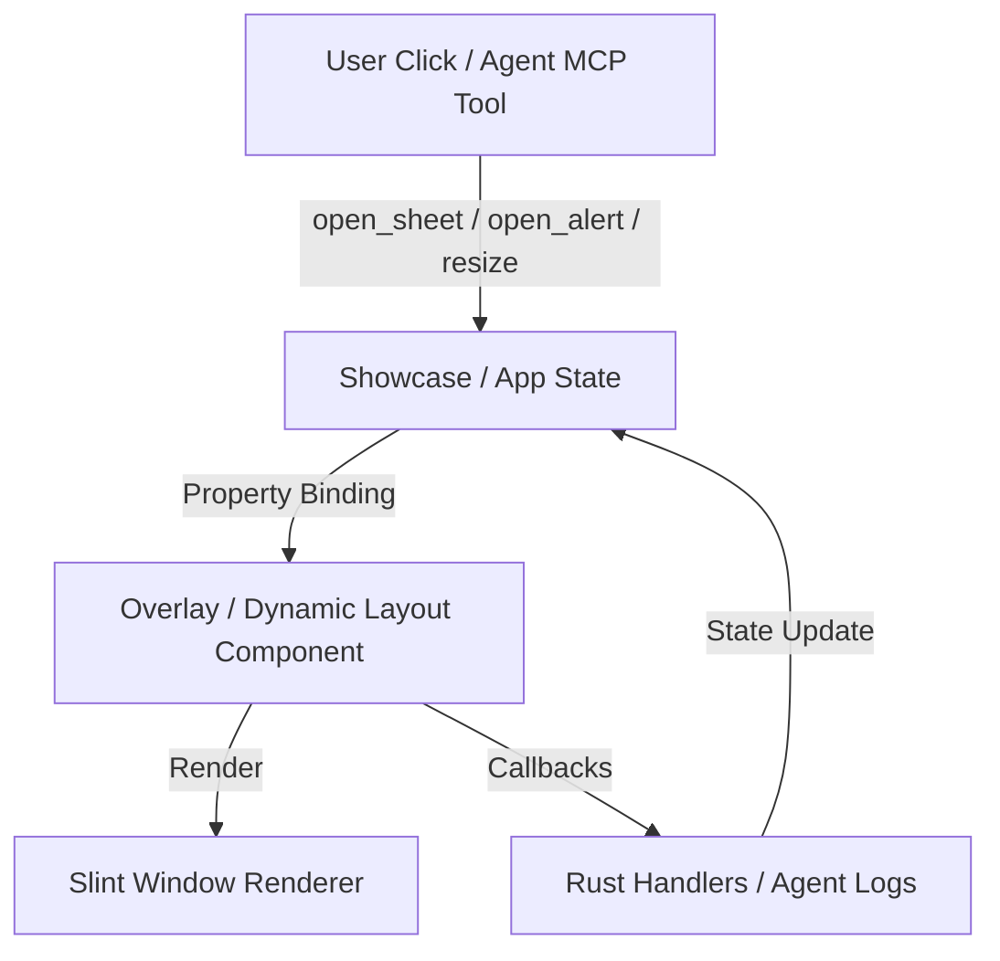

# Plan: Extended Overlay & Dynamic Layout Components for Slate Desktop

- **Owning Project**: `slate` (`ui`, `lib`, `examples/showcase`, `agent`, `mcp`)
- **Status**: `approved`
- **Revision**: 2
- **Timestamp**: 2026-10-10T12:20:00Z
- **Author**: Antigravity Assistant

---

## 1. Goal, Scope, and Non-Goals

### Goal
Expand Slate's Slint component library with modern, desktop-first overlay and dynamic layout components matching the design system capabilities already available in the React web application (`frontend/src/components/ui/`), with special emphasis on a dynamic 3-panel workspace layout where side panels can scale to 0 (collapse/invisible) or maximize, and the base panel scales down responsively.

### Scope
1. **Dynamic Layout Components**:
   - `SlateThreePanelLayout` (`ui/layouts/three_panel_layout.slint`): Dynamic 3-panel workspace layout (Left Sidebar, Center Base Panel, Right Utility Panel).
     - Left panel: can be resized, collapsed to 0 (invisible), or maximized.
     - Center base panel: flexible canvas scaling down as side panels grow, or maximized (collapsing left and right).
     - Right panel: can be resized, collapsed to 0 (invisible), or maximized.
     - Draggable splitter handles between Left-Center and Center-Right.
     - Header/utility controls to toggle collapse and maximize state.
   - `SlateResizablePanelGroup` & `SlateResizableHandle`: Two-pane split container (horizontal or vertical) with interactive draggable divider.
   - `SlateCollapsible`: Single-slot expandable container with animated disclosure chevron.

2. **Overlay Components**:
   - `SlateSheet`: Off-canvas side drawer modal sliding in from the right, left, bottom, or top with backdrop dimming, header, content area, and footer actions.
   - `SlateAlertDialog`: Dedicated modal variant for destructive/critical confirmations with alert variant styling, warning iconography, destructive button, and non-dismissable click barriers.
   - `SlatePopover`: Floating card overlay positioned relative to an anchor coordinate with automatic window bounds clamping.
   - `SlateTooltip`: Contextual label overlay appearing near hover/focus anchors.
   - `SlateToast`: Floating notification stack supporting `info`, `success`, `warning`, and `error` variants.

3. **Showcase & Agent Automation**:
   - Update `examples/showcase/ui/app.slint` (Tab 5: Overlays & Modals) with interactive triggers for all new overlay types.
   - Register accessible element IDs and agent remote-control triggers in `examples/showcase/src/main.rs`.
   - Add automated verification tests in `lib/tests/` and `test/src/`.

### Non-Goals
- Web/React changes (the webapp already contains Radix-based implementations).
- Breaking existing `SlateModal` or `SlateNavigationSplitView` APIs.
- Adding unvetted external dependencies.

---

## 2. Evidence and Current Architecture

### Current Components in Slint (`ui/`)
- `ui/components/modal.slint`: Currently the only overlay primitive in Slint, implementing full-window backdrop dimming (`SlateTheme.overlay-backdrop`), centered placement, drop shadows, and `confirmed`/`cancelled` callbacks.
- `ui/components/accordion.slint`: Multi-item accordion, but no standalone single-slot collapsible panel.
- `ui/layouts/navigation_split_view.slint`: Static split layout (fixed sidebar width 240px, non-resizable content area).
- `ui/index.slint`: Central export manifest for all desktop primitives.

### Current Webapp Overlay Primitives (`frontend/src/components/ui/`)
- `dialog.tsx`, `alert-dialog.tsx`, `sheet.tsx`, `drawer.tsx`, `popover.tsx`, `hover-card.tsx`, `tooltip.tsx`, `dropdown-menu.tsx`, `command.tsx`.

### Dataflow Analysis

No external network or backend API dataflow impact. All operations remain strictly client-side UI and thread-safe.

---

## 3. Proposed Design and Material Decisions

### D1: Overlay Layering Architecture in Slint
- **Problem**: Slint does not have browser DOM portals or z-index CSS properties. Children rendered later in the markup hierarchy paint on top of earlier siblings.
- **Options**:
  - *Option A (Window-level overlay slots)*: Define overlay components (`SlateModal`, `SlateSheet`, `SlateAlertDialog`) at the root level of the window layout so they naturally render above all content views.
  - *Option B (Embedded sub-tree overlays)*: Allow overlays inside nested containers with absolute coordinate transforms.
- **Decision**: **Option A**. Overlays are placed at the root level of `MainWindow` or `SlateWebAppLayout` and bound via boolean properties (e.g. `is-open: false`). This guarantees that dimmed backdrops cover the entire window without clipping issues.

### D2: Draggable Splitter Implementation
- **Problem**: Slint lacks native splitter controls. Resizing requires pointer tracking during drag.
- **Options**:
  - *Option A (Slint TouchArea delta tracking)*: Use `TouchArea` with `moved` and `mouse-cursor: col-resize | row-resize`, updating a `split-offset` or `panel-1-size` property clamped within `[min-size, max-size]`.
  - *Option B (Rust-side event pump)*: Handle pointer events in Rust window event handlers.
- **Decision**: **Option A**. Slint's `TouchArea` provides `mouse-x`, `mouse-y`, and `pressed`. Managing drag geometry purely inside Slint ensures 60+ FPS zero-latency resizing without IPC or UI loop round-trips.

---

## 4. EARS Requirements and Acceptance Scenarios

### EARS Requirements
- **U1 (Ubiquitous)**: The `SlateSheet` shall render an off-canvas drawer surface with backdrop dimming whenever `is-open` is true.
- **E1 (Event-driven)**: When the user clicks the backdrop or close button of `SlateSheet`, the component shall emit `closed()` and set `is-open = false`.
- **U2 (Ubiquitous)**: The `SlateAlertDialog` shall render a high-prominence modal dialog with `variant: "destructive" | "warning"` styling and require explicit confirmation or cancellation.
- **E2 (Event-driven)**: When `SlateResizableHandle` is dragged horizontally or vertically, the `SlateResizablePanelGroup` shall dynamically update the split proportion while respecting `min-size` and `max-size`.
- **E3 (Event-driven)**: When hovering or focusing a `SlateTooltip` trigger area, the tooltip bubble shall appear after a configurable delay.
- **U3 (Ubiquitous)**: The `SlatePopover` shall anchor floating content relative to trigger coordinates and clamp within window boundaries.
- **O1 (Optional-feature)**: Where agent remote control is enabled, all new overlay controls and resizable splitters shall expose accessible IDs (`id`) and interact via `click_element` and `inspect_tree`.

### Acceptance Scenarios

```gherkin
Scenario: T1 - SlateSheet opens and dismisses
  Given a Slate application with a closed SlateSheet
  When the trigger button is clicked
  Then is-open becomes true and the drawer slides in from the right edge
  When the backdrop TouchArea is clicked
  Then closed() is emitted and is-open becomes false

Scenario: T2 - SlateAlertDialog prevents accidental dismiss
  Given a SlateAlertDialog open on screen
  When clicking outside on the backdrop
  Then the dialog remains visible until explicit Cancel or Action button is pressed

Scenario: T3 - SlateResizablePanelGroup drag resizing
  Given a two-pane horizontal SlateResizablePanelGroup with initial 50% split
  When the handle is dragged 50px to the right
  Then the left panel width increases by 50px and the right panel width decreases by 50px
  And neither pane exceeds defined min-width or max-width bounds

Scenario: T4 - MCP Agent targets new overlay elements
  Given the showcase application running with --agent
  When the agent issues click_element for the sheet trigger
  Then inspect_tree returns the visible SlateSheet node and its action buttons
```

| Scenario | Requirements | Target Test Suite | Layer |
|---|---|---|---|
| `T1` | `U1`, `E1` | `lib/tests/overlay_components_tests.rs` | Integration |
| `T2` | `U2` | `lib/tests/overlay_components_tests.rs` | Integration |
| `T3` | `E2` | `lib/tests/dynamic_layout_tests.rs` | Integration |
| `T4` | `O1` | `test/src/tier4_showcase_workloads.rs` | E2E |

---

## 5. Affected Files & Implementation Steps

### Phase 1: Overlay Components in Slint (`ui/components/`)
- `[NEW] ui/components/sheet.slint`: `SlateSheet` component (right/left/top/bottom drawer).
- `[NEW] ui/components/alert_dialog.slint`: `SlateAlertDialog` component.
- `[NEW] ui/components/popover.slint`: `SlatePopover` floating card.
- `[NEW] ui/components/tooltip.slint`: `SlateTooltip` component.
- `[NEW] ui/components/toast.slint`: `SlateToast` notification card.
- `[MODIFY] ui/index.slint`: Re-export the 5 new overlay components.

### Phase 2: Dynamic Layout Components (`ui/layouts/`)
- `[NEW] ui/layouts/resizable_panel_group.slint`: `SlateResizablePanelGroup` and `SlateResizableHandle`.
- `[NEW] ui/layouts/collapsible.slint`: `SlateCollapsible` container.
- `[MODIFY] ui/index.slint`: Re-export layout components.

### Phase 3: Rust Library & Showcase Integration
- `[MODIFY] lib/src/lib.rs`: Verify and test re-exports.
- `[MODIFY] examples/showcase/ui/app.slint`: Expand Tab 5 (`Overlays & Modals`) with interactive demonstrations for Sheet, Alert Dialog, Popover, Tooltip, and Resizable Splitter.
- `[MODIFY] examples/showcase/src/main.rs`: Wire up callbacks and agent automation targets for new components.

### Phase 4: Automated Verification
- `[NEW] lib/tests/overlay_components_tests.rs`: Integration tests for Slint overlay components.
- `[NEW] lib/tests/dynamic_layout_tests.rs`: Integration tests for resizable panels and collapsibles.
- `[MODIFY] test/src/tier4_showcase_workloads.rs`: Add E2E tests validating agent remote-control over sheets, alert dialogs, and splitters.

---

## 6. Verification Plan

1. **Compilation & Syntax**:
   - `cargo check --workspace`
2. **Component Integration Tests**:
   - `cargo test -p slate --test overlay_components_tests`
   - `cargo test -p slate --test dynamic_layout_tests`
3. **E2E & MCP Verification**:
   - `cargo run -p slate-tests --bin e2e_runner`
   - `target/debug/slate-mcp inspect`
   - `target/debug/slate-mcp click trigger_sheet_btn`
   - `target/debug/slate-mcp screenshot --out /tmp/showcase_sheet.png`
