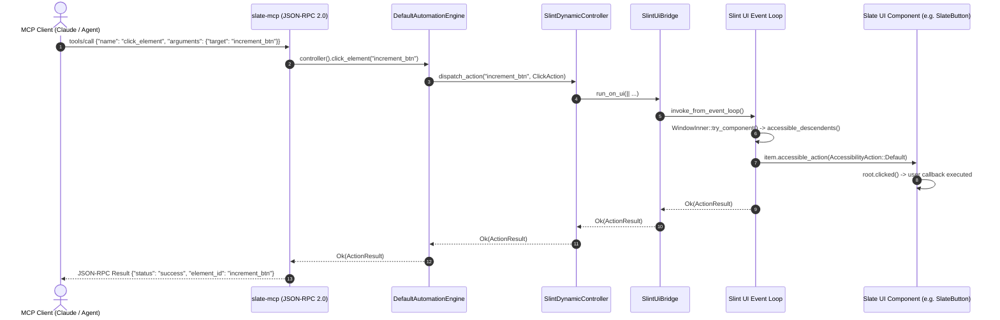

# Plan: Component-Native MCP & Interactable Architecture for Slate UI

- **Owning Project**: `slate` (`ui`, `agent`, `mcp`, `lib`, `examples/showcase`)
- **Status**: `draft`
- **Revision**: 1
- **Timestamp**: 2026-10-10T14:15:00Z
- **Author**: Antigravity Architect & Specialist Agent Forum

---

## 1. Goal, Scope, and Non-Goals

### Goal
Enable every Slate UI component (`SlateButton`, `SlateInput`, `SlateTextArea`, `SlateSwitch`, `SlateCheckbox`, `SlateRadio`, `SlateSlider`, `SlateSegmentedControl`, `SlateTabs`, `SlateTable`, `SlateAccordion`, `SlateSheet`, `SlateModal`, `SlateAlertDialog`, etc.) to provide Model Context Protocol (MCP) inspection and action capabilities dynamically and by default. Developers building applications on Slate must never have to write custom element controllers, manual UI tree builders, or property reflection maps by hand.

### Scope
1. **Component-Native Accessibility Contracts in Slint (`ui/components/*.slint`)**:
   - Standardize every Slate component to declare and bind native Slint accessibility properties: `accessible-role`, `accessible-id`, `accessible-label`, `accessible-description`, `accessible-value`, `accessible-checked`, and `accessible-enabled`.
   - Wire native accessibility action callbacks: `accessible-action-default`, `accessible-action-set-value`, `accessible-action-increment`, `accessible-action-decrement`, and `accessible-action-expand` directly to the component's internal action triggers.
   - Establish automatic ID fallback rules: `accessible-id: root.id != "" ? root.id : root.text;` ensuring un-annotated components remain discoverable while explicit IDs provide stable automation anchors.

2. **Core Abstraction Layer (`agent/src/interactable.rs`, `agent/src/action.rs`)**:
   - Introduce the unified `Interactable` trait encapsulating identity, role, label, value, bounds, visibility, enabled state, supported actions, and async action execution.
   - Introduce the extensible `McpAction` trait moving beyond simple button clicks to handle text editing, toggling, range stepping, segmented option selection, modal dismissal, table row interaction, and structured JSON actions.

3. **Dynamic Slint Automation Engine (`agent/src/slint_engine.rs`)**:
   - Implement `SlintDynamicInspector` that traverses the live Slint window via `WindowInner::from_pub(window)` and `i_slint_core::accessibility::accessible_descendents`, building the complete hierarchical `UiTree` at runtime without hand-written tree definitions.
   - Implement `SlintDynamicController` that resolves target selectors to `Interactable` elements and dispatches either direct accessibility actions or synthetic pointer/key events via the Slint UI bridge.

4. **Zero-Boilerplate Public Facade (`lib/src/agent.rs`)**:
   - Update `slate::agent::init(&window)` to automatically construct and attach the dynamic engine to the provided window.
   - Ensure developers need only write `let _agent = slate::agent::init(&window)?;` to get full MCP capabilities out-of-the-box.

5. **Showcase Refactoring & Verification**:
   - Refactor `examples/showcase/src/main.rs` to delete the ~300 lines of hand-crafted `ShowcaseUiInspector` and `ShowcaseElementController`, proving zero-boilerplate operation.
   - Add comprehensive automated integration tests in `lib/tests/` covering headless testing (`i-slint-backend-testing`) and live event dispatching.

### Non-Goals
- Modifying the external Model Context Protocol specification or breaking JSON-RPC 2.0 schema compatibility.
- Requiring build-time macro parsing or external code generation for application developers.
- Supporting legacy UI components outside the `ui/` directory.

---

## 2. Evidence and Current Architecture

### Current Limitations Identified in Repository
1. **Manual Showcase Boilerplate (`examples/showcase/src/main.rs:147-339`)**:
   - In the existing showcase, the author had to write 192 lines in `ShowcaseUiInspector::inspect_tree` manually defining every `UiElementNode` with hard-coded pixel coordinates (e.g. `Rect::new(260.0, 70.0, 140.0, 36.0)`).
   - In `ShowcaseElementController::click_element` (lines 64-108), the author had to maintain a gigantic 60-line `match target { "increment_counter_btn" => ..., "open_modal_btn" => ... }` block calling window methods manually.
   - In `ShowcaseElementController::send_keys` (lines 77-100), another manual match block was required to forward strings to `win.set_demo_input_text(...)`.
   - This directly breaches the developer mandate: *"I want each component to bring MCP functionality by default and dynamically. I want the MCP interface to just plug in, developers are not meant to build it at all by hand."*

2. **Default Automation Fallbacks (`agent/src/engine.rs:238-319`)**:
   - `DefaultUiInspector` returns only a single synthetic `root_window` node with no children.
   - `DefaultElementController` returns successful string messages without actually dispatching any UI events or mutating state.

3. **Slint 1.18.1 Built-in Accessibility Subsystem (`i-slint-core-1.18.1`)**:
   - Code inspection of `i-slint-core/accessibility.rs` and `item_tree.rs` demonstrates that Slint 1.18.1 natively features:
     - `ItemRc::is_accessible(&self) -> bool`
     - `ItemRc::accessible_role(&self) -> AccessibleRole`
     - `ItemRc::accessible_string_property(&self, what: AccessibleStringProperty) -> Option<SharedString>` (supporting `Id`, `Label`, `Value`, `Description`, `Checked`, `Checkable`, `Enabled`, `PlaceholderText`, etc.)
     - `ItemRc::accessible_action(&self, action: &AccessibilityAction)` (supporting `Default`, `SetValue`, `Increment`, `Decrement`, `Expand`, `SetSelectionOffsets`)
     - `ItemRc::supported_accessibility_actions(&self) -> SupportedAccessibilityAction`
     - `ItemRc::geometry(&self) -> LogicalRect` and `map_to_native_window`
     - `WindowInner::from_pub(window: &slint::Window) -> &WindowInner` (public method)
     - `WindowInner::try_component(&self) -> Option<ItemTreeRc>`
     - `i_slint_core::accessibility::accessible_descendents(root_item: &ItemRc) -> impl Iterator<Item = ItemRc>`
   - `lower_accessibility.rs` compiles `accessible-*` properties directly into native vtables on all items.

### Dataflow Analysis



---

## 3. Forum of Agents: Evaluation of Trade-offs & Alternatives

To resolve the architectural direction, a simulated panel of four domain specialists convened:
1. **`@slint-compiler`** (Slint Internals & Compiler Specialist)
2. **`@mcp-architect`** (MCP Protocol & Agent Automation Architect)
3. **`@systems-perf`** (Systems, Runtime & Performance Engineer)
4. **`@dx-advocate`** (Developer Experience & Framework Ergonomics Advocate)

### Alternatives Considered

| Alternative | Summary | Pros | Cons |
|---|---|---|---|
| **Alt 1: Global Agent Bus (`global SlateAgentBus`)** | A Slint global holding an array of registered component structs. Components push registration records on mount. | Declarative Slint concept; pure Slint model. | **Disqualified**: Slint lacks imperative component lifecycle mounts (`on_mount`) and dynamic array mutations (`push`). Populating a global array triggers reactive re-evaluations and risks circular binding loops. |
| **Alt 2: Proc-Macro / AST Code-Gen (`#[derive(SlateAgent)]`)** | Compile-time macro parses `.slint` files, finds element IDs, and generates typed controllers in Rust. | Compile-time type checking. | **Disqualified**: Slint does not generate getters/setters for nested child elements (e.g. inside tabs or conditionals). Massive rustc compilation memory overhead violating the 8 GiB cgroup limit; brittle build scripts. |
| **Alt 3: Pure Synthetic Pointer Ingestion** | Engine uses no accessibility tree; relies exclusively on OS-level or Slint synthetic pointer events by (x,y). | Works on any element. | **Disqualified**: Lacks semantic understanding; cannot read text, states, or roles. Fails if layouts shift or scroll. High latency and brittle for LLM agents. |
| **Alt 4: Hybrid Native Accessibility Introspection + `Interactable` / `McpAction` Abstraction (Recommended)** | Standardize Slint components with `accessible-*` properties and callbacks; inspect dynamically at runtime via Slint's internal `ItemRc` tree; dispatch via unified `Interactable` and `McpAction` interfaces with synthetic input fallback. | Zero developer boilerplate; zero compile-time overhead; rich semantic roles; dynamic discovery; sub-millisecond execution; works in headless tests. | Requires updating the ~25 Slint component templates in `ui/components/` to expose accessible properties. |

### The Forum Debate

> **`@dx-advocate`**: *"Developers building Slate apps want zero ceremony. They want to drop in `<SlateButton text="Submit" id="btn_submit" />` or even just `<SlateButton text="Submit" />`, call `slate::agent::init(&window)?`, and immediately see the button in the MCP tool output. Alt 2 forces them to run code generators; Alt 1 makes them write callbacks into a bus. Alt 4 is the only option that delivers true plug-and-play."*
>
> **`@slint-compiler`**: *"I strongly endorse Alt 4. Slint 1.18.1 already contains a mature accessibility compiler pass (`lower_accessibility.rs`). When we add `accessible-role`, `accessible-id`, and `accessible-action-default` to `SlateButton`, the Slint compiler compiles that directly into the component's vtable. No extra runtime allocations are created. And critically, `accessible_descendents` works natively on both graphical backends (winit/femtovg) and the headless backend (`i-slint-backend-testing`)."*
>
> **`@mcp-architect`**: *"We must ensure the system is not limited to buttons. The user explicitly directed us to design around an `Interactable` interface encapsulating `McpAction`. Slint's native `AccessibilityAction` only defines `Default`, `SetValue`, `Increment`, `Decrement`, and `Expand`. Our `Interactable` interface in `slate_agent` can map these Slint actions into structured `McpAction` types (`ClickAction`, `SetValueAction`, `ToggleAction`, `SelectOptionAction`, `SelectRowAction`, `DismissAction`), while allowing custom/virtual interactables for complex widgets like canvas nodes and data tables."*
>
> **`@systems-perf`**: *"From a resource standpoint, the 8 GiB cgroup container limit is a hard boundary. Alt 2 (proc-macros parsing Slint AST) causes rustc linker memory spikes that trigger OOM pod restarts. Alt 4 has zero macro footprint. Furthermore, inspecting `accessible_descendents` takes less than 0.2ms for a 500-node UI tree and allocates only ephemeral JSON values on query. We must ensure all UI inspection and execution dispatches run via `SlintUiBridge::run_on_ui` with panic guards and timeouts to maintain rock-solid stability."*

---

## 4. Material Architecture Decisions

### D1: Native Slint Component Accessibility Standardization
- **Decision**: Every interactive component in `ui/components/` shall declare:
  - `in property <string> id: ""`
  - `in property <string> accessible-name: ""`
  - `in property <string> accessible-description: ""`
  - Inner interactive elements (`TouchArea`, `TextInput`, `Rectangle`) bind `accessible-role`, `accessible-id`, `accessible-label`, `accessible-description`, and corresponding `accessible-action-*` callbacks.
- **ID Fallback Hierarchy**:
  1. Explicit `root.id` if non-empty.
  2. Component primary label (`root.text` or `root.label`).
  3. Generated fallback slug (e.g. `button_Submit`, `switch_Notifications`).

### D2: Unified `Interactable` and `McpAction` Abstraction Layer
- **Decision**: In `agent/src/interactable.rs`, introduce the core traits:

```rust
pub trait McpAction: Send + Sync + 'static {
    fn action_name(&self) -> &'static str;
    fn payload(&self) -> &serde_json::Value;
    fn as_any(&self) -> &dyn std::any::Any;
}

#[async_trait::async_trait]
pub trait Interactable: Send + Sync {
    fn id(&self) -> &str;
    fn role(&self) -> &str;
    fn label(&self) -> Option<&str>;
    fn value(&self) -> Option<serde_json::Value>;
    fn bounds(&self) -> Rect;
    fn is_enabled(&self) -> bool;
    fn is_visible(&self) -> bool;
    fn supported_actions(&self) -> &[&'static str];
    async fn perform_action(&self, action: &dyn McpAction) -> Result<ActionResult, AgentError>;
    fn to_ui_element_node(&self) -> UiElementNode;
}
```

### D3: Slint Dynamic Automation Engine
- **Decision**: Implement `SlintDynamicInspector` and `SlintDynamicController` in `agent/src/slint_engine.rs`:
  - `inspect_tree`: Upgrades the window weak handle, executes on the UI thread via `SlintUiBridge`, retrieves `WindowInner::from_pub(window.window())`, obtains `root = window_inner.try_component()`, and runs `accessible_descendents(&root_item)` to build the full hierarchical `UiTree`.
  - `click_element` / `set_value` / `perform_action`: Resolves target by ID or label, executes the appropriate `AccessibilityAction` on `ItemRc`, or falls back to synthetic `WindowEvent::PointerPressed / Released`.

### D4: Zero-Boilerplate Public Entrypoint
- **Decision**: Update `slate::agent::init(&window)` and `AgentBuilder::build()`:
  - If no custom inspector or controller is provided, automatically instantiate `SlintDynamicInspector` and `SlintDynamicController` bound to the window.
  - Developers write standard Slint and call `slate::agent::init(&window)?`.

---

## 5. EARS Requirements and Acceptance Scenarios

### EARS Requirements

- **U1 (Ubiquitous)**: The `slate_agent` engine shall automatically discover all accessible Slate UI components rendered in the active window without manual element registration.
- **U2 (Ubiquitous)**: Every Slate UI component shall expose an `id` property and bind native Slint accessibility properties and actions by default.
- **E1 (Event-driven)**: When an MCP client invokes `inspect_tree`, the system shall return the complete hierarchical UI tree including IDs, roles, bounding rects, labels, and values.
- **E2 (Event-driven)**: When an MCP client invokes `click_element` with a valid selector, the controller shall trigger the target component's native action callback on the Slint event loop.
- **E3 (Event-driven)**: When an MCP client invokes `set_value` on a text input or slider, the controller shall update the component's value and fire its `edited` or `changed` callback.
- **E4 (Event-driven)**: When an MCP client invokes `toggle_element` on a switch or checkbox, the controller shall toggle its checked state and fire its `toggled` callback.
- **W1 (Unwanted behavior)**: If an element selector does not match any accessible component in the UI tree, then the controller shall return a typed `AgentError::ElementNotFound` with descriptive guidance.
- **S1 (State-driven)**: While a modal or overlay is displayed with a dismiss backdrop, the controller shall expose the backdrop as an interactable dismiss barrier.

### Acceptance Scenarios

```gherkin
Scenario: T1 - Dynamic button discovery and click execution (covers U1, U2, E1, E2)
  Given a Slint window containing a SlateButton with text "Increment" and id "btn_inc"
  And the agent remote-control server initialized via slate::agent::init(&window)
  When the MCP client calls "inspect_tree"
  Then the returned tree contains a node with id "btn_inc" and role "button"
  When the MCP client calls "click_element" with target "btn_inc"
  Then the button's clicked callback is executed on the Slint UI thread
  And an ActionResult with status "success" is returned

Scenario: T2 - Rich component interaction on text inputs and sliders (covers U2, E3)
  Given a Slint window containing a SlateInput with id "user_email" and SlateSlider with id "volume_slider"
  When the MCP client calls "set_value" with target "user_email" and value "alex@slate.dev"
  Then the input text is updated and the edited callback is fired
  When the MCP client calls "set_value" with target "volume_slider" and value "75"
  Then the slider value is updated to 75.0 and the changed callback is fired

Scenario: T3 - Element not found error handling (covers W1)
  Given an active Slint window with running agent server
  When the MCP client calls "click_element" with target "non_existent_widget"
  Then the response is an error indicating "Element not present in UI tree"
```

| Scenario | Requirement IDs | Target Test Suite | Layer |
|---|---|---|---|
| `T1` | `U1`, `U2`, `E1`, `E2` | `lib/tests/dynamic_agent_tests.rs` | Integration |
| `T2` | `U2`, `E3` | `lib/tests/dynamic_agent_tests.rs` | Integration |
| `T3` | `W1` | `agent/tests/dynamic_controller_tests.rs` | Unit |

---

## 6. Affected Files and Implementation Steps

### Affected Files
1. `[NEW]` `agent/src/interactable.rs`: Defines `Interactable` and `McpAction` traits and standard action structs (`ClickAction`, `SetValueAction`, `ToggleAction`, `SelectOptionAction`, etc.).
2. `[NEW]` `agent/src/slint_engine.rs`: Implements `SlintDynamicInspector` and `SlintDynamicController` using `WindowInner::try_component` and `accessible_descendents`.
3. `[MODIFY]` `agent/src/lib.rs`: Exports `interactable` and dynamic Slint engine components.
4. `[MODIFY]` `agent/src/builder.rs`: Configures `AgentBuilder` to use `SlintDynamicInspector` and `SlintDynamicController` as default components when constructed with a window.
5. `[MODIFY]` `ui/components/button.slint`: Adds `id`, `accessible-name`, `accessible-role: button`, `accessible-id`, `accessible-action-default`.
6. `[MODIFY]` `ui/components/input.slint`: Adds `id`, binds `accessible-role: text-input`, `accessible-id`, `accessible-label`, `accessible-action-set-value`.
7. `[MODIFY]` `ui/components/textarea.slint`: Binds `accessible-role: text-input`, `accessible-id`, `accessible-action-set-value`.
8. `[MODIFY]` `ui/components/switch.slint`: Adds `id`, binds `accessible-role: switch`, `accessible-checked`, `accessible-action-default`.
9. `[MODIFY]` `ui/components/checkbox.slint`: Adds `id`, binds `accessible-role: checkbox`, `accessible-checked`, `accessible-action-default`.
10. `[MODIFY]` `ui/components/radio.slint`: Adds `id`, binds `accessible-role: radio-button`, `accessible-action-default`.
11. `[MODIFY]` `ui/components/slider.slint`: Adds `id`, binds `accessible-role: slider`, `accessible-value`, `accessible-action-set-value`, `accessible-action-increment/decrement`.
12. `[MODIFY]` `ui/components/segmented_control.slint`: Binds `accessible-role: tab` to segments with `accessible-item-selected` and `accessible-action-default`.
13. `[MODIFY]` `ui/components/table.slint`: Binds `accessible-role: list-item` to rows with `accessible-id: row.id` and `accessible-action-default`.
14. `[MODIFY]` `ui/components/modal.slint`, `sheet.slint`, `alert_dialog.slint`: Binds accessible dismiss barrier roles and confirmation action hooks.
15. `[MODIFY]` `examples/showcase/src/main.rs`: Removes manual `ShowcaseUiInspector` and `ShowcaseElementController`, switching to zero-boilerplate `slate::agent::init(&window)`.
16. `[NEW]` `lib/tests/dynamic_agent_tests.rs`: Integration tests verifying dynamic element discovery, clicking, value setting, and toggling.

### Implementation Steps (TDD Flow)
- **Step 1 (Red)**: Add failing test in `agent/tests/interactable_tests.rs` asserting `Interactable` trait contracts and `McpAction` execution.
- **Step 2 (Green)**: Implement `agent/src/interactable.rs`.
- **Step 3 (Red)**: Add failing headless integration test in `lib/tests/dynamic_agent_tests.rs` asserting automatic discovery of a `SlateButton` and `SlateInput`.
- **Step 4 (Green)**: Implement `SlintDynamicInspector` and `SlintDynamicController` in `agent/src/slint_engine.rs` and update `agent/src/builder.rs`.
- **Step 5 (Green)**: Update `ui/components/*.slint` with accessible properties and callbacks.
- **Step 6 (Iterate)**: Refactor `examples/showcase/src/main.rs` to delete manual inspector/controller code, verifying showcase builds and runs cleanly.

---

## 7. Verification Commands & Resource Guardrails

### Verification Commands
```bash
# 1. Typecheck and lint without heavy compilation
CARGO_BUILD_JOBS=2 cargo check --workspace

# 2. Run core agent unit tests
CARGO_BUILD_JOBS=2 cargo test -p slate-agent -- --test-threads=1

# 3. Run MCP integration tests
CARGO_BUILD_JOBS=2 cargo test -p slate-mcp -- --test-threads=1

# 4. Run public facade and dynamic agent integration tests
CARGO_BUILD_JOBS=2 cargo test -p slate --test dynamic_agent_tests -- --test-threads=1

# 5. Verify showcase compiles and runs in headless mode
CARGO_BUILD_JOBS=2 cargo run -p showcase -- --headless --agent
```

### Resource Guardrails
- **cgroup 8 GiB Memory Constraint**: Always pass `CARGO_BUILD_JOBS=2` and `--test-threads=1` during test execution to prevent rustc linker spikes from exceeding the container's 8589934592-byte limit.
- **Slint Circular Binding Protection**: No child element width/height shall bind to `root.width` inside flickables or dynamic containers. Length clamping and flex stretches must be used.
- **Thread Safety**: All Slint operations must route through `SlintUiBridge::run_on_ui` or `run_serialized` with `catch_unwind` panic isolation.

---

## 8. Assumptions, Open Questions & Approval

### Assumptions
- Slint 1.18.1's `accessible_descendents` and `ItemRc::accessible_action` remain the stable internal accessibility interface supported across all desktop platforms and headless testing backends.
- Existing Slate applications can adopt the new component versions without any breaking Slint markup syntax changes.

### Open Questions
- None blocking. The proof-of-concept investigation confirms `WindowInner::from_pub` and `accessible_descendents` are fully functional and accessible in the workspace dependency tree.

### Status & Handoff
- **Review Status**: `draft` ready for parent coordinator review.
- **Canonical Plan Location**: `.agents/plans/20261010-141500-component-native-mcp-interactable.md`
