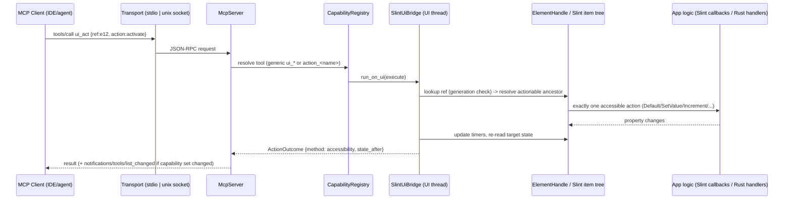

# Plan: Fully Dynamic, Semantic MCP Support for Slate Apps

- **Owning project:** Slate Rust/Slint workspace (`slate-rust/`, shared UI library `ui/`); consumer: `slate-carbon/` gallery
- **Status:** approved (revision 2) + revision 3 amendment to D1 (pending user acknowledgement) — handover package in `20261011-162725-dynamic-mcp-capabilities/`
- **Revision:** 3
- **Date:** 2026-10-11

---

## 1. Goal, Scope, and Non-Goals

### Goal
Any Slate application calling `slate::agent::init(&window)` exposes a complete, correct MCP
surface **without writing per-app automation code**:

1. A semantic snapshot of the *live* UI (what the user actually sees), with stable element refs.
2. Semantic interaction execution (activate, toggle, set value, increment/decrement, expand,
   focus, type) through each control's own interaction logic, not pixel simulation.
3. Capabilities derived automatically from standard Slate components.
4. Custom capabilities declared by app authors in **Slint** (UI-scoped, context-sensitive) and in
   **Rust** (app-scoped, typed), surfaced as discoverable MCP tools with JSON schemas.
5. No mock engines, no hardcoded element lists, anywhere (production code or tests).

### Scope
`slate-agent` semantic backend, `slate-mcp` server/tools/transports/CLI, standard component
accessibility contract in `ui/`, a new `SlateAgentAction` component, the Rust action registry,
replacement of the mock test harness with real-window tests, showcase migration, docs/skill.

### Non-Goals
- AT-SPI2 adapter (evaluated previously; optional future Linux-only adapter, not needed for this goal).
- Controlling non-Slate / uninstrumented apps.
- Network exposure beyond the local machine (no TCP/HTTP transport from Slate; Slint's own
  `SLINT_MCP_PORT` server remains available for that, see D1).
- Changes to the Carbon C ABI (`slate_gallery_run_native`) beyond stdout hygiene.
- Web mirror / AppImage / optical-regression pipelines.

---

## 2. Evidence and Current Behavior

| # | Finding | Evidence |
|---|---|---|
| E-1 | MCP tool list is a fixed `match` of 5 tools; no way for apps to add tools. | [tools/mod.rs](../../slate-rust/mcp/src/tools/mod.rs) `dispatch_tool`; `all_standard_tools` in [schema.rs](../../slate-rust/mcp/src/schema.rs) |
| E-2 | **Root cause of the "Max Right does nothing" failure (probable, to be locked in by T1):** the controller dispatches a synthetic pointer click **and** `AccessibilityAction::Default` on the same element. `SlateButton` routes both to `root.clicked()`, and the "Max Right" handler *toggles* `right-maximized` → two toggles = visible no-op. Idempotent actions (tab switch) appear to work, which masked the bug. This corrects my earlier "Text-leaf" diagnosis: the MCP response shows the target was `SlateButton::root`. | [slint_backend.rs](../../slate-rust/agent/src/slint_backend.rs) L419-431; [button.slint](../../ui/components/button.slint) L49-52 and L69-75; [three_panel_layout.slint](../../ui/layouts/three_panel_layout.slint) L163-173 |
| E-3 | Coordinate clicks resolved via `find_at_point` to the full-window `MainWindow::toast-host` overlay and clicked *its* center (1280,683). | MCP response for request id 6; [click.rs](../../slate-rust/mcp/src/tools/click.rs). **Note:** an uncommitted edit from the debugging session changed this to `click_at`; it must be reverted or superseded in Phase 0. |
| E-4 | Element ids are not unique (`SlateButton::root`, `clear` repeat), come from compiler debug info (only with `with_debug_info(true)`) or label slugs. Slint 1.18 supports author-defined `accessible-id` (`AccessibleStringProperty::Id`), but no Slate component or app uses it. | [slint_backend.rs](../../slate-rust/agent/src/slint_backend.rs) L136-184; `i-slint-core-1.18.1/accessibility.rs` L19-41; audit of `ui/` (0 uses) |
| E-5 | `inspect_tree` dumps every layout primitive (~100–200 KB per call) and omits supported actions; agents can't tell what is actionable. | live MCP output in this session |
| E-6 | Standard components with interaction but **no accessibility semantics**: `navigation_split_view` (sidebar items: `nav-touch` has role none), `collapsible`, `resizable_panel_group`, `action_row`, `card`, `alert_dialog`, `popover`, `sheet`, `table`, `tooltip`. `slider` has a role but no increment/decrement/set-value actions. | grep audit of `ui/components/*.slint`, `ui/layouts/*.slint` |
| E-7 | Mocks remain: hardcoded `DefaultUiInspector` / `DefaultElementController` / `DefaultVisualRenderer` / `DefaultStateProvider` (used by 10 test files) and a 1,182-line simulated `TestEngine` behind the 73 "tier" tests. The real Slint backend has **no** event-loop tests (all use `init_no_event_loop`, where `run_on_ui` returns `EventLoopUnavailable`). This is why a green suite shipped E-2. | [engine.rs](../../slate-rust/agent/src/engine.rs) L124-319; [harness.rs](../../slate-rust/test/src/harness.rs); `grep init_no_event_loop` |
| E-8 | Slint 1.18 ships (a) a public element query/interaction API `ElementHandle` (`invoke_accessible_default_action`, `…_increment/decrement/expand_action`, `set_accessible_value`, all `accessible_*` getters, `is_valid`, generation-checked handles) implemented for every `ComponentHandle`; (b) an embedded MCP server (`slint` feature `mcp`, `SLINT_MCP_PORT`, Streamable HTTP on `127.0.0.1`, 18 fixed low-level tools, no extension point for custom tools or app state); (c) `init_integration_test_with_mock_time()` which provides a real event loop for tests. | `i-slint-backend-testing-1.18.1/search_api.rs` L228-1110, `mcp_server.rs` L1-160, L958-1060, `lib.rs` L37-72 |
| E-9 | Only stdio + in-memory transports. App stdout is shared with banners (Carbon runner prints to stdout), which corrupts JSON-RPC framing; a desktop-launched app cannot be attached by an IDE MCP client. | [transport/](../../slate-rust/mcp/src/transport/); [main.carbon](../../slate-carbon/examples/gallery/main.carbon) L18-21 |
| E-10 | Internal Slint crates use caret requirements (`i-slint-core = "1.18.1"`); they carry no semver guarantee. | [Cargo.toml](../../slate-rust/Cargo.toml) L24 |
| E-11 | `window_size` uses `window.size()` (physical px) while bounds are logical → wrong under fractional scaling. | [slint_backend.rs](../../slate-rust/agent/src/slint_backend.rs) L274 |
| E-12 | Protocol version hardcoded to `2024-11-05`. | [server.rs](../../slate-rust/mcp/src/server.rs) L128 |

### Dataflow (target)



Failure points: **F1** stale ref (element destroyed/regenerated) · **F2** element disabled/invisible ·
**F3** no supported semantic action · **F4** UI thread timeout/window closed · **F5** invalid custom
action args · **F6** custom handler error/panic · **F7** capability churn → notification storms ·
**F8** stdout pollution breaking stdio framing.

---

## 3. Proposed Design and Alternatives

### D1 — Foundation
| Option | Pros | Cons |
|---|---|---|
| a) Adopt Slint's embedded MCP only | zero code, upstream-maintained | no custom actions/tools, no app state, low-level handle/flat-tree API, ids need debug info, HTTP/TCP only |
| b) Keep current raw `i_slint_core` internals backend | already exists | duplicates upstream, fragile internals (`WindowInner`, `visit_items`), broken semantics (E-2) |
| **c) Slate MCP server built on Slint's public `ElementHandle` API** | reuses upstream query/action code, generation-checked handles, keeps Slate's semantic + capability layer and custom actions | `i-slint-backend-testing` becomes a runtime dependency (exact-pinned) |

**Selected (rev 1/2): (c).** `SLINT_MCP_PORT` stays usable side by side for low-level debugging (documented, not wrapped).

> [!IMPORTANT]
> **Revision 3 amendment (D1 → c′), found while preparing the handover.**
> `ElementHandle` traversal (`visit_descendants`, `query_descendants`, `find_by_accessible_label`)
> yields **zero elements without compiler debug info** (`search_api.rs` `collect_elements` →
> `ItemRc::element_count()` → `warn_missing_debug_info`). It also does not expose
> `supported_accessibility_actions`. The goal is to work out of the box in any Slate app, including
> release builds that have no debug info, so (c) as written fails.
>
> **Selected (rev 3): (c′).** The semantic core walks `i_slint_core::items::ItemRc` directly. These
> are the same calls `ElementHandle` makes internally: `visit_descendants`/`visit_items`,
> `is_visible`, `accessible_role`, `accessible_string_property`, `accessible_action`,
> `supported_accessibility_actions`, `ItemWeak` for stale detection, and
> `WindowInner::active_popups` for popups.
> `search_api.rs` L340-415 is the reference implementation to mirror.
> `i-slint-backend-testing` stays a **dev-dependency only** (test platform with an event loop). No new
> runtime dependency is needed, so the D1 grant is kept in reserve and not used. `i-slint-core` is exact-pinned.
> Debug info is used only for the optional O1 enrichment.

### D2 — Interaction execution
Execute **exactly one** semantic accessibility action on the resolved actionable element
(nearest inclusive ancestor of the matched node that supports the requested action). No pointer
events in the semantic path. Pointer interaction is an **explicit last resort** (`fallback: "pointer"`
argument), performed once, and reported as `method: "pointer"`. Every result reports the method used.

### D3 — Identity and refs
- Each snapshot assigns short refs (`e1`, `e2`, …) mapped to `ElementHandle`s in a UI-thread
  registry; handles carry Slint's generation → stale refs are detected (F1), never mis-targeted.
- Selectors: `accessible-id` (author-controlled, stable, works in release builds) → role + name →
  name text. Ambiguous selectors return candidates; the agent never guesses.
- Debug-info ids/type names are optional enrichment only (O1).

### D4 — Snapshot shape
Default `ui_snapshot` returns only accessible/actionable elements as a compact tree: `ref`, `role`,
`name`, `value`, states (`checked`, `expanded`, `selected`, `enabled`, `focused`, `visible`),
`actions` (supported), `id` (accessible-id). `mode: "full"` restores the raw primitive tree;
`include_bounds` is opt-in. Window size reported in logical px (fixes E-11).

### D5 — Standard component contract
Every interactive Slate component declares `accessible-role`, `accessible-label`, state properties,
and the actions matching its interaction. Apps target instances by setting the built-in
`accessible-id` on any component instance (no extra API). Contract per component:

| Component(s) | Role | Actions |
|---|---|---|
| button, card (clickable), action_row, menubar items, pagination, toast dismiss | button | default |
| switch, checkbox | switch / checkbox | default (toggle) |
| radio, segmented_control, tabs, navigation_split_view items | radio / tab / list-item | default (select) |
| slider | slider | increment, decrement, set-value |
| input, textarea, search_input | text-input | set-value |
| accordion, collapsible | button + expandable/expanded | expand / default |
| modal, alert_dialog, sheet, drawer, popover | groupbox (dialog) + close button | close via button default |
| resizable_panel_group handle | slider (orientation) | increment, decrement |
| table rows | list-item (selectable/selected) | default (select) |

A contract test enforces this automatically for every exported component (T9).

### D6 — Custom actions (three tiers, one registry)
1. **Tier 1 — automatic:** semantics of standard (or any a11y-annotated custom) components.
2. **Tier 2 — UI-scoped, declared in Slint:** new `SlateAgentAction` component:
   ```slint
   SlateAgentAction {
       name: "export_report";
       description: "Export the current table as CSV";
       params-schema: "{\"type\":\"object\",\"properties\":{\"path\":{\"type\":\"string\"}},\"required\":[\"path\"]}";
       enabled: root.has-data;
       invoked(args) => { root.export(args); }   // args = JSON string
   }
   ```
   Implemented purely with built-in accessibility properties (`accessible-id: "slate.action:" + name`,
   `accessible-description`, `accessible-action-set-value(args) => invoked(args)`) so discovery works
   in release builds without debug info. Listed only while visible and enabled → capabilities follow
   UI context (e.g. an action inside a dialog exists only while the dialog is open).
   Must not appear to screen readers (see A1).
3. **Tier 3 — app-scoped, declared in Rust:**
   `builder(&win).with_action(ActionSpec::new("start_compute").description(..).input_schema(json!(..)).destructive(false), |ctx, args| async { .. })`
   with typed JSON results and access to the window handle.

Rejected: Slint global registry (globals cannot aggregate per-instance declarations); discovery by
element type name (requires debug info); AT-SPI custom actions (platform-specific, no payloads).

### D7 — MCP tool surface
- **Fixed generic tools:** `ui_snapshot`, `ui_find`, `ui_act` (`activate|toggle|set_value|increment|decrement|expand|focus|type`), `ui_wait_for` (exists/value/text with timeout), `screenshot`, `list_capabilities`, `invoke_action` (generic entry for custom actions).
- **Dynamic tools:** each Tier 2/3 action is also listed as tool `action_<name>` with its schema and
  annotations (`readOnlyHint`/`destructiveHint`).
- `tools.listChanged: true`; the server recomputes a capability fingerprint after each handled
  request and on `tools/list`, emitting at most one `notifications/tools/list_changed` per change (F7).
- Old tools (`inspect_tree`, `click_element`, `send_keys`, `get_state`, `get_screenshot`) are
  **replaced**, not aliased (pre-1.0; only internal consumers: `slate-mcp` CLI, skill docs).

### D8 — Transports
Keep stdio; add a **Unix domain socket** transport (`$XDG_RUNTIME_DIR/slate-mcp/<app>-<pid>.sock`,
mode 0600, removed on shutdown), enabled via `SLATE_MCP=socket` or builder. `slate-mcp ps` lists
running apps; `slate-mcp attach <app|pid>` proxies an IDE's stdio to the socket — enabling the
"app runs on my desktop, agent attaches live" workflow. Stdout hygiene: when stdio is active, the
framework logs to stderr only; Carbon banner moves to stderr (F8).

### D9 — Mock elimination
Delete the hardcoded `Default*` inspector/controller/renderer/state mocks and the simulated
`TestEngine`. All agent/MCP tests run against real Slint windows (fixture components via `slint!`
plus the real showcase `MainWindow`) on the testing backend with an event loop.

### D10 — Protocol version
Negotiate: support current spec features (structured tool output, tool annotations) with fallback
to `2024-11-05` for older clients (A3).

---

## 4. Requirements and Acceptance Tests

### EARS requirements
- **U1** The agent shall derive all UI capabilities exclusively from the live Slint element tree and registered actions.
- **U2** The snapshot shall include, for each accessible element, its ref, role, name, value, states, supported actions, and accessible-id when set.
- **U3** Every exported interactive Slate component shall expose role, label, states, and the actions defined in the D5 contract.
- **U4** The agent shall list a `SlateAgentAction` as a capability only while it is visible and enabled.
- **U5** The agent shall list Rust-registered actions with their input schema and annotations.
- **S1** While no MCP transport is enabled, the agent shall perform no tree traversal.
- **E1** When `ui_act` requests `activate` on an element supporting the default action, the agent shall invoke exactly one default action and dispatch no pointer events.
- **E2** When the target is a non-actionable descendant, the agent shall act on the nearest ancestor supporting the requested action.
- **E3** When `set_value` targets an element supporting set-value, the agent shall invoke set-value; when it supports only increment/decrement, the agent shall step until the value is within one step of the target.
- **E4** When an action completes, the response shall include the target's state re-read after the action.
- **E5** When the capability set differs from the last reported set, the server shall send one `notifications/tools/list_changed`.
- **E6** When a custom action tool is called with valid args, the agent shall invoke its handler exactly once and return the handler result.
- **E7** When the socket transport is enabled, the agent shall create the socket with mode 0600 under `$XDG_RUNTIME_DIR` and remove it on shutdown.
- **W1** If a ref is stale, then the agent shall return `stale_ref` and perform no action.
- **W2** If a selector matches more than one element, then the agent shall return `ambiguous_target` listing candidates with refs and perform no action.
- **W3** If the target is disabled or not visible, then the agent shall return `not_interactable` and perform no action.
- **W4** If no supported semantic action exists and pointer fallback was not requested, then the agent shall return `unsupported_action` listing the supported actions.
- **W5** If pointer fallback is requested, then the agent shall perform exactly one pointer click at the element center and report `method: "pointer"`.
- **W6** If custom action args violate the schema, then the server shall return `invalid_params` with the failing field path and not call the handler.
- **W7** If a custom handler fails or panics, then the server shall return an error result and the application shall keep running.
- **W8** If the stdio transport is active, then nothing other than JSON-RPC frames shall be written to stdout.
- **O1** Where the app is built with debug info, the snapshot shall additionally include element ids and type names.

### Acceptance scenarios

```gherkin
Scenario: T1 - Toggle button toggles exactly once (covers E1, regression E-2)
  Given a real window with a SlateThreePanelLayout
  When the agent activates the "⛶ Max Right" button
  Then right-maximized is true and the button name becomes "Restore Right"
  And no pointer event was dispatched

Scenario: T2 - Label text resolves to its button (covers E2)
  Given a SlateButton whose label Text is matched by name
  When the agent activates the matched Text ref
  Then the button's clicked callback fired exactly once

Scenario: T3 - Snapshot is semantic and compact (covers U2, D4)
  Given the showcase MainWindow on the Forms tab
  When ui_snapshot is called
  Then every entry has ref, role, name and actions
  And no layout-only primitives are included
  And the window size is in logical pixels

Scenario: T4 - Stale ref is rejected (covers W1)
  Given a ref taken inside an open dialog
  When the dialog closes and the ref is used
  Then the result is stale_ref and nothing changes

Scenario: T5 - Ambiguous selector (covers W2)
  Given two "Clear" buttons
  When ui_act targets name "Clear"
  Then the result is ambiguous_target with two candidate refs

Scenario: T6 - Disabled control (covers W3)
  Given a disabled SlateButton
  When it is activated
  Then the result is not_interactable and clicked did not fire

Scenario: T7 - Slider set_value (covers E3, E4)
  Given the "Worker Thread Pool Concurrency" slider at 68
  When set_value 30 is requested
  Then the slider value is 30 within one step and the response contains value_after

Scenario: T8 - Unsupported action and explicit pointer fallback (covers W4, W5)
  Given an element with no semantic actions
  When activate is requested without fallback
  Then unsupported_action is returned
  When activate is requested with fallback "pointer"
  Then exactly one click happens and method is "pointer"

Scenario: T9 - Component contract (covers U3)
  Given a fixture window instantiating every exported interactive Slate component
  When the contract checker snapshots it
  Then each component exposes the role and actions from the D5 table

Scenario: T10 - Context-sensitive Slint action (covers U4, E5, E6)
  Given a SlateAgentAction "export_report" inside a closed dialog
  When tools/list is requested
  Then action_export_report is absent
  When the dialog opens
  Then exactly one tools/list_changed notification is sent and the tool is listed
  When the tool is called with valid args
  Then the Slint invoked callback receives the JSON args once

Scenario: T11 - Rust action schema validation (covers U5, W6, W7)
  Given a Rust action with a required "path" string
  When it is called without "path"
  Then invalid_params names "path" and the handler was not called
  When the handler panics
  Then an error result is returned and the app keeps running

Scenario: T12 - Socket attach (covers E7)
  Given an app started with SLATE_MCP=socket
  When slate-mcp attach connects and lists tools
  Then the socket exists with mode 0600
  And it is removed after the app exits

Scenario: T13 - Stdout hygiene (covers W8)
  Given the Carbon gallery started with stdio MCP
  When initialize is sent
  Then the first stdout line is a valid JSON-RPC response

Scenario: T14 - Idle cost (covers S1)
  Given an app with the agent initialized but no transport enabled
  Then no tree traversal is performed
```

| Scenario | Requirements | Target test file (proposed unless noted) | Layer |
|---|---|---|---|
| T1, T2, T6, T7, T8 | E1, E2, E3, E4, W3, W4, W5 | `slate-rust/agent/tests/semantic_actions_tests.rs` [NEW] | Integration (real window, mock-time event loop) |
| T3, T4, T5, O1 | U2, W1, W2, O1 | `slate-rust/agent/tests/semantic_snapshot_tests.rs` [NEW] | Integration |
| T9 | U3 | `slate-rust/lib/tests/component_contract_tests.rs` [NEW] | Integration |
| T10, T11 | U4, U5, E5, E6, W6, W7 | `slate-rust/mcp/tests/dynamic_tools_tests.rs` [NEW] | Integration (MCP in-memory transport + real window) |
| T12 | E7 | `slate-rust/mcp/tests/socket_transport_tests.rs` [NEW] | Integration |
| T13 | W8 | `slate-rust/test/` real-app E2E (rewritten) + manual Carbon check | E2E |
| T14 | S1 | `slate-rust/agent/tests/builder_tests.rs` (existing, extended) | Unit |
| U1 | U1 | Review gate: no `Default*` mocks / `TestEngine` remain (grep check in Verification) | Static check |

---

## 5. Affected Files and Implementation Steps

Every behavior step follows Red → Green → Iterate.

**Phase 0 — Preconditions**
1. Commit or branch the uncommitted `slate-rust/` restructure (currently on `main`, see git workflow rules); start a feature branch.
2. Revert the debugging edit in [click.rs](../../slate-rust/mcp/src/tools/click.rs) (superseded in Phase 5).
3. [MODIFY] [slate-rust/Cargo.toml](../../slate-rust/Cargo.toml): exact-pin `i-slint-core`, add exact-pinned `i-slint-backend-testing = "=1.18.1"` as a runtime workspace dependency → **dependency change: human-gate + security-auditor per AGENTS.md** before adding.

**Phase 1 — Real-window test harness (unblocks everything)**
4. [NEW] `slate-rust/agent/tests/support/mod.rs`: fixture runner using `init_integration_test_with_mock_time()`, driving `run_on_ui` from a tokio thread while the Slint event loop runs on the test thread. Spikes A1/A2 live here.

**Phase 2 — Semantic core (`slate-agent`)**
5. [NEW] `slate-rust/agent/src/semantic/{mod,snapshot,refs,resolve,execute}.rs`: snapshot builder on `ElementHandle`, ref registry with generation checks, ancestor resolution, single-dispatch executor, post-action state read. (T1–T8)
6. [MODIFY] [model.rs](../../slate-rust/agent/src/model.rs): `SemanticNode`, `ElementRef`, `ActionKind`, `ActionOutcome { method, state_after }`, error codes.
7. [MODIFY] [traits.rs](../../slate-rust/agent/src/traits.rs): replace coordinate-centric `ElementController` methods with `act(target, ActionKind, opts)`; add `CapabilityProvider`.
8. [MODIFY] [slint_backend.rs](../../slate-rust/agent/src/slint_backend.rs): delete pointer double-dispatch, raw `visit_items` tree builder and label-slug ids; delegate to `semantic/`; logical window size.

**Phase 3 — Component contract (`ui/`)**
9. [NEW] `slate-rust/lib/tests/component_contract_tests.rs` + fixture window (Red: fails on E-6 gaps).
10. [MODIFY] `ui/layouts/navigation_split_view.slint`, `collapsible.slint`, `resizable_panel_group.slint`, `ui/components/{action_row,card,alert_dialog,popover,sheet,table,tooltip,slider,textarea}.slint`: add roles/labels/states/actions per D5 (Green). Run `just optical-check` to prove no visual change.
11. [NEW] `ui/components/agent_action.slint` (`SlateAgentAction`) and export from [ui/index.slint](../../ui/index.slint).

**Phase 4 — Action registry**
12. [NEW] `slate-rust/agent/src/actions.rs`: `ActionSpec`, registry merging Tier 2 (discovered) and Tier 3 (registered), fingerprinting, minimal built-in JSON-schema validation (object/required/type/enum) to avoid a new dependency.
13. [MODIFY] [builder.rs](../../slate-rust/agent/src/builder.rs): `with_action(...)`; default backend wiring; no mock fallbacks.

**Phase 5 — MCP surface (`slate-mcp`)**
14. [DELETE] `slate-rust/mcp/src/tools/{click,keys,tree,state}.rs`; [NEW] `tools/{ui,actions,capabilities}.rs`; [MODIFY] `tools/screenshot.rs`, `tools/mod.rs` (registry-driven dispatch).
15. [MODIFY] [schema.rs](../../slate-rust/mcp/src/schema.rs), [server.rs](../../slate-rust/mcp/src/server.rs): dynamic `tools/list`, list_changed emission, protocol negotiation, structured results/annotations.
16. [MODIFY] `slate-rust/mcp/src/bin/` (`slate-mcp`): subcommands `snapshot`, `act`, `actions`, `call`, `ps`, `attach`; remove old ones.

**Phase 6 — Transport and stdout hygiene**
17. [NEW] `slate-rust/mcp/src/transport/socket.rs`; [MODIFY] `transport/mod.rs`, [adapter.rs](../../slate-rust/mcp/src/adapter.rs) (`with_mcp_socket()`, `SLATE_MCP` env).
18. [MODIFY] [main.carbon](../../slate-carbon/examples/gallery/main.carbon) and Slate logging init: stdout reserved for JSON-RPC when stdio is active.

**Phase 7 — Mock elimination and showcase migration**
19. [MODIFY] [engine.rs](../../slate-rust/agent/src/engine.rs): delete `DefaultUiInspector`, `DefaultElementController`, `DefaultVisualRenderer`, `DefaultStateProvider` mocks (keep composition type only); migrate the 10 dependent test files to the Phase 1 harness.
20. [DELETE] simulated `TestEngine` in [harness.rs](../../slate-rust/test/src/harness.rs); rewrite tier suites against the real showcase `MainWindow` over MCP.
21. [MODIFY] [showcase lib.rs](../../slate-rust/examples/showcase/src/lib.rs): replace hand-written `ShowcaseStateProvider` property mapping with Tier 2/3 action declarations (e.g. `start_compute`, `cancel_compute`) demonstrating the custom-action API.

**Phase 8 — Docs**
22. [MODIFY] `.agents/skills/slate-agent-control/SKILL.md`, `README.md`, `CLAUDE.md`: new tools, `accessible-id` guidance, `SlateAgentAction`, Rust actions, socket attach.

Parallel-safe after Phase 2: Phase 3 (UI) ∥ Phase 4 (registry) ∥ Phase 6 (transport).

---

## 6. Verification (planned, not executed)

Working directory: repository root unless noted.

| Check | Command | Expected |
|---|---|---|
| Compile | `just check` | clean |
| All tests | `just test` | all pass, including new real-window suites |
| E2E over MCP | `just e2e` | passes against the real showcase app |
| Visual regression for a11y edits | `just optical-check` | zero diff |
| Formatting | `just fmt` | no changes after run |
| Zero-mock gate | `grep -rn "DefaultUiInspector\|DefaultElementController\|TestEngine" slate-rust --include=*.rs` (excluding `target/`) | no matches |
| Carbon build | `just carbon-build` | builds |
| Manual live check | `SLATE_MCP=socket just carbon-gallery`, then `slate-mcp attach` → `ui_snapshot`, activate "Overlays & Modals" nav item, "⛶ Max Right", toggle a switch, set slider | user observes each change on screen; responses report `method: accessibility` |

---

## 7. Risks and Delivery

- **Internal crate API churn:** `i-slint-backend-testing`/`i-slint-core` have no semver guarantees → exact pins; Slint upgrades become deliberate, test-gated changes.
- **Licensing:** `i-slint-backend-testing` uses the same license set as `slint` (GPL-3.0 / Royalty-free / Software-3.0) — no new license class; confirm in security review.
- **Security:** semantic actions can trigger destructive app behavior → only local transports (stdio, 0600 socket in user runtime dir); `destructiveHint` annotations on actions; agent disabled unless explicitly enabled (existing `--agent/--mcp/SLATE_AGENT` gate kept).
- **Screen-reader impact:** a11y additions in D5 improve real accessibility; `SlateAgentAction` must stay invisible to assistive tech (A1).
- **Breaking change:** MCP tool names and `slate-mcp` CLI change; only internal consumers. Documented in README/skill.
- **Rollback:** each phase is an independent commit; the old backend is removed only in Phase 7 after the new suites are green.

---

## 8. Assumptions, Open Questions, and Approval

### Assumptions (validated by spikes in Phase 1)
- **A1** Accessible properties/actions on an element with `accessible-role: none` remain readable/invocable in-process but are not exported to the platform a11y tree. *Fallback if false:* drop the Slint-only Tier 2 discovery; app authors declare UI-scoped actions in Rust (Tier 3) and bind them to a Slint `callback`, with visibility/enabled supplied by a Rust predicate.
- **A2** `init_integration_test_with_mock_time()` supports `invoke_from_event_loop` from a tokio thread while the test thread runs the event loop.
- **A3** Exact current MCP spec revision and its structured-output/annotation fields to be verified against the official spec at implementation time.

### Decisions (revision 2, confirmed by user 2026-10-11)
1. **D1 — granted:** `i-slint-backend-testing = "=1.18.1"` becomes an exact-pinned runtime dependency. The AGENTS.md human-gate + security-auditor review is still executed (and recorded) in WP-00 before the line is added.
2. **D7 — replaced:** old MCP tool names are removed outright; no aliases.
3. **D8 — in scope:** Unix socket transport plus `slate-mcp ps` / `slate-mcp attach`.
4. **Branching — yes:** the `slate-rust/` restructure is committed on a feature branch before implementation starts.
5. The debugging edit in `click.rs` has been reverted (Phase 0 step 2 done).

### Approval
- Review status: **approved (revision 2)**.
- Handoff: implementation is delegated to an agent team via the handover package in
  [`20261011-162725-dynamic-mcp-capabilities/`](20261011-162725-dynamic-mcp-capabilities/00-meta-implementation-plan.md)
  (meta plan, shared contracts, work packages, review gates).
