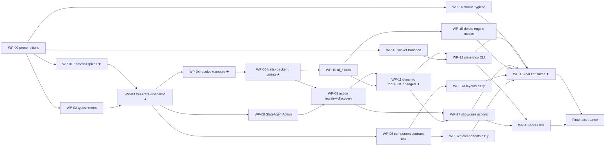

# 00 — Meta Implementation Plan: Dynamic Semantic MCP for Slate

| Field | Value |
|---|---|
| Plan | [`../20261011-162725-dynamic-mcp-capabilities.md`](../20261011-162725-dynamic-mcp-capabilities.md) (revision 3) |
| Audience | Orchestrator agent (team lead) + implementing agents (haiku-level) + reviewer agents |
| Branch | `feat/<ticket>-dynamic-mcp` (ticket id to be supplied by Marc; see §8) |
| Status | ready for handoff once the §10 open items are resolved |

---

## 1. Package index

| Path | What | Who reads it |
|---|---|---|
| `00-meta-implementation-plan.md` | this file: waves, roles, gates, prompts, escalation | orchestrator |
| `context/01-repo-map.md` | crates, files, tests, mock inventory, just recipes | everyone |
| `context/02-api-cheatsheet.md` | verified Slint 1.18.1 + Slate signatures with source lines | implementers |
| `context/03-shared-contracts.md` | **single source of truth**: names, types, errors, tool schemas, harness, file ownership | everyone, before every WP |
| `context/04-wp-template.md` | mandatory WP structure | WP authors |
| `handover/WP-00 … WP-18*.md` | one self-contained work package each | the assigned implementer |
| `review/00-gate-protocol.md` | how a WP is gated (who, when, commands, verdicts) | orchestrator, reviewers |
| `review/01-haiku-failure-rubric.md` | the known shortcuts low-capability agents take, and how to detect each | reviewers, implementers |
| `review/02-architecture-review-guide.md` | cross-WP invariants checked at wave boundaries | reviewer (strong model) |
| `review/03-wp-gate-checklists.md` | a per-WP checklist with exact commands | reviewers |
| `review/04-final-acceptance.md` | end-to-end acceptance, including Marc's manual live check | orchestrator + Marc |

---

## 2. Roles

| Role | Model | Responsibilities | Must not |
|---|---|---|---|
| **Orchestrator** | strong (opus/sonnet-class) | schedules waves; hands one WP to one implementer; runs the gates; resolves escalations; updates contracts (versioned, §7); prepares commit dry-runs; asks Marc for commit consent | write production code itself, except to resolve escalations |
| **Implementer** | haiku by default; see §4 for escalations | executes exactly one WP, following its steps literally; returns the WP report | edit files outside its ownership; change contracts; commit; push |
| **Reviewer** | different instance from the implementer; sonnet-class for the WPs marked ★ | runs `review/03` for the WP and `review/01` rubric; returns PASS / FAIL with evidence | fix the code (it only reports) |
| **Architecture reviewer** | strong | runs `review/02` at the end of waves 3, 5, 7, and 9 | — |

AGENTS.md compliance: in-session subagents only, with no Agent Manager worktrees unless Marc asks.
If worktrees are used anyway, create them from the feature branch, never from `main`.

---

## 3. Waves and dependencies



| Wave | WPs (parallel within a wave) | Gate at the end of the wave |
|---|---|---|
| 0 | WP-00 (orchestrator, serial) | `review/03#WP-00`; Marc approves the dependency review |
| 1 | WP-01 ★, WP-02, WP-13, WP-14 | per-WP gates; **the spike results from WP-01 are reviewed by the orchestrator, and contracts §8 is updated if needed, before wave 2 starts** |
| 2 | WP-03 ★ | per-WP gate |
| 3 | WP-04 ★, WP-06, WP-08 | per-WP gates + architecture review #1 |
| 4 | WP-05 ★, WP-07a, WP-07b | per-WP gates; `just optical-check` for 07a/07b |
| 5 | WP-09, WP-10 | per-WP gates + architecture review #2 |
| 6 | WP-11 ★, WP-15 | per-WP gates |
| 7 | WP-12, WP-17 | per-WP gates + architecture review #3 |
| 8 | WP-16 ★, WP-18 | per-WP gates |
| 9 | Final acceptance (`review/04`) | architecture review #4 + Marc's manual live check |

★ = high-risk WP: use a stronger implementer or a stronger reviewer (§4).

Shared-file note: WP-05 and WP-09 both touch `agent/src/builder.rs`. WP-09 starts only after WP-05
is merged (enforced by the waves). WP-15 deletes code inside files owned by WP-05; this is safe
because it runs in a later wave.

---

## 4. Model assignment

| WP | Implementer | Reviewer | Why |
|---|---|---|---|
| WP-00 | orchestrator | Marc (dependency gate) | dependency policy needs human sign-off |
| WP-01 | **sonnet** | sonnet | event-loop/threading spike; its unknowns can derail every later WP |
| WP-02 | haiku | haiku | pure types + serde tests |
| WP-03 | **sonnet** | sonnet | `i_slint_core` internals, popups, thread_local registry |
| WP-04 | **sonnet** | sonnet | the core correctness fix (single dispatch, stepping, focus) |
| WP-05 | haiku (sonnet if 2 failed attempts) | sonnet | wiring across 4 files |
| WP-06, 07a, 07b, 08 | haiku | haiku + optical check | Slint markup with exact snippets given |
| WP-09 | haiku | sonnet | schema validator + panic isolation |
| WP-10 | haiku | haiku | mechanical tool handlers per contract |
| WP-11 | **sonnet** | sonnet | protocol negotiation, outbound channel, notification semantics |
| WP-12, 13, 14, 15, 17, 18 | haiku | haiku | well-specified |
| WP-16 | **sonnet** | sonnet | rewrites 73 tests against the real app; the main risk is weakened assertions |

Escalation rule: after **2 failed gate attempts** on the same WP, the orchestrator re-assigns it to
the next stronger model. It never lowers the acceptance bar.

---

## 5. Per-WP lifecycle

1. **Dispatch.** The orchestrator checks that the WP's dependencies are gate-passed and merged on
   the feature branch. It then sends the implementer prompt (§6.1).
2. **Implement.** The implementer follows the WP steps (Red → Green → Iterate) and returns the
   WP report (template §8 of the WP).
3. **Gate.** A fresh reviewer runs `review/03#WP-xx` + `review/01`. The verdict is PASS or FAIL,
   with the command output as evidence.
4. **FAIL** → the orchestrator sends the findings back to the same implementer (attempt 2), then
   escalates per §4.
5. **PASS** → the orchestrator prepares a commit dry-run (§8). Marc's consent is needed before
   any commit. Consent may be given once per wave, if Marc pre-authorizes.
6. **Record.** The orchestrator appends a line to `progress.md` in this directory:
   `| WP | wave | implementer model | attempts | gate verdict | commit sha | notes |`.

---

## 6. Prompt templates

### 6.1 Implementer prompt (copy verbatim, fill `<…>`)

```text
You are implementing exactly one work package in the Slate repository at
/home/marc/Entwicklung/slate on branch <branch>.

Read, in this order, before touching anything:
1. .agents/plans/20261011-162725-dynamic-mcp-capabilities/context/03-shared-contracts.md (all of it)
2. .agents/plans/20261011-162725-dynamic-mcp-capabilities/review/01-haiku-failure-rubric.md
3. .agents/plans/20261011-162725-dynamic-mcp-capabilities/handover/<WP file>
4. The files listed in "Read first" of the WP.

Rules:
- Edit ONLY the files listed under "Files you own". Do not commit, push, or change branches.
- Work test-first: run the Red test and capture its failing output before writing the implementation.
- No mocks, fakes, stubs, #[ignore], todo!(), unimplemented!(), or weakened assertions. Ever.
- Use the exact names and signatures from 03-shared-contracts.md. Do not rename anything.
- If any STOP condition in the WP applies, stop immediately and report; do not improvise.
- Finish by returning the report described in section 8 of the WP, including pasted command output.
```

### 6.2 Reviewer prompt

```text
You are the gate reviewer for <WP id> in /home/marc/Entwicklung/slate (branch <branch>).
You did not write this code. You must not modify any file.

Read: context/03-shared-contracts.md, review/00-gate-protocol.md, review/01-haiku-failure-rubric.md,
review/03-wp-gate-checklists.md#<WP id>, and handover/<WP file>.
Then run every command in the WP's gate checklist and every rubric detector against the files the
WP owns (use `git diff --name-only <base>..HEAD` plus uncommitted changes).

Return: verdict PASS or FAIL; for every checklist item, the command you ran, the relevant output
lines, and ok/not-ok; for every FAIL, the file:line and the rubric id.
Never PASS a WP whose tests pass only because assertions were weakened, mocks were introduced,
or tests were skipped.
```

### 6.3 Architecture reviewer prompt

```text
Run review/02-architecture-review-guide.md against the current feature branch at the end of
wave <n>. Report every invariant as held/violated with evidence (grep output, file:line).
Do not modify files.
```

---

## 7. Contract change protocol
- Only the orchestrator edits `context/03-shared-contracts.md`.
- Each change adds a line to the "Changelog" at the bottom of that file:
  `YYYY-MM-DD — §x — change — reason — affected WPs`.
- WPs that are already done and affected by the change are re-gated. WPs in flight are notified.
- Triggers for a change: a STOP escalation that proves a contract signature cannot work with
  Slint 1.18.1, or the results of spikes A1/A2/A3.

---

## 8. Git protocol (AGENTS.md + git-commit-workflow skill)
- **Before wave 0**, the orchestrator does these, with Marc:
  - Create `feat/<ticket>-dynamic-mcp` from the current `main`.
  - Commit the pending `slate-rust/` restructure on it as its own commit
    (`refactor(#<ticket>-dynamic-mcp): move Rust workspace into slate-rust/`).
- **Per commit:**
  1. Run `./scripts/security-scan.sh`.
  2. Run `python3 scripts/validate-commit-msg.py <msgfile>`.
  3. Report every warning to Marc.
  4. Commit only after Marc's explicit consent.
- Message format: `<type>(#<ticket>-dynamic-mcp): WP-xx <summary>`, with bullet lines starting with
  `Added|Removed|Changed|Fixed|Updated|Security`.
- One commit per gate-passed WP. Never commit to `main` directly. Push only when Marc asks (the SSH
  agent setup is described in the user rules).

---

## 9. Escalation protocol

| Situation | Implementer does | Orchestrator does |
|---|---|---|
| Contract signature does not compile | STOP, report the compiler error | verify against `02-api-cheatsheet`; amend contracts (§7) or give an exact workaround |
| Test passes only with a mock, `#[ignore]`, or a weaker assertion | STOP | treat as a design problem; never accept the shortcut |
| Needs a file outside ownership | STOP | reassign ownership, or split into a follow-up WP |
| Needs a new crate | STOP | human-gate → security-auditor → Marc |
| Spike A1 fails (role `none` hides props from in-process reads, or the element is exported to AT) | — | switch Tier 2 to the plan's A1 fallback; rewrite WP-08/09 accordingly |
| Spike A2 fails (harness shape) | report the working alternative | update contracts §8 before wave 2 |
| Same compile error after 2 attempts | STOP | escalate the model (§4) |

---

## 10. Open items to resolve before handoff
1. **Ticket id** for the branch and commit messages.
2. **Plan revision 3 / D1 amendment:** acknowledge that the semantic core walks raw `ItemRc`
   instead of `ElementHandle`, because `ElementHandle` needs debug info. The effect is that no new
   runtime dependency is needed.
3. **ACP mocks:** `MockAcpAdapter`, `MockAcpClient`, `MockAcpConfig`, and `MockAcpServerHandle`
   (`slate-rust/agent/src/acp.rs` ~L440-600, re-exported from `slate::agent`) are mocks that are
   outside this plan's MCP scope. Decide between:
   - (a) add a WP to replace them with a real ACP adapter;
   - (b) delete ACP entirely;
   - (c) keep it explicitly out of scope.
4. **Commit consent mode:** per WP, or pre-authorized per wave.

---

## 11. Definition of done
- All of WP-00 to WP-18 are gate-PASS and committed on the feature branch.
- `review/04-final-acceptance.md` is fully green, including Marc's manual live check on the Carbon
  gallery via `slate-mcp attach`.
- The zero-mock grep from plan §6 returns nothing.
- The plan file status is set to `implemented`, with a link to `progress.md`.
