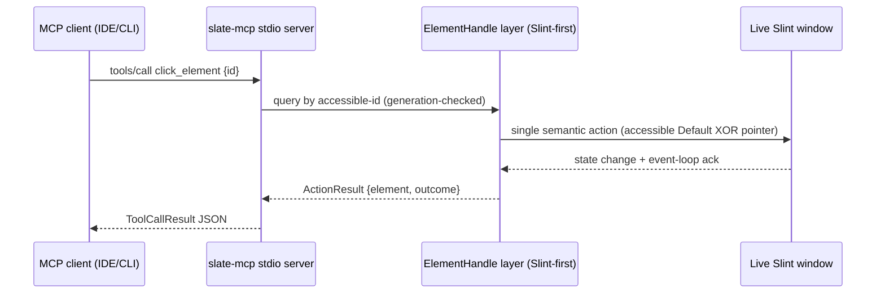

# MCP Server Remediation — Slint-First Foundation with Semantic Extension

- **Owning project:** Slate Rust/Slint workspace (`slate-rust/`, shared `ui/`); consumer: `slate-carbon/` gallery
- **Status:** draft
- **Revision:** 1
- **Date:** 2026-10-12
- **Prior art:** `20261011-162725-dynamic-mcp-capabilities.md` (approved rev 2 + rev 3 D1 amendment, pending acknowledgement) and its handover package in `20261011-162725-dynamic-mcp-capabilities/`; superseded draft `20261010-141500-component-native-mcp-interactable.md` (untracked leftover, do not build on)
- **Strategy decision (user, 2026-10-12):** base on Slint first, extend where useful (see D1)

## 1. Goal, Scope, and Non-Goals

### Goal
Replace the current parallel-universe MCP stack (custom 5-tool stdio server + hand-rolled item-tree walk + string IDs + mock engines) with a **Slint-first** stack: Slint 1.18's introspection/query/accessibility APIs as the foundation, our stdio/in-memory server as the local attached surface, and our semantic tools as extensions Slint does not provide. Eliminate the double/triple-dispatch interaction bugs, unstable IDs, and mock-blind test coverage that let regressions ship green.

Observable success: a real-window test clicks a toggle twice and observes toggle-on then toggle-off (no silent no-op); `inspect_tree` returns stable unique IDs with supported actions; `get_state` filtering works through our own client; the suite fails if any of these regress.

### Scope
1. Interaction semantics: single-dispatch per action (accessible action **or** pointer, chosen by role — never both), plus `toggle`/`increment`/`decrement`/`expand`/`focus`/`set_value` tool surface.
2. Identity: `accessible-id` contract in `ui/`, unique stable IDs, duplicate detector.
3. Slint-first introspection: migrate tree walk + targeting from raw `ItemRc`/`visit_items` + counter IDs to `ElementHandle` query API (`match_id`, `match_accessible_role`, `query_descendants`), generation-checked handles.
4. Protocol minimums: version negotiation on `initialize` (accept `2024-11-05`, advertise support; document `2025-06-18` gap vs Slint HTTP server), fix `get_state` `query` vs `keys` mismatch, unify viewport to logical px, cap logs, fix resource identity.
5. Transports/client/CLI hygiene: remove dead duplex loop, fix `slate-rust/target` default path, stdout framing safety, `kill`+`wait`.
6. Tests: one real event-loop slice (`init_integration_test_with_mock_time`) replacing mock assertions for interaction paths; keep mock tests labeled as framing-only.

### Non-Goals
- Enabling Slint's Streamable HTTP server (`SLINT_MCP_PORT`) by default or exposing TCP beyond localhost. Slint's HTTP stack stays dormant/opt-in; our stdio/in-memory transports remain the attached surface. (Revisit only with explicit network-exposure approval.)
- AT-SPI2 adapter, non-Slate app control, prompt/sampling/roots end-to-end support.
- Full 18-tool parity with Slint's server in this plan — parity is phased (this plan: interaction + identity + state minimums).
- Web mirror / AppImage / optical-regression pipelines.

## 2. Evidence and Current Behavior

Confirmed facts (all verified on `feat/rework-mcp` unless noted):

| # | Finding | Evidence |
|---|---|---|
| E-1 | Custom 5-tool server shadows Slint's 18-tool server; Slint `mcp` feature never enabled | [`slate-rust/mcp/src/tools/mod.rs`](../../slate-rust/mcp/src/tools/mod.rs) `dispatch_tool` (5 arms); [`slate-rust/mcp/src/schema.rs`](../../slate-rust/mcp/src/schema.rs) `all_standard_tools`; [`slate-rust/Cargo.toml`](../../slate-rust/Cargo.toml) (`slint = "1.18.1"`, no features; `i-slint-backend-testing = "=1.18.1"` as dep but `mcp` feature off); Slint source `i-slint-backend-testing-1.18.1/mcp_server.rs` (18 `ToolDef`s, `protocolVersion 2025-06-18`) |
| E-2 | Double dispatch: pointer events **plus** accessible `Default` on the same element; toggles fire twice = visible no-op | [`slate-rust/agent/src/slint_backend.rs`](../../slate-rust/agent/src/slint_backend.rs) L419-431; same file `send_keys` L507-530 (click-focus + SetValue + KeyPressed/Released) and `set_value` L567-591 (click + SetValue + KeyPressed/Released) |
| E-3 | `button` ignored on element path; double-click is two singles | [`slate-rust/mcp/src/tools/click.rs`](../../slate-rust/mcp/src/tools/click.rs) L53-57 parsed, L112-125 element branch calls `click_element(id)` which always synthesizes Left (`slint_backend.rs` L421-428); `click_count >= 2` re-invokes (L101-124), no OS double-click semantics |
| E-4 | Coordinate clicks can hit the wrong element via fullscreen overlay resolution | [`slate-rust/mcp/src/tools/click.rs`](../../slate-rust/mcp/src/tools/click.rs) L88-111 (`find_at_point` → click resolved id; overlay `toast-host` case from prior session) |
| E-5 | IDs unstable: debug-info → `accessible-id` → label slug → `type_counter`; duplicates silently target first match | [`slate-rust/agent/src/slint_backend.rs`](../../slate-rust/agent/src/slint_backend.rs) L136-184; `find_by_id` returns first match ([`slate-rust/agent/src/model.rs`](../../slate-rust/agent/src/model.rs) L192-203) |
| E-6 | Zero `accessible-id` in `ui/`; many interactive components expose no semantics | `grep accessible-id ui/` = 0 hits; prior audit of `navigation_split_view`, `collapsible`, `resizable_panel_group`, `action_row`, `card`, `alert_dialog`, `popover`, `sheet`, `table`, `tooltip`, `slider` (carried from `20261011` plan E-6, spot-checked) |
| E-7 | `get_state` client/server param mismatch: client sends `query`, server reads `keys` | [`slate-rust/mcp/src/client.rs`](../../slate-rust/mcp/src/client.rs) L258-266 vs [`slate-rust/mcp/src/tools/state.rs`](../../slate-rust/mcp/src/tools/state.rs) L11-15; test-harness client sends `keys` ([`slate-rust/test/src/client.rs`](../../slate-rust/test/src/client.rs) L401-408) — two clients, two contracts |
| E-8 | State provider returns title/size only; `set_property` no-op; `get_diagnostics` default | [`slate-rust/agent/src/slint_backend.rs`](../../slate-rust/agent/src/slint_backend.rs) L681-719 |
| E-9 | Three disagreeing viewport fallbacks; physical-vs-logical bug | `click.rs` L68-72 `(1920,1080)`; [`slate-rust/mcp/src/resources.rs`](../../slate-rust/mcp/src/resources.rs) L44-48 `(1040,720)`; [`slate-rust/agent/src/engine.rs`](../../slate-rust/agent/src/engine.rs) L208-211 `(800,600)`; real renderer returns physical px (`slint_backend.rs` L657-666) while inputs are logical |
| E-10 | Resources hardcoded: app `slate-showcase`/`0.1.0`, unbounded log vec, fake seed lines | [`slate-rust/mcp/src/resources.rs`](../../slate-rust/mcp/src/resources.rs) L50-55, L65; [`slate-rust/mcp/src/server.rs`](../../slate-rust/mcp/src/server.rs) L109, L130-133 |
| E-11 | `initialize` ignores negotiation; advertised-but-missing capabilities | [`slate-rust/mcp/src/server.rs`](../../slate-rust/mcp/src/server.rs) L222-237 (ignores `protocolVersion`/`capabilities`/`clientInfo`); L227-229 advertises `listChanged`/`subscribe`/`logging` with no `list_changed` emission, no `resources/subscribe`, no `logging/setLevel`; `handle_notification` L207-212 drops everything except `notifications/initialized` |
| E-12 | Dead_dup loop + live loop coexist | `server.rs` L314-373 (`run_stream`/`run_duplex`, queue 256, no shutdown) vs [`slate-rust/mcp/src/transport/mod.rs`](../../slate-rust/mcp/src/transport/mod.rs) L34-122 (`run_line_transport`, queue 1024, broadcast shutdown); transports use the latter |
| E-13 | Tests blind to real backend: `Default*` always-Ok engines + simulated `TestEngine`, no event-loop coverage | `mcp/tests/adapter_tests.rs` L21-26, `resource_tests.rs` L13-17, `tool_tests.rs` `Mock*` trio; [`slate-rust/test/src/harness.rs`](../../slate-rust/test/src/harness.rs) `TestEngine`; no use of `init_integration_test_with_mock_time` anywhere in `slate-rust/` |
| E-14 | CLI default paths predate restructure; hand-rolled parser; `serve` proxy leaks direction tasks | [`slate-rust/mcp/src/bin/slate_mcp.rs`](../../slate-rust/mcp/src/bin/slate_mcp.rs) L107-136 (`target/debug/` not `slate-rust/target/`), L380-386 flag injection, L620-653 proxy `select!` |
| E-15 | `send_keys` editability gate is substring sniffing and fails open | [`slate-rust/mcp/src/tools/keys.rs`](../../slate-rust/mcp/src/tools/keys.rs) L21-47 |
| E-16 | Controller capabilities unreachable: `set_value`/`toggle` exist on trait, no MCP tool | [`slate-rust/agent/src/traits.rs`](../../slate-rust/agent/src/traits.rs) vs `tools/mod.rs` 5 arms |

Assumptions: Slint 1.18 `ElementHandle` API (`invoke_accessible_default_action`, `set_accessible_value`, `match_id`/`match_accessible_role`, `init_integration_test_with_mock_time`) behaves as documented in vendored `i-slint-backend-testing-1.18.1/search_api.rs` / `lib.rs`; to be validated by Phase 0 spikes (A1). `slate-rust/lib/build.rs` `with_debug_info(true)` reaches app binaries built through the lib build script; showcase binary path to be confirmed in Phase 0 (A2).

### Dataflow (target)



No dataflow impact outside the agent/MCP boundary: no persistence, no network beyond stdio pipes, no auth boundary change (local-only retained).

## 3. Proposed Design and Alternatives

### D1 — Foundation: Slint-first, extend where useful (DECIDED by user)
- **Problem:** two MCP stacks (§E-1); custom tree walk duplicates Slint's query layer.
- **Selected:** base introspection, targeting, and action dispatch on Slint's `ElementHandle`/accessibility APIs; keep our stdio/in-memory server as the attached local surface; add only semantic tools Slint lacks (toggle/increment/decrement/expand/focus, filtered snapshot, app state). Slint's HTTP server stays opt-in/dormant (non-goal).
- **Rationale:** user direction 2026-10-12; removes the O(n)×3 hand walk, gets generation-checked handles + query pipeline + event-loop test support for free.
- **Consequence:** `slint_backend.rs` targeting/inspection rewritten against `ElementHandle`; raw `visit_items` walk retained only as fallback until parity proven, then deleted.

### D2 — Single dispatch by role (needs implementation, no open choice)
- **Problem:** E-2 double/triple dispatch.
- **Selected:** role-driven single path — elements with a semantic accessible action (button/checkbox/switch/slider/spinbox/combobox) go through `invoke_accessible_*` / `set_accessible_value` **only**; pure positional clicks go through pointer events **only**. `toggle_element` routes to the semantic path, not `click_element`.
- **Alternatives rejected:** pointer-only (breaks keyboard/screen-reader parity), both-with-debounce (masks rather than fixes).

### D3 — Identity: `accessible-id` required, duplicates are errors
- **Problem:** E-5/E-6 unstable colliding IDs.
- **Selected:** declare `accessible-id` on all interactive Slate components in `ui/`; inspector prefers `accessible-id`, then debug ID; label-slug/counter fallback kept only behind a `debug` flag and marked unstable; duplicate IDs across one window are an error surfaced by a detector test.
- **Alternatives rejected:** global registry of slug IDs (still unstable), UUID-per-run (breaks stable refs).

### D4 — Protocol minimums without scope explosion
- **Selected:** `initialize` negotiates (accept requested version if known `2024-11-05`, else respond with ours + `data.supportedVersions`); stop advertising `subscribe`/`listChanged` until implemented (or implement `logging/setLevel` thinly with level filter — implementer picks the smaller one and records it); fix `get_state` to accept **both** `keys` and legacy `query` during migration, document `keys` canonical.

## 4. Requirements and Acceptance Tests

| Category | ID | Requirement |
|---|---|---|
| Unwanted | W1 | If an element exposes a semantic accessible action, then a single `click_element`/`toggle` invocation shall cause exactly one state transition (no double toggle). |
| Ubiquitous | U1 | The inspector shall return stable unique IDs preferring `accessible-id`, and shall annotate each node with supported actions. |
| Event | E1 | When a client calls `tools/call` with `id`, the server shall resolve via the `ElementHandle` query path, not label-substring search. |
| Event | E2 | When a client calls `get_state` with `keys` (or legacy `query`), the server shall filter to the requested keys. |
| State | S1 | While attached to a live window, `get_viewport_size` and bounds inputs shall use logical pixels consistently. |
| Unwanted | W2 | If duplicate `accessible-id`s exist in one window, then inspection shall surface an error naming the duplicates. |
| Unwanted | W3 | If the child app writes non-protocol bytes to stdout, then the MCP stream shall remain framed (stdout hygiene enforced or documented with a failing guard test). |
| Optional | O1 | Where Slint's HTTP MCP is explicitly enabled (`SLINT_MCP_PORT`), the custom server shall not conflict (different port/process documented; no auto-enable). |

```gherkin
Scenario: T1 - Toggle fires exactly once (covers W1)
  Given a live showcase window with a toggle bound to a boolean
  When the client calls click_element twice with the element id
  Then the boolean is true after the first call and false after the second
  And each call reports a single action outcome
```

```gherkin
Scenario: T2 - Stable unique IDs with actions (covers U1, E1, W2)
  Given the showcase window
  When the client calls inspect_tree
  Then every interactive node has a non-empty unique id
  And each interactive node lists its supported actions
  And no two nodes share the same accessible-id
```

```gherkin
Scenario: T3 - State filtering through our own client (covers E2)
  Given an attached engine with properties a and b
  When McpClient.get_state requests only [a]
  Then the result contains a and omits b
```

```gherkin
Scenario: T4 - Logical viewport consistency (covers S1)
  Given a window with scale factor != 1 (or mock-time backend reporting logical size)
  When click bounds-check and screenshot viewport are queried
  Then both agree in logical pixels (no physical/logical mix)
```

```gherkin
Scenario: T5 - New semantic tools (covers E1, W1)
  Given a slider and a switch
  When the client calls increment/set_value/toggle
  Then each resolves by id and performs exactly one semantic change
```

| Scenario/check | Requirement IDs | Target test file/suite | Layer |
|---|---|---|---|
| T1 | W1 | [NEW] `slate-rust/mcp/tests/real_window_interaction_tests.rs` (via `init_integration_test_with_mock_time`) | Integration (real event loop) |
| T2 | U1, E1, W2 | same new file + `ui/` component updates | Integration |
| T3 | E2 | extend `slate-rust/mcp/tests/tool_tests.rs` + client unit | Integration/unit |
| T4 | S1 | new file or `slate-rust/agent/tests/` renderer/viewport test | Integration |
| T5 | E1, W1 | new file (tools: toggle/increment/decrement/expand/set_value) | Integration |
| framing-only label audit | — | existing `mcp/tests/*` using `Default*` marked `#[ignore]`-free but documented as framing-only | Unit |

For docs/config-only steps (capability advertisement fix, CLI help text), validation is `cargo test` + manual `--help`/handshake transcript, recorded in §6.

## 5. Affected Files and Implementation Steps

Order by dependency; each behavior step Red → Green → Iterate.

- **Phase 0 — Harness + locked regressions (no prod change first):**
  - `[NEW]` `slate-rust/mcp/tests/real_window_interaction_tests.rs` — Red T1/T2 skeleton using `init_integration_test_with_mock_time` (validate A1 here; if the API differs, record actuals and adjust D1 minimally).
  - `[MODIFY]` `slate-rust/mcp/tests/tool_tests.rs`, `adapter_tests.rs`, `resource_tests.rs` — label mock-based cases as framing-only (comments + test names), no behavior change.
- **Phase 1 — Single dispatch (fixes E-2/E-3):**
  - `[MODIFY]` `slate-rust/agent/src/slint_backend.rs` — role-driven single path in `click_element`/`send_keys`/`set_value`/`toggle_element`; `toggle_element` stops delegating to `click_element`; `click_at` stays pointer-only.
  - `[MODIFY]` `slate-rust/mcp/src/tools/click.rs` — honor `button` on element path or reject non-left explicitly; remove overlay-id hijack (click point clicks the point; resolve id only for reporting); real double-click or explicit two-step documentation.
  - `[MODIFY]` `slate-rust/mcp/src/tools/keys.rs` — replace substring gate with role/type check against Slint roles; fail closed on unknown target; check `clear_first` result.
- **Phase 2 — Slint-first targeting (fixes E-1/E-5 core):**
  - `[MODIFY]` `slate-rust/agent/src/slint_backend.rs` — inspector + targeting via `ElementHandle` query (`match_id`, `match_accessible_role`, `query_descendants`); generation-checked handles; keep `visit_items` walk as fallback behind a flag, delete when T2 green without it.
  - `[MODIFY]` `slate-rust/agent/Cargo.toml`, `slate-rust/mcp/Cargo.toml` — only if a feature/ dep is actually needed for the query API (prefer no new deps; record if `mcp` feature must stay off).
- **Phase 3 — Identity contract (fixes E-5/E-6):**
  - `[MODIFY]` `ui/components/*.slint`, `ui/layouts/*.slint` — add `accessible-id` (+ roles/actions where missing: nav items, collapsible, panels, action_row, card, dialogs, popover, sheet, table, slider actions). Smallest per-component diffs; land behind T2.
  - `[MODIFY]` inspector fallback chain — `accessible-id` first, debug ID second, slug/counter last + unstable-marked.
- **Phase 4 — Tool + protocol minimums (fixes E-7–E-11, E-15–E-16):**
  - `[MODIFY]` `slate-rust/mcp/src/tools/mod.rs`, `schema.rs` — add `toggle_element`/`increment`/`decrement`/`expand`/`focus_element`/`set_value` tools + schemas; `get_state` accepts `keys` (+ legacy `query` mapped, deprecated).
  - `[MODIFY]` `slate-rust/mcp/src/client.rs` — `get_state` sends `keys`; fix `click_element` helper to send one coordinate form.
  - `[MODIFY]` `slate-rust/mcp/src/resources.rs`, `slate-rust/agent/src/slint_backend.rs`, `slate-rust/agent/src/engine.rs` — single logical-px viewport source (no per-file fallbacks; error instead of fake sizes); real app name/version in context resource; bounded log buffer (e.g. 2000 lines, documented) + remove fake seed lines.
  - `[MODIFY]` `slate-rust/mcp/src/server.rs` — negotiate `initialize`; de-advertise unimplemented capabilities (or implement `logging/setLevel` thinly); **delete** `run_stream`/`run_duplex` in favor of `transport::run_line_transport`.
- **Phase 5 — Transport/CLI hygiene (fixes E-12/E-14, E-10 stdout):**
  - `[MODIFY]` `slate-rust/mcp/src/bin/slate_mcp.rs` — `slate-rust/target/...` default paths; `kill`+`wait`; proxy shutdown propagation; PNG magic validation.
  - `[MODIFY]` showcase/Carbon launch paths — stdout reserved for protocol in `--agent`/`--mcp` mode (banners → stderr); documents W3 guard test.
- **Phase 6 — Cleanup + docs:**
  - `[MODIFY]` `slate-rust/test/src/*` — keep `TestEngine` only for framing/load tests, clearly separated from real-window suites.
  - `[MODIFY]` `README.md`, `CLAUDE.md`, `.agents/skills/slate-agent-control/SKILL.md` — Slint-first architecture + `accessible-id` authoring rule; skill updated so app authors never hand-write controllers (existing contract, restated).

Parallel-safe: Phase 3 `ui/` per-component id additions can parallelize after T2 Red lands; Phase 4 client fix can parallelize with Phase 1.

## 6. Verification

Run from repo root unless noted; record planned vs executed (none executed during planning):

- `just check` — fast compile check (`slate-rust` workspace). Prereq: Rust toolchain + vendored Slint deps cached.
- `just test` — full workspace suite. Expected: green, including new `real_window_interaction_tests.rs` (T1–T5).
- `cd slate-rust && cargo test -p slate-mcp` — MCP-focused slice during iteration.
- `cd slate-rust && cargo test -p slate-agent` — backend slice.
- Manual: `slate-mcp --help`, stdio handshake transcript (`initialize` → `tools/list` → `tools/call inspect_tree`) against showcase `--headless --agent`, screenshot PNG magic check (`file out.png`).
- Slint HTTP non-conflict (O1): only if explicitly enabled — set `SLINT_MCP_PORT` on a scratch port, confirm our stdio server unaffected; otherwise record as not-executed with reason (default dormant).

## 7. Risks and Delivery

- **Slint API drift:** pinned `=1.18.1` internal crates carry no semver guarantee (prior E-10); `ElementHandle`/mock-time APIs may differ from docs — mitigated by Phase 0 spike (A1) before rewriting dispatch.
- **ID migration breakage:** existing clients/tests using slug/counter IDs will break once IDs stabilize — mitigated by accepting legacy `query`, dual-accept in targeting during migration, and grep-migration of tests/CLI examples.
- **Event-loop test flakiness:** real-window tests need mock-time backend + headless; keep them in a dedicated file with generous timeouts, separate from framing unit tests.
- **Log cap data loss:** bounding the log buffer drops history — acceptable for live-tail resource; document retention (count + drop counter).
- **No network/secret risk:** local-only retained; no new persistence; docs updated in Phase 6; rollback = revert per phase (no migrations).

## 8. Assumptions, Open Questions, and Approval

- A1 (validate Phase 0): exact `ElementHandle` method names + `init_integration_test_with_mock_time` availability in pinned `=1.18.1` — validation: compiling spike test.
- A2: showcase binary built via `slate-rust/lib/build.rs` gets `with_debug_info(true)` IDs — validation: T2 against real showcase.
- Q1 (non-blocking): implement `logging/setLevel` thinly vs de-advertise `logging` — implementer picks smaller, records in revision.
- Q2 (non-blocking): `expand`/`focus` as separate tools vs flags on a unified `act` tool — implementer proposes in Phase 4, needs no re-approval if schemas stay explicit.
- Prior pending acknowledgement (rev 3 D1 amendment of the `20261011` plan) is **superseded by the user's 2026-10-12 Slint-first decision** recorded here as D1.
- **Review status:** draft rev 1, saved at `.agents/plans/20261012-114132-mcp-slint-first-remediation.md`, awaiting explicit user approval. No implementation authorized until approved. (Deliberately saved under `.agents`, not `.kilo`, per user instruction.)
