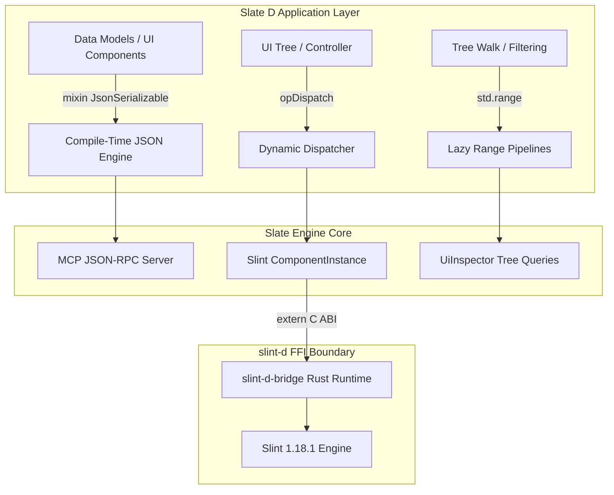

# Plan: D-Specific Idiomatic Elegance & Language Feature Exploitation for Slate/Slint

- **Owning Project**: `slate-dlang` and `slint-d`
- **Status**: `draft`
- **Revision**: 1
- **Timestamp**: 2026-10-13T08:01:18Z
- **Author**: Antigravity Architect & Systems Engineer

---

## 1. Goal, Scope, and Non-Goals

### Goal
Elevate the Slate D implementation (`slate-dlang`) and its Slint binding (`slint-d`) from a faithful 1:1 port of the Rust codebase into a **distinctly idiomatic, expressive, and high-performance D application framework**. Leverage D-specific language superpowers (compile-time reflection, mixin templates, UDAs, CTFE, contract programming, range pipelines, and `opDispatch`) to eliminate boilerplate, guarantee UI render-loop safety, and dramatically simplify UI automation and component authoring.

### Scope
1. **Catalog and evaluate all D-specific language features** against Slate and Slint design challenges.
2. **Declarative serialization**: Implement compile-time introspection-based JSON serialization (`slate.utils.json`) utilizing `mixin template JsonSerializable` and User-Defined Attributes (`@JsonKey`, `@jsonIgnore`), eliminating manual `JSONValue` boilerplate in data models.
3. **Monadic `Nullable!T` UFCS combinators**: Implement fluid chaining (`map`, `andThen`, `unwrapOr`, `match`) matching Rust's `Option`/`?` ergonomics.
4. **Dynamic UI property & element access via `opDispatch`**: Enable compile-time generated member dispatch (`ui.submitBtn` or `instance.counter`) over element trees and property maps.
5. **Contract programming & UI invariants**: Embed runtime/debug safety invariants (`invariant`, `in`, `out`) for controllers, bounding geometry, and range constraints.
6. **Range-based tree traversal**: Implement non-allocating lazy range primitives for traversing and filtering `UiTree` and `UiElementNode`.

### Non-Goals
- Replacing Slint's core C++/Rust rendering engine.
- Writing a new macro preprocessor or external build-time code generator.
- Re-architecting the JSON-RPC wire protocol specification (must remain 100% interoperable with standard Slate MCP clients).

---

## 2. Evidence and Current Behavior

### Cited Repository Findings
- [`slate-dlang/source/slate/agent/model.d`](../../slate-dlang/source/slate/agent/model.d): Models like `Point`, `Rect`, `UiTree`, `DiagnosticMetrics`, and `ActionResult` contain ~150 lines of manual dictionary allocations (`JSONValue(["x": JSONValue(x), ...])`) and manual type-casting logic.
- [`slate-dlang/source/slate/tasks.d`](../../slate-dlang/source/slate/tasks.d): `TaskCancellation` originally used a heap `Mutex` for a single boolean; now refactored to `core.atomic` lock-free primitives, but can be further integrated with `scope(exit)` and contract invariants.
- [`slint-d/source/slint/instance.d`](../../slint-d/source/slint/instance.d): Property querying currently requires string lookups (`getProperty("counter")`) rather than typed member syntax.
- [`slate-rust/agent/src/model.rs`](../../slate-rust/agent/src/model.rs): Relies on `serde::Serialize` and `serde::Deserialize` derives for declarative wire representations.

### Data Flow Diagram



---

## 3. Catalog: D-Specific Language Features & Impact on Slate/Slint

| Feature | What D Provides | Specific Value for Slate / Slint |
|---|---|---|
| **1. Template Mixins (`mixin template`)** | Injects declarations, methods, and types into the enclosing aggregate scope. | **Declarative serialization & components**: `mixin JsonSerializable;` injects `toJson()`/`fromJson()` into structs without external macros. `mixin SlintComponent!"app.slint";` binds properties automatically. |
| **2. Compile-Time Introspection (`__traits`, `std.traits`)** | Inspects fields, types, attributes, member functions, and layout at compile-time. | **Zero-boilerplate FFI & mapping**: Automatically reflects D struct fields to Slint struct properties or JSON dictionary keys with zero runtime overhead. |
| **3. User-Defined Attributes (UDAs)** | Arbitrary types or expressions attached as metadata (`@JsonKey("name")`, `@nogc`). | **Field tagging & schema annotation**: Annotates serialization keys (`@JsonKey`), exclusion (`@jsonIgnore`), and validation constraints (`@range(0, 100)`). |
| **4. Compile-Time Function Execution (CTFE)** | Runs standard D code at compile time during compilation. | **Compile-time validation**: Hex color string parsing (`enum red = Rgba.fromHex("#f00").get;`), UI layout constraint checking, and precomputing CRC/hash tables before runtime. |
| **5. String Mixins (`mixin(...)`)** | Compiles arbitrary strings generated at compile-time into executable code. | **Embedded Slint code generation**: Generate Slint property getters/setters dynamically from parsed `.slint` file definitions. |
| **6. Uniform Function Call Syntax (UFCS)** | Enables `func(obj, args)` to be written as `obj.func(args)`. | **Fluent API design**: Extends external types (interfaces, `Nullable!T`, arrays) with method syntax: `tree.filterRole("Button")` or `opt.unwrapOr(def)`. |
| **7. Fine-Grained Attributes (`@safe`, `pure`, `nothrow`, `@nogc`)** | Compiler-enforced guarantees on safety, memory allocation, purity, and exceptions. | **60/120 FPS UI loop safety**: Mark layout calculations, color blending, and render math `@nogc nothrow` to guarantee zero GC pauses during animation cycles. |
| **8. Dynamic Member Dispatch (`opDispatch`)** | Intercepts undefined member accesses at compile-time: `obj.foo(args)`. | **Natural UI element & property access**: Enables `window.submitButton.click()` or `state.counter = 10` by intercepting the identifier and routing to `findElement` or `setProperty`. |
| **9. Scope Guards (`scope(exit)`, `scope(failure)`, `scope(success)`)** | Schedules cleanup or rollback actions right next to the resource acquisition. | **Transactional UI & FFI**: Guarantees lock release and state restoration without deep `try {} catch {} finally {}` indentations: `scope(failure) rollbackUiState();`. |
| **10. Contract Programming (`in`, `out`, `invariant`)** | Formal preconditions, postconditions, and class invariants built into the language. | **Self-testing UI state**: Assert that `Rect.width >= 0`, `progress in [0.0, 1.0]`, and bounding box intersections remain consistent during transformations. |
| **11. Ranges & Algorithms (`std.range`, `std.algorithm`)** | Composable, lazy, non-allocating iteration primitives (`map`, `filter`, `take`). | **Zero-allocation UI tree search**: Search and filter deep element hierarchies without allocating intermediary arrays: `tree.byElement.filter!(e => e.visible)`. |
| **12. Fibers & Coroutines (`core.thread.fiber`)** | Lightweight stackful cooperative multi-tasking. | **Animation & Scripted UI Workflows**: Express sequential UI automation steps and multi-frame easing curves synchronously without callback hell or viral `async/await`. |

---

## 4. Proposed Design and Material Decisions

### Decision 1 (D1): Reusable Declarative JSON Serialization Engine
- **Problem**: Data models in `slate.agent.model` manually construct and parse JSON dictionaries, totaling hundreds of lines of fragile boilerplate.
- **Options**:
  - *Option A (Keep manual parsing)*: Low upfront work, high maintenance, error-prone.
  - *Option B (External generator / vibe.d)*: Introduces heavy third-party dependencies into what is currently a pure Phobos library.
  - *Option C (Internal `slate.utils.json` with `mixin template JsonSerializable`)*: Zero external dependencies, pure Phobos (`__traits`, `std.json`), fully compile-time, support for `@JsonKey` and `@jsonIgnore`.
- **Selected**: **Option C**.

### Decision 2 (D2): Monadic UFCS Combinators for `Nullable!T`
- **Problem**: `Nullable!T` in D requires repeated `if (!opt.isNull) return opt.get;` patterns, which is less elegant than Rust's `Option<T>` with `?` and combinators.
- **Options**:
  - *Option A (Leave as is)*: Verbose code at every call site.
  - *Option B (`slate.utils.optional` UFCS extension module)*: Provides `map`, `andThen`, `unwrapOr`, `match`, and `filter` for any `Nullable!T` via UFCS.
- **Selected**: **Option B**.

### Decision 3 (D3): Dynamic Property / Component Access via `opDispatch`
- **Problem**: Accessing properties in Slint instances and elements in `UiTree` requires string-based lookups (`tree.findById("login_btn")`).
- **Options**:
  - *Option A (String methods only)*: Explicit but repetitive.
  - *Option B (`opDispatch` wrapper)*: Wraps `UiTree` and `ComponentInstance` so `tree.login_btn` or `instance.user_name` automatically resolves at runtime with clean dot-syntax.
- **Selected**: **Option B** (provided as an opt-in wrapper `UiFacade`).

### Decision 4 (D4): Lazy Range Traversal for UI Elements
- **Problem**: `collectElements()` allocates an entire heap array of element nodes just to search or count.
- **Options**:
  - *Option A (Heap array slice)*: Current behavior.
  - *Option B (`byElement` lazy input range)*: Non-allocating recursive/stack-based lazy range that yields `UiElementNode` items on demand.
- **Selected**: **Option B**.

---

## 5. Requirements and Acceptance Tests

### EARS Requirements
- **U1**: The serialization engine shall serialize and deserialize arbitrary structs decorated with `mixin JsonSerializable` to and from `std.json.JSONValue`.
- **E1**: When a field is annotated with `@JsonKey("custom_name")`, the serialization engine shall use `"custom_name"` as the wire dictionary key.
- **E2**: When a field is annotated with `@jsonIgnore`, the serialization engine shall skip serializing and deserializing that field.
- **E3**: When a `Nullable!T` field is null during serialization, the engine shall omit the key from the output dictionary.
- **U2**: The `Nullable` combinator module shall provide `map`, `andThen`, and `unwrapOr` operations executable via UFCS.
- **U3**: The `UiFacade` wrapper shall resolve element lookups by member name using `opDispatch`.
- **U4**: The `byElement` range shall traverse a `UiTree` pre-order without allocating an intermediate array of nodes.

### Acceptance Scenarios (Gherkin)

```gherkin
Scenario: T1 - Declarative JSON serialization with key remapping and ignoring (covers U1, E1, E2, E3)
  Given a struct with @JsonKey("wire_name"), @jsonIgnore, and Nullable!T fields
  When toJson() is called
  Then the JSON output contains "wire_name"
  And the ignored field is absent
  And the null Nullable field is absent
  When fromJson() is called with valid JSON
  Then a fully populated struct instance is returned

Scenario: T2 - Monadic Nullable combinators via UFCS (covers U2)
  Given a Nullable!int with value 21
  When calling opt.map!(x => x * 2).unwrapOr(0)
  Then the result is 42
  Given an empty Nullable!int
  When calling opt.unwrapOr(100)
  Then the result is 100

Scenario: T3 - opDispatch UI Tree accessor (covers U3)
  Given a UiTree containing an element with id "submit_btn"
  When accessing facade.submit_btn
  Then the element node for "submit_btn" is returned

Scenario: T4 - Lazy element range traversal (covers U4)
  Given a nested UiTree with 50 elements
  When iterating through tree.byElement
  Then all 50 elements are yielded in pre-order without heap-allocating an array
```

### Coverage Matrix
| Scenario | Requirement IDs | Target Test Module | Layer |
|---|---|---|---|
| `T1` | `U1`, `E1`, `E2`, `E3` | `slate.utils.json` (unittest) | Unit |
| `T2` | `U2` | `slate.utils.optional` (unittest) | Unit |
| `T3` | `U3` | `slate.agent.model` (unittest) | Unit |
| `T4` | `U4` | `slate.agent.model` (unittest) | Unit |

---

## 6. Affected Files and Implementation Steps

### Planned Increments (TDD Red-Green Loop)

#### Increment 1: Declarative Serialization Module
- `[NEW]` `slate-dlang/source/slate/utils/json.d`: Implement `@JsonKey`, `@jsonIgnore`, and `mixin template JsonSerializable`.
- `[MODIFY]` `slate-dlang/source/slate/agent/model.d`: Apply `mixin JsonSerializable` to `Point`, `Rect`, `DiagnosticMetrics`, and verify against existing wire tests.
- `[MODIFY]` `slate-dlang/source/slate/agent/error.d`: Apply `mixin JsonSerializable` to `Candidate`.

#### Increment 2: Monadic `Nullable` Utilities
- `[NEW]` `slate-dlang/source/slate/utils/optional.d`: Implement `map`, `andThen`, `unwrapOr`, and `match` for `Nullable!T`.
- `[MODIFY]` `slate-dlang/source/slate/app.d`: Use `unwrapOr` and `map` for system appearance resolution.

#### Increment 3: Range-Based Tree Walking and `opDispatch`
- `[MODIFY]` `slate-dlang/source/slate/agent/model.d`:
  - Add `byElement` range primitive to `UiElementNode` and `UiTree`.
  - Add `UiFacade` struct using `opDispatch` for identifier dispatching.

---

## 7. Verification

### Execution Environment
- Compiler: `dmd-2.113.0` via `/home/developer/dlang/dmd-2.113.0/activate`
- Build System: `dub` (via `dub test`)
- Target Workspace: `/home/developer/projects/slate/slate-dlang`

### Verification Commands
```sh
source /home/developer/dlang/dmd-2.113.0/activate
cd /home/developer/projects/slate/slate-dlang
dub test
```
**Expected Outcome**: All existing unittests pass, plus new tests in `slate.utils.json`, `slate.utils.optional`, and extended `slate.agent.model`.

---

## 8. Risks and Delivery

- **Risk 1: Cyclic struct dependencies during compile-time reflection**: Handled by checking `__traits(compiles, ...)` and restricting static recursion to non-pointer/non-class value fields.
- **Risk 2: Backwards compatibility with MCP JSON-RPC wire format**: Preserved exactly via `@JsonKey` and targeted tests verifying raw JSON string equivalence.

---

## 9. Assumptions, Open Questions, and Approval Gate

### Assumptions
- D compiler `dmd` 2.113.0 is the active toolchain and supports full compile-time introspection and static foreach.
- Phobos `std.json` is sufficient when driven by compile-time reflection, avoiding any external dub dependencies.

### Approval Gate
- **Status**: `draft` awaiting user review.
- Canonical Plan File: `.agents/plans/20261013-080118-dlang-idiomatic-elegance-and-features.md`.
