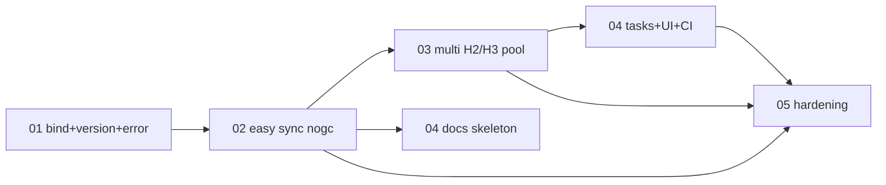

# 00 — Meta Plan: D-native libcurl wrapper (HTTP/2 + HTTP/3/QUIC)

| Field | Value |
|---|---|
| Owning project | `slate-dlang` (`source/slate/http/`) |
| Status | draft |
| Date | 2026-10-13 |
| Goal | Idiomatic D `@safe` wrapper over modern libcurl 8.6+ gaining full H1/H2/H3-QUIC support |
| Non-goal v1 | WebSockets, server-push app logic, raw QUIC sockets, port of `std.net.curl` |

## 1. Why libcurl

- `std.net.curl` / `etc.c.curl`: dated, easy-only, no H3 tuning.
- `vibe-http`: pure D, no QUIC.
- Raw `ngtcp2`+`nghttp3`: full control, large surface (UDP, TLS, congestion).
- libcurl 8.x: one maintained H1/H2 (`nghttp2`) + H3 (`nghttp3`/`ngtcp2` + quictls/OpenSSL 3.2+/BoringSSL) stack with `curl_version_info` feature detection.

## 2. Locked decisions

1. **Memory split (hybrid):** GC allowed in one-shot `Client` builder (cold path); `@nogc` enforced in all exec hot paths (perform, callbacks, `multi` loop, `byChunk` iteration).
2. **Layering:** private `@system extern(C)` `c_bind` → `@trusted @nogc` thin wrappers → `@safe` public `slate.http` API. Raw `CURLOPT_*` never in public signatures.
3. **TDD rule:** every `unittest` carries `// Spec:` (RFC/curl doc) or `// Best practice:` plus a `/// Example:` documentable use. Bare-coverage tests rejected in review.

## 3. Phase index

| Doc | Phase | Produces | Status |
|---|---|---|---|
| `01-cbind-version-error.md` | P1 raw bind + version + error | `c_bind.d`, `version_.d`, `error.d` | blocks P2 |
| `02-easy-sync-nogc.md` | P2 sync easy client | `request.d`, `response.d`, `client.d` (easy path) | blocks P3 |
| `03-multi-h2-h3-pool.md` | P3 multiplex + pooling | `multi.d`, reuse + `h3Only` semantics | blocks P4 |
| `04-tasks-ui-docs-ci.md` | P4 UI + docs + CI | `slate.tasks` integration, DDoc, nghttpd/H3 harness | blocks P5 |
| `05-hardening.md` | P5 hardening | TLS, timeouts, redirects, qlog, leak audit | final gate |

## 4. Dependency DAG

Interactions / contracts:

- P1 → P2: P2 consumes `CURLcode→CurlException` mapping and `hasHttp2()/hasHttp3()` gates. Contract: `c_bind` stays `@system`; `version_`/`error` are `@trusted @nogc nothrow` where possible.
- P2 → P3: P3 reuses `Request`/`Response` value types unchanged. Contract: no public-type break; P3 only adds pooled `perform`.
- P2+P3 → P4: P4 documents the frozen public API and drives it from `spawnCompute` workers with Slint marshaling. Contract: DDoc `/// Example:` blocks compile as unittests.
- All → P5: P5 tightens behaviour (verify, timeouts, redirects) without public-signature breaks, except documented additions.

## 5. Cross-phase acceptance gates

- G1: `dub test --build=unittest` green on curl+nghttp2 and curl+nghttp2+ngtcp2 matrix entries.
- G2: `@nogc:` compile asserts pass for every hot-path unittest.
- G3: `hasHttp3()==false` + `h3Only` fails fast, never silently downgrades (ST-2).
- G4: every unittest has `Spec`/`Best practice` + `Example` header (UB-5), checked in review.
- G5: no `CURL*`/`CURLM*` leak on throw paths (`scope(exit)` RAII audit).

## 6. Full EARS index (detail in phase docs)

- UB-1..UB-5, EV-1..EV-4, ST-1..ST-3, OPT-1..OPT-2, UN-1..UN-3 — see P1–P5 docs for owning phase.
- Gherkin TC-01..TC-06 mapped 1:1 to EARS; each TC lives in its owning phase doc.
