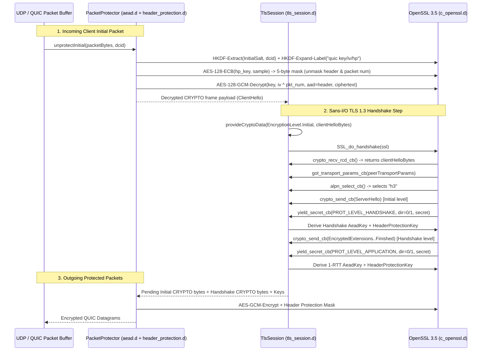

# Implementation Plan: `slate.quic.crypto` — QUIC Packet Protection & TLS 1.3 Engine (RFC 9001)

| Field | Value |
|---|---|
| **Owning Project** | `slate-dlang` (`slate-dlang/source/slate/quic/crypto/`) |
| **Status** | `approved` |
| **Revision** | `1.0` |
| **Date** | `2026-10-13` |
| **Reference Specs** | RFC 9001 (Using TLS to Secure QUIC), RFC 9000 §5/§17, OpenSSL 3.5 `SSL_set_quic_tls_cbs` |
| **Reference Implementations** | Rust `quinn-proto/src/crypto/` (Sans-I/O trait boundary) & Go `quic-go/internal/handshake/` |

---

## 1. Goal, Scope, and Non-Goals

### 1.1 Goal
Build a self-contained, Sans-I/O, `@safe @nogc` D cryptographic and TLS 1.3 handshake engine (`slate.quic.crypto`) that implements **100% of RFC 9001 (Using TLS to Secure QUIC)** for both QUIC server and client endpoints, backed by a minimal, package-private `extern(C)` binding (`c_openssl.d`) to the system's OpenSSL 3.5 (`libcrypto.so.3` and `libssl.so.3`).

### 1.2 Scope
1. **Minimal OpenSSL 3.5 C FFI (`c_openssl.d`)**:
   - `@system extern(C) @nogc nothrow` declarations for `libcrypto` (`EVP_CIPHER_CTX`, `EVP_KDF` / `EVP_PKEY_CTX` HKDF, `HMAC`, `SHA256`/`SHA384`, `RAND_bytes`) and `libssl` (`SSL_CTX`, `SSL`, `SSL_set_quic_tls_cbs`, `SSL_set_quic_tls_transport_params`, `SSL_set_quic_tls_early_data_enabled`).
   - Zero public leakage of raw OpenSSL pointers (`SSL*`, `EVP_CIPHER_CTX*`) outside `slate.quic.crypto`.
2. **RFC 9001 Key Derivation (`kdf.d`)**:
   - `hkdfExtract` and `hkdfExpandLabel` (`"tls13 quic key"`, `"tls13 quic iv"`, `"tls13 quic hp"`, `"tls13 quic ku"`).
   - Initial packet key derivation from a Client Destination Connection ID (`DCID`) and RFC 9001 §5.2 Initial Salt (`0x38762cf7f55934b34d179ae6a4c80cadccbb7f0a`).
   - Key Update (`"tls13 quic ku"`) next-generation traffic secret derivation (RFC 9001 §6.1).
3. **AEAD Packet Protection (`aead.d`)**:
   - RAII `AeadKey` supporting all three RFC 9001 §5.3 TLS 1.3 cipher suites:
     - `TLS_AES_128_GCM_SHA256` (`0x1301`) — mandatory to implement
     - `TLS_AES_256_GCM_SHA384` (`0x1302`)
     - `TLS_CHACHA20_POLY1305_SHA256` (`0x1303`)
   - 96-bit IV XOR 62-bit reconstructed packet number nonce construction.
   - Zero-allocation `@nogc nothrow` `encryptInPlace` and `decryptInPlace` with 16-byte authentication tag verification.
   - RFC 9001 §5.8 Retry Packet Integrity Tag calculation (`AES-128-GCM` with fixed key `0xbe0c690b9f66575a1d766b54e368c84e` and nonce `0x461599d35d632bf2239825bb`).
4. **Header Protection (`header_protection.d`)**:
   - RAII `HeaderProtectionKey` (`AES-128-ECB`, `AES-256-ECB`, `ChaCha20`) generating the 5-byte mask from a 16-byte ciphertext sample (RFC 9001 §5.4).
   - Applying and removing header protection on Long Headers (`Initial`, `0-RTT`, `Handshake`) and Short Headers (`1-RTT`, including `Key Phase` bit `0x04`), plus truncated packet number encoding/decoding.
5. **Sans-I/O TLS 1.3 QUIC Handshake Engine (`tls_session.d`)**:
   - Wraps OpenSSL 3.5's `SSL_set_quic_tls_cbs` (`OSSL_DISPATCH` function IDs `2001..2006`) without any socket or BIO overhead.
   - Feeds incoming `CRYPTO` frame payload bytes into TLS at a given `EncryptionLevel` (`Initial`, `ZeroRtt`, `Handshake`, `OneRtt`).
   - Collects outgoing TLS flight records (`ClientHello`, `ServerHello`, `EncryptedExtensions`, `Certificate`, `CertificateVerify`, `Finished`, `NewSessionTicket`) into `@nogc` level-indexed buffers ready to be framed into QUIC `CRYPTO` frames.
   - Captures `Handshake` and `1-RTT` read/write traffic secrets yielded by OpenSSL and immediately constructs ready-to-use `DirectionalKeys`.
   - Injects and extracts raw RFC 9000 §18 QUIC Transport Parameters (`extension_type = 0x0039`).
   - Enforces ALPN selection (e.g., `"h3"`) and translates TLS alerts (`alert_cb`) into QUIC `CRYPTO_ERROR (0x0100 | alert)` error codes (RFC 9001 §4.8).

### 1.3 Non-Goals (Deferred to Subsequent QUIC/H3 Phases)
- Full QUIC frame parsing beyond what is needed for RFC 9001 Appendix A Initial packet vectors (owned by `slate.quic.wire`).
- Loss recovery, congestion control, stream flow control, and UDP sockets (owned by `slate.quic.recovery`, `slate.quic.stream`, `slate.quic.endpoint`).
- QPACK and HTTP/3 framing (owned by `slate.h3`).

---

## 2. Evidence, System Constraints & Dataflow Analysis

### 2.1 Verified Host Environment Evidence
- **Compiler**: DMD `2.113.0` at `/home/developer/dlang/dmd-2.113.0/linux/bin64`.
- **Installed Libraries**:
  - `/usr/lib/x86_64-linux-gnu/libcrypto.so.3` (OpenSSL 3.5.5)
  - `/usr/lib/x86_64-linux-gnu/libssl.so.3` (OpenSSL 3.5.5)
- **Verified OpenSSL 3.5 QUIC TLS Callback ABI** (confirmed via `nm -D` and `objdump -d` on `/usr/lib/x86_64-linux-gnu/libssl.so.3`):
  - `SSL_set_quic_tls_cbs(SSL* s, const OSSL_DISPATCH* qtdis, void* arg)` (`OPENSSL_3.5.0`)
  - `SSL_set_quic_tls_transport_params(SSL* s, const ubyte* params, size_t params_len)` (`OPENSSL_3.5.0`)
  - `SSL_set_quic_tls_early_data_enabled(SSL* s, int enabled)` (`OPENSSL_3.5.0`)
  - `OSSL_DISPATCH` table entries (`struct OsslDispatch { int functionId; void* fn; }`, terminated by `{0, null}`), requiring all 6 function IDs `2001..2006`:
    - `2001` (`OSSL_FUNC_SSL_QUIC_TLS_CRYPTO_SEND`): `int function(SSL* s, const(ubyte)* buf, size_t buf_len, size_t* consumed, void* arg) @nogc nothrow`
    - `2002` (`OSSL_FUNC_SSL_QUIC_TLS_CRYPTO_RECV_RCD`): `int function(SSL* s, const(ubyte)** buf, size_t* bytes_read, void* arg) @nogc nothrow`
    - `2003` (`OSSL_FUNC_SSL_QUIC_TLS_CRYPTO_RELEASE_RCD`): `int function(SSL* s, size_t bytes_read, void* arg) @nogc nothrow`
    - `2004` (`OSSL_FUNC_SSL_QUIC_TLS_YIELD_SECRET`): `int function(SSL* s, uint prot_level, int direction, const(ubyte)* secret, size_t secret_len, void* arg) @nogc nothrow`
    - `2005` (`OSSL_FUNC_SSL_QUIC_TLS_GOT_TRANSPORT_PARAMS`): `int function(SSL* s, const(ubyte)* params, size_t params_len, void* arg) @nogc nothrow`
    - `2006` (`OSSL_FUNC_SSL_QUIC_TLS_ALERT`): `int function(SSL* s, ubyte alert_code, void* arg) @nogc nothrow`
- **Linker Setup**: Symlink `slate-dlang/lib/libssl.so -> /usr/lib/x86_64-linux-gnu/libssl.so.3` and `slate-dlang/lib/libcrypto.so -> /usr/lib/x86_64-linux-gnu/libcrypto.so.3` (gitignored under `slate-dlang/lib/`), and add `"ssl"`, `"crypto"` to `"libs"` in [`slate-dlang/dub.json`](../../slate-dlang/dub.json).

### 2.2 Dataflow & Trust Boundary Diagram



### 2.3 Failure Points (`F1`–`F6`)
- **`F1` (Header Protection Sample Too Short)**: If ciphertext remaining after packet number is `< 20` bytes (cannot extract a 16-byte sample starting 4 bytes after packet number offset), `unprotect` must reject the packet with `QuicCryptoError.packetTooShort` without out-of-bounds read.
- **`F2` (AEAD Authentication Tag Failure)**: Tampered header (AAD) or payload must fail `EVP_CipherFinal_ex` and return `QuicCryptoError.aeadTagMismatch` without leaking unauthenticated plaintext (RFC 9001 §5.3).
- **`F3` (Missing or Mismatched ALPN)**: If a client does not offer `"h3"` (or configured ALPN), `alpn_select_cb` returns `SSL_TLSEXT_ERR_NOACK`, triggering TLS alert `no_application_protocol (120)` mapped to QUIC `0x0178` (`CRYPTO_ERROR`).
- **`F4` (Encryption Level Violation)**: Feeding `CRYPTO` data at a mismatched encryption level or receiving TLS records spanning level boundaries must trigger `CRYPTO_ERROR` / `PROTOCOL_VIOLATION`.
- **`F5` (C Resource Leaks on Error)**: `EVP_CIPHER_CTX*`, `EVP_PKEY_CTX*`, `SSL_CTX*`, and `SSL*` handles must be strictly owned by non-copyable (`@disable this(this)`) RAII structs with `@nogc nothrow ~this()` and `scope(exit)` cleanup.
- **`F6` (D GC Delegate Across C Callback Boundary)**: OpenSSL `OSSL_DISPATCH` and ALPN callbacks are `extern(C)` and invoked from C stack frames. All callbacks must be `extern(C) ... @nogc nothrow` function pointers receiving `TlsSession*` via `void* arg`.

---

## 3. Proposed Design and Material Decisions (`D1`–`D4`)

### `D1`: OpenSSL 3.5 `SSL_set_quic_tls_cbs` vs. Legacy Custom `BIO` Pair
- **Problem**: QUIC requires raw TLS 1.3 handshake messages (without 5-byte TLS record headers) and raw per-level traffic secrets (`Initial`, `Handshake`, `1-RTT`). Standard OpenSSL `BIO` pairs wrap messages in TLS record layer headers (`0x16 0x03 0x03 ...`) and encrypt them with TLS record keys, which violates RFC 9001 §8.3.
- **Options**:
  1. Use OpenSSL 3.5's native `SSL_set_quic_tls_cbs` (`OSSL_DISPATCH` IDs `2001..2006`).
  2. Link a separate custom `quictls` or `boringssl` fork with `SSL_set_quic_method`.
- **Selected Approach**: **Option 1 (`SSL_set_quic_tls_cbs` in system OpenSSL 3.5)**.
- **Rationale**: The host already ships OpenSSL 3.5.5 with `SSL_set_quic_tls_cbs` exported in `/usr/lib/x86_64-linux-gnu/libssl.so.3`. It requires zero third-party C builds and delivers raw TLS handshake records, raw traffic secrets, transport parameter extension (`0x0039`) handling, and alert codes directly via 6 clean C callbacks.

### `D2`: Pre-initialized Reusable `EVP_CIPHER_CTX*` Inside `AeadKey` and `HeaderProtectionKey`
- **Problem**: Calling `EVP_CIPHER_CTX_new()` and setting the key on every single QUIC packet causes C heap `malloc`/`free` churn and hurts `@nogc` packet throughput.
- **Selected Approach**: Initialize `EVP_CIPHER_CTX*` and set the cipher + key **once** when `AeadKey` / `HeaderProtectionKey` is constructed (at key derivation time, max 3–4 times per connection). Per-packet `encryptInPlace` / `decryptInPlace` only updates the 12-byte IV (`EVP_EncryptInit_ex(ctx, null, null, null, nonce.ptr)`) with zero heap allocations on the packet hot path.

### `D3`: Sans-I/O `TlsSession` Value/RAII Design (Modeled on `quinn-proto`)
- **Problem**: How should `slate.quic.crypto` interact with the future `QuicConnection` state machine?
- **Selected Approach**: Mirror `quinn-proto::crypto::Session`:
  - `TlsSession.readHandshake(EncryptionLevel level, const(ubyte)[] data)` feeds incoming `CRYPTO` frame bytes.
  - `TlsSession.writeHandshake(EncryptionLevel level, ubyte[] outBuf)` pulls outgoing TLS handshake bytes for a level.
  - `TlsSession.pollNextKeys()` returns newly derived `LevelKeys` (`EncryptionLevel` + `Keys`) whenever OpenSSL yields a read/write secret pair.
  - `TlsSession.peerTransportParams()` returns the raw peer transport parameters slice once received.

### `D4`: Memory Split & `@nogc` Discipline
- **Cold Path**: Loading PEM certificate/key files (`TlsContext.createServer(certPemPath, keyPemPath, alpnProtocols)`) may use standard D strings/paths during server startup.
- **Hot Path**: All per-connection and per-packet operations (`deriveInitialKeys`, `AeadKey.encryptInPlace`, `AeadKey.decryptInPlace`, `HeaderProtectionKey.apply`, `HeaderProtectionKey.remove`, `KeyUpdate`, and `TlsSession` handshake step execution) are strictly **`@safe` / `@trusted`, `@nogc`, and `nothrow`** (returning `QuicCryptoResult` status enums rather than allocating exceptions on malformed network packets!).

---

## 4. EARS Requirements & Acceptance Scenarios

### 4.1 EARS Requirements

#### Ubiquitous Requirements
- **`U1`**: The `slate.quic.crypto.c_openssl` module shall remain `package(slate.quic)` and `@system`, and no raw OpenSSL types (`SSL*`, `SSL_CTX*`, `EVP_CIPHER_CTX*`) shall appear in any public `slate.quic.crypto` signature.
- **`U2`**: All packet protection (`AeadKey`, `HeaderProtectionKey`, `DirectionalKeys`, `protectPacket`, `unprotectPacket`), key derivation (`hkdfExtract`, `hkdfExpandLabel`, `deriveInitialKeys`, `deriveNextKeyUpdate`), and per-connection handshake operations (`TlsSession`) shall execute as `@nogc nothrow`.
- **`U3`**: Every RAII resource wrapper (`AeadKey`, `HeaderProtectionKey`, `TlsContext`, `TlsSession`) shall disable copying (`@disable this(this)`) and release its underlying OpenSSL C handles deterministically in `@nogc nothrow ~this()`.
- **`U4`**: Every `unittest` block in `slate.quic.crypto` shall include a `// Spec:` (citing the exact RFC 9001 section or OpenSSL manual) or `// Best practice:` comment AND a `/// Example:` DDoc block.

#### Event-Driven Requirements
- **`E1` (Initial Key Derivation — RFC 9001 §5.2 & Appendix A.1)**: When `deriveInitialKeys(dcid, Side.Client / Side.Server)` is called with a Destination Connection ID, the system shall derive Initial secrets, AEAD keys, IVs, and Header Protection keys using `HKDF-Extract(0x38762cf7f55934b34d179ae6a4c80cadccbb7f0a, dcid)` and `HKDF-Expand-Label` with `"tls13 quic key"`, `"tls13 quic iv"`, and `"tls13 quic hp"`, matching the RFC 9001 Appendix A.1 test vectors byte-for-byte.
- **`E2` (Packet Protection & Unprotection — RFC 9001 §5.3–5.4 & Appendix A.2–A.3)**: When protecting or unprotecting a QUIC packet, the system shall construct the 12-byte AEAD nonce by XORing the 96-bit `iv` with the big-endian 62-bit reconstructed packet number, authenticate the unprotected header bytes as AAD, encrypt/decrypt the payload with a 16-byte tag, and apply/remove the 5-byte header protection mask sampled 4 bytes after the packet number offset.
- **`E3` (ChaCha20-Poly1305 & Key Update — RFC 9001 §5.4.4, §6.1 & Appendix A.5)**: When using `CipherSuite.TLS_CHACHA20_POLY1305_SHA256` or performing a 1-RTT Key Update (`deriveNextApplicationSecret`), the system shall compute the ChaCha20 header protection mask using the first 4 bytes of the sample as a little-endian counter and the remaining 12 bytes as the nonce, and derive the next-generation secret via `"tls13 quic ku"`.
- **`E4` (Retry Integrity Tag — RFC 9001 §5.8 & Appendix A.4)**: When `computeRetryIntegrityTag(origDcid, retryPacketWithoutTag)` is called, the system shall compute the 16-byte AES-128-GCM authentication tag over the Retry Pseudo-Packet matching RFC 9001 Appendix A.4 byte-for-byte.
- **`E5` (Sans-I/O TLS 1.3 Handshake via `SSL_set_quic_tls_cbs` — RFC 9001 §4)**: When a client `TlsSession` and a server `TlsSession` exchange `CRYPTO` frame bytes in memory, both sessions shall complete the TLS 1.3 handshake, negotiate ALPN `"h3"`, exchange raw QUIC transport parameters (`0x0039`), and yield matching `Handshake` and `1-RTT` (`Application`) read/write keys capable of encrypting and decrypting 1-RTT packets between them.

#### Unwanted-Behavior Requirements
- **`W1` (Tampered Ciphertext or Header AAD — RFC 9001 §5.3)**: If any byte of a protected QUIC packet's header (AAD), ciphertext, or 16-byte authentication tag is modified, `unprotectPacket` shall return `QuicCryptoError.aeadTagMismatch` without modifying the output payload slice or throwing a GC exception.
- **`W2` (Truncated Packet / Short Sample — RFC 9001 §5.4.2)**: If an incoming packet is too short to contain a 16-byte header protection sample (`pktNumOffset + 4 + 16 > packet.length`), `unprotectPacket` shall return `QuicCryptoError.packetTooShort` safely without out-of-bounds memory access.
- **`W3` (ALPN Mismatch & TLS Alert Mapping — RFC 9001 §4.8, §8.1)**: If a client `TlsSession` offers an ALPN list that does not intersect the server's configured ALPN (e.g. `"h3"`), the server `TlsSession` shall abort the handshake via `alert_cb` with TLS alert `120` (`no_application_protocol`), mapping to QUIC transport error code `0x0178` (`CRYPTO_ERROR`).

---

### 4.2 Acceptance Scenarios (`T1`–`T6`)

```gherkin
Scenario: T1 - RFC 9001 Appendix A.1 Initial Key Derivation (covers U2, U4, E1)
  Given the RFC 9001 Appendix A client Destination Connection ID 0x8394c8f03e515708
  When deriveInitialKeys is invoked for both Client and Server sides
  Then the client initial secret equals 0xc00cf151ca5be075ed0ebfb5c80323c42d6b7db67881289af4008f1f6c357aea
  And the client key equals 0x1f369613dd76d5467730efcb3b1a22d, IV equals 0xfa044b2f42a3fd3b46fb255c, and HP key equals 0x9f50449e04a0e810283a1e9933adedd2
  And the server key equals 0xcf3a5331653c364c88f0f379b6067e37, IV equals 0x0ac1493ca1905853b0bba03e, and HP key equals 0xc206b8d9b9f0f37644430b490eeaa314

Scenario: T2 - RFC 9001 Appendix A.2 & A.3 Client and Server Initial Packet Protection & Unprotection (covers U2, E2, W1, W2)
  Given the unprotected Client Initial packet and Server Initial packet from RFC 9001 Appendix A.2 and A.3
  When protectPacket is executed with the derived Initial keys
  Then the resulting wire bytes match the RFC 9001 Appendix A.2 (1200-byte) and A.3 (135-byte) protected packets byte-for-byte
  And when unprotectPacket is executed on the protected bytes, it recovers the exact packet number (2 and 1) and plaintext CRYPTO frames
  And flipping any bit in the protected payload or header causes unprotectPacket to fail with QuicCryptoError.aeadTagMismatch

Scenario: T3 - RFC 9001 Appendix A.4 Retry Integrity Tag & Appendix A.5 ChaCha20-Poly1305 Short Header Protection (covers E3, E4)
  Given the RFC 9001 Appendix A.4 Retry packet and Original DCID 0x8394c8f03e515708
  When computeRetryIntegrityTag is called
  Then the 16-byte tag equals 0x04a265ba2eff4d829058fb3f0f2496ba
  And given the RFC 9001 Appendix A.5 ChaCha20-Poly1305 1-RTT secret, protecting packet number 654360564 produces the exact Appendix A.5 wire bytes

Scenario: T4 - Key Update Next-Generation Secret Rotation (covers U2, E3)
  Given a 1-RTT Application traffic secret pair (TLS_AES_128_GCM_SHA256 and TLS_AES_256_GCM_SHA384)
  When deriveNextApplicationSecret is executed and KeyPhase is toggled
  Then packets encrypted with KeyPhase 1 are decrypted by the peer's updated KeyPhase 1 keys and rejected by KeyPhase 0 keys

Scenario: T5 - Sans-I/O Client <-> Server TLS 1.3 Handshake via OpenSSL 3.5 SSL_set_quic_tls_cbs (covers U1, U2, U3, E5)
  Given a Server TlsContext configured with an X.509 certificate, private key, ALPN "h3", and server transport parameters
  And a Client TlsContext configured with ALPN "h3" and client transport parameters
  When Client and Server TlsSession instances exchange Initial and Handshake CRYPTO bytes in memory
  Then the handshake completes in 1 RTT without any socket or GC allocation
  And both sides negotiate ALPN "h3", receive each other's exact QUIC transport parameter bytes, and yield matching Handshake and 1-RTT keys
  And a 1-RTT packet encrypted by the Server's 1-RTT write key decrypts cleanly with the Client's 1-RTT read key

Scenario: T6 - ALPN Mismatch & Corrupt CRYPTO Frame Rejection (covers W3)
  Given a Server TlsContext requiring ALPN "h3" and a Client TlsSession offering only ALPN "hq-29"
  When the ClientHello CRYPTO bytes are fed to the Server TlsSession
  Then the Server TlsSession aborts the handshake, invokes alert_cb with alert 120 (no_application_protocol), and reports quicErrorCode == 0x0178
```

### 4.3 Coverage Matrix

| Scenario | Requirement IDs | Target Module / Test Suite | Layer |
|---|---|---|---|
| `T1` | `U1`, `U2`, `U4`, `E1` | `source/slate/quic/crypto/kdf.d` | Unit (`@nogc`) |
| `T2` | `U2`, `U3`, `U4`, `E2`, `W1`, `W2` | `source/slate/quic/crypto/packet_keys.d` | Unit (`@nogc`) |
| `T3` | `U2`, `U4`, `E3`, `E4` | `source/slate/quic/crypto/aead.d`, `header_protection.d`, `packet_keys.d` | Unit (`@nogc`) |
| `T4` | `U2`, `U4`, `E3` | `source/slate/quic/crypto/packet_keys.d` | Unit (`@nogc`) |
| `T5` | `U1`, `U2`, `U3`, `U4`, `E5` | `source/slate/quic/crypto/tls_session.d` | Integration (In-Memory Sans-I/O) |
| `T6` | `U2`, `U3`, `U4`, `W3` | `source/slate/quic/crypto/tls_session.d` | Integration (In-Memory Sans-I/O) |

---

## 5. Affected Files and Implementation Steps

| Action | Path | Purpose |
|---|---|---|
| `[MODIFY]` | [`slate-dlang/dub.json`](../../slate-dlang/dub.json) | Add `"ssl"` and `"crypto"` to `"libs"` so DMD links against OpenSSL 3.5 (`libssl.so.3`, `libcrypto.so.3`). |
| `[NEW]` | `slate-dlang/source/slate/quic/crypto/c_openssl.d` | `package(slate.quic)` `@system extern(C) @nogc nothrow` bindings for `libcrypto` (EVP AEAD, ECB, ChaCha20, HKDF) and `libssl` (`SSL_CTX`, `SSL`, `SSL_set_quic_tls_cbs`, `OSSL_DISPATCH` IDs `2001..2006`). |
| `[NEW]` | `slate-dlang/source/slate/quic/crypto/kdf.d` | RFC 9001 §5.1–5.2 & §6.1 `CipherSuite`, `hkdfExtract`, `hkdfExpandLabel`, `deriveInitialSecrets`, `deriveNextApplicationSecret`, and RFC 9001 Appendix A.1 test vectors (`T1`). |
| `[NEW]` | `slate-dlang/source/slate/quic/crypto/aead.d` | RAII `AeadKey` (`AES-128-GCM`, `AES-256-GCM`, `ChaCha20-Poly1305`) with 96-bit IV XOR packet-number nonce, `@nogc nothrow` `encryptInPlace` / `decryptInPlace`, and RFC 9001 §5.8 Retry Integrity Tag (`T3`). |
| `[NEW]` | `slate-dlang/source/slate/quic/crypto/header_protection.d` | RAII `HeaderProtectionKey` (`AES-128-ECB`, `AES-256-ECB`, `ChaCha20`), 5-byte mask derivation, Long/Short header protection apply/remove, and RFC 9000 Appendix A packet number truncation/reconstruction (`T2`, `T3`). |
| `[NEW]` | `slate-dlang/source/slate/quic/crypto/packet_keys.d` | `DirectionalKeys`, `Keys`, `KeyPhase` rotation (`T4`), full packet `protectPacket` / `unprotectPacket`, and full RFC 9001 Appendix A.2, A.3, and A.5 end-to-end packet protection tests (`T2`, `T3`). |
| `[NEW]` | `slate-dlang/source/slate/quic/crypto/tls_session.d` | RAII `TlsContext` and Sans-I/O `TlsSession` wrapping `SSL_set_quic_tls_cbs` (`OSSL_DISPATCH` `2001..2006`), ALPN `"h3"` selection, transport parameter exchange (`0x0039`), secret yielding, and client $\leftrightarrow$ server memory handshake tests (`T5`, `T6`). |
| `[NEW]` | `slate-dlang/source/slate/quic/crypto/package.d` | Public module re-exporting `kdf`, `aead`, `header_protection`, `packet_keys`, and `tls_session`. |

### Step-by-Step TDD Sequence (Red $\rightarrow$ Green $\rightarrow$ Iterate)
1. **Step 1 — Linker Setup & `c_openssl.d`**:
   - Create gitignored symlinks `slate-dlang/lib/libssl.so -> /usr/lib/x86_64-linux-gnu/libssl.so.3` and `slate-dlang/lib/libcrypto.so -> /usr/lib/x86_64-linux-gnu/libcrypto.so.3`.
   - Update [`slate-dlang/dub.json`](../../slate-dlang/dub.json) `"libs": ["curl", "ssl", "crypto"]`.
   - Write `c_openssl.d` with smoke test verifying `OpenSSL_version_num() >= 0x30500000L` (OpenSSL 3.5.0+).
2. **Step 2 — `kdf.d` (`T1`)**:
   - Write failing test for RFC 9001 Appendix A.1 Initial secret and key/IV/HP derivation from `DCID = 0x8394c8f03e515708`.
   - Implement `hkdfExtract` and `hkdfExpandLabel` (`"tls13 quic key"`, `"tls13 quic iv"`, `"tls13 quic hp"`, `"tls13 quic ku"`). Verify `T1` passes in `@safe @nogc nothrow`.
3. **Step 3 — `aead.d` & `header_protection.d` (`T3`)**:
   - Write failing tests for AES-128-GCM, AES-256-GCM, ChaCha20-Poly1305 AEAD, Retry Integrity Tag (Appendix A.4), and 5-byte Header Protection masks (Appendix A.2, A.5).
   - Implement RAII `AeadKey` and `HeaderProtectionKey` with pre-initialized `EVP_CIPHER_CTX*`. Verify `T3` passes in `@safe @nogc nothrow`.
4. **Step 4 — `packet_keys.d` (`T2`, `T4`)**:
   - Write failing tests for full RFC 9001 Appendix A.2 (1200-byte Client Initial), Appendix A.3 (135-byte Server Initial), Appendix A.5 (ChaCha20 Short Header), tampered-bit rejection (`W1`), truncated sample rejection (`W2`), and KeyPhase rotation (`T4`).
   - Implement `protectPacket`, `unprotectPacket`, and `KeyUpdate` state machine. Verify `T2` and `T4` pass in `@safe @nogc nothrow`.
5. **Step 5 — `tls_session.d` & `package.d` (`T5`, `T6`)**:
   - Write failing tests for Sans-I/O in-memory Client $\leftrightarrow$ Server TLS 1.3 QUIC handshake (`T5`) and ALPN mismatch alert `0x0178` (`T6`).
   - Implement `TlsContext` and `TlsSession` over `SSL_set_quic_tls_cbs` (`OSSL_DISPATCH` `2001..2006`). Verify `T5` and `T6` pass with zero leaks and `@nogc nothrow` handshake stepping.

---

## 6. Verification Commands & Gates

All commands run from `/home/developer/projects/slate/slate-dlang` with `PATH="/home/developer/dlang/dmd-2.113.0/linux/bin64:$PATH"`:

1. **Unit & Integration Test Suite**:
   ```bash
   dub test --force
   dub test --config=integration --force
   ```
2. **Documentation Build Gate**:
   ```bash
   dub build --build=docs
   ```
3. **Adversarial Audit Gates**:
   - **G1 (Encapsulation)**: `grep` confirms no `SSL*` or `EVP_CIPHER_CTX*` in public function signatures outside `c_openssl.d`.
   - **G2 (`@nogc` Hot Path)**: All packet protection, KDF, and `TlsSession` step functions carry explicit `@nogc nothrow` attributes and `@nogc` unittests.
   - **G3 (RFC 9001 Vector Authenticity)**: All Appendix A.1–A.5 byte vectors are tested byte-for-byte against live `libcrypto` calls (zero hardcoded return stubs).
   - **G4 (`UB-5` Doc Compliance)**: 100% of `unittest` blocks include `// Spec:` or `// Best practice:` + `/// Example:`.
   - **G5 (RAII Leak Check)**: High-iteration loop creating and destroying `AeadKey`, `HeaderProtectionKey`, and `TlsSession` instances verifies zero handle leaks.

---

## 7. Risks, Assumptions, and Approval

- **Verified Fact**: `/usr/lib/x86_64-linux-gnu/libssl.so.3` (OpenSSL 3.5.5) exports `SSL_set_quic_tls_cbs@@OPENSSL_3.5.0`, `SSL_set_quic_tls_transport_params@@OPENSSL_3.5.0`, and `SSL_set_quic_tls_early_data_enabled@@OPENSSL_3.5.0`, and its `OSSL_DISPATCH` table expects all 6 callback IDs (`2001..2006`) to be non-null (verified at `SSL_set_quic_tls_cbs+0x9b..0xef`).
- **Approval Status**: `in-review` — awaiting user approval to dispatch implementation to the Implementor Subagent and verify with the Adversarial Auditor Subagent.
