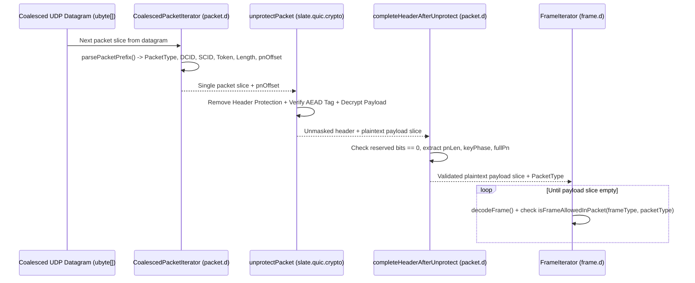

# Implementation Plan: `slate.quic.wire` — QUIC Wire Primitives, Headers, Frames & Transport Parameters (RFC 9000)

| Field | Value |
|---|---|
| **Owning Project** | `slate-dlang` (`slate-dlang/source/slate/quic/wire/`) |
| **Status** | `approved` |
| **Revision** | `1.0` |
| **Date** | `2026-10-14` |
| **Reference Specs** | RFC 9000 §5.1, §12.2, §12.4, §16, §17, §18, §19, §20.1 & Appendix A; RFC 9001 Appendix A.2–A.5 |
| **Reference Implementations** | Rust `quinn-proto` (`coding.rs`, `packet.rs`, `frame.rs`, `transport_parameters.rs`) & Go `quic-go/internal/wire/` |

---

## 1. Goal, Scope, and Non-Goals

### 1.1 Goal
Implement a 100% pure-D, zero-allocation (`@safe pure @nogc nothrow`), Sans-I/O QUIC wire framing subsystem (`slate.quic.wire`) covering Variable-Length Integers (`VarInt`), Connection IDs, Long/Short/Retry/VersionNegotiation Packet Headers, Coalesced Datagram Splitting, all 20 RFC 9000 §19 Frame types, and RFC 9000 §18 Transport Parameters—integrating directly with `slate.quic.crypto`.

### 1.2 Scope
1. **Variable-Length Integer & Buffer Cursors (`varint.d`)**:
   - RFC 9000 §16 62-bit `VarInt` encoding/decoding (`1`, `2`, `4`, `8` bytes, up to `VARINT_MAX = (1UL << 62) - 1`).
   - Fixed-width `encodeVarIntWithLen` (e.g., 2-byte Long Header `Length` field).
   - Bounds-checked, `@safe pure @nogc nothrow` slice cursors (`WireReader` and `WireWriter`) returning `WireError` codes instead of throwing GC exceptions.
2. **Connection IDs & Transport Error Codes (`cid.d`)**:
   - `ConnectionId` value struct (`0..20` bytes per RFC 9000 §17.2, with `invariant { assert(len <= 20); }`).
   - `StatelessResetToken` (`ubyte[16]`).
   - `TransportErrorCode` enum covering all RFC 9000 §20.1 transport error codes (`NO_ERROR = 0x00` through `NO_VIABLE_PATH = 0x10` and `CRYPTO_ERROR = 0x0100..0x01ff`).
3. **Packet Headers & Coalesced Datagram Splitter (`packet.d`)**:
   - Two-phase header parsing required by RFC 9001 §5.4:
     - **Phase A (Pre-Unprotect)**: `parsePacketPrefix` parses the unmasked invariant fields (`PacketType`, `version`, `dcid`, `scid`, `token`, `payloadAndPnLength`, `pnOffset`, and total packet byte length) so `CoalescedPacketIterator` can split coalesced UDP datagrams and pass `pnOffset` to `slate.quic.crypto.unprotectPacket`.
     - **Phase B (Post-Unprotect)**: `completeHeaderAfterUnprotect` validates reserved bits (`must be 0` or `PROTOCOL_VIOLATION` per RFC 9000 §17.2 / §17.3.1), extracts `pnLen` (`1..4`), `keyPhase` (Short Header), and reconstructs the 62-bit packet number via `decodePacketNumber`.
   - Full encoding and decoding of `Initial`, `0-RTT`, `Handshake`, `Retry`, `VersionNegotiation`, and `1-RTT` Short Header packets.
4. **All 20 Core QUIC Frame Types (`frame.d`)**:
   - Zero-copy `@safe pure @nogc nothrow` parser and serializer for all RFC 9000 §19 frames:
     `PADDING`, `PING`, `ACK` (with ECN and range compression/decompression), `RESET_STREAM`, `STOP_SENDING`, `CRYPTO`, `NEW_TOKEN`, `STREAM` (`OFF`/`LEN`/`FIN`), `MAX_DATA`, `MAX_STREAM_DATA`, `MAX_STREAMS`, `DATA_BLOCKED`, `STREAM_DATA_BLOCKED`, `STREAMS_BLOCKED`, `NEW_CONNECTION_ID`, `RETIRE_CONNECTION_ID`, `PATH_CHALLENGE`, `PATH_RESPONSE`, `CONNECTION_CLOSE` (`0x1c`/`0x1d`), and `HANDSHAKE_DONE` (`0x1e`).
   - RFC 9000 §12.4 Table 3 packet-type legality check (`isFrameAllowedInPacket(FrameType, PacketType)`).
5. **QUIC Transport Parameters (`transport_params.d`)**:
   - RFC 9000 §18 TLV serialization, parsing, duplicate-ID detection, unknown/grease parameter skipping, client-forbidden parameter checks, and bounds validation (`max_udp_payload_size >= 1200`, `ack_delay_exponent <= 20`, `max_ack_delay < 16384`, `active_connection_id_limit >= 2`).

### 1.3 Non-Goals
- Stream reassembly buffers, flow-control state machines, and loss-recovery timers (owned by `slate.quic.stream` and `slate.quic.recovery`).
- UDP socket I/O (owned by `slate.quic.endpoint`).

---

## 2. Evidence & Dataflow Analysis

### 2.1 Integration with Existing `slate.quic.crypto`
- [`slate-dlang/source/slate/quic/crypto/header_protection.d`](../../slate-dlang/source/slate/quic/crypto/header_protection.d) already exports `@safe @nogc nothrow pure` `encodePacketNumber`, `packetNumberLength`, and `decodePacketNumber`. `slate.quic.wire.packet` will reuse and re-export these functions rather than duplicating them.
- [`slate-dlang/source/slate/quic/crypto/packet_keys.d`](../../slate-dlang/source/slate/quic/crypto/packet_keys.d) exports `protectPacket(ref DirectionalKeys, ulong packetNumber, size_t pnLen, size_t pnOffset, ubyte[] packetBuffer, size_t plaintextLen)` and `unprotectPacket(ref DirectionalKeys, ulong largestAckedPn, size_t pnOffset, ubyte[] packetBuffer, out ulong outPacketNumber, out size_t outPayloadOffset, out size_t outPayloadLen)`.
- [`slate-dlang/source/slate/quic/crypto/tls_session.d`](../../slate-dlang/source/slate/quic/crypto/tls_session.d) exchanges raw `const(ubyte)[]` transport parameter blobs (`0x0039` extension), which `slate.quic.wire.transport_params` encodes and decodes directly.

### 2.2 Coalesced Packet Unpack -> Unprotect -> Frame Decode Dataflow



### 2.3 Failure Points (`F1`–`F6`)
- **`F1` (Truncated VarInt or Frame Payload)**: Malformed packets with a `VarInt` or length field exceeding remaining slice bytes must fail deterministically with `WireError.unexpectedEof` without out-of-bounds slice indexing.
- **`F2` (Non-Zero Reserved Header Bits — RFC 9000 §17.2 & §17.3.1)**: After header protection is removed, if Long Header bits `(firstByte & 0x0c) != 0` or Short Header bits `(firstByte & 0x18) != 0`, the parser must report `TransportErrorCode.protocolViolation`.
- **`F3` (Forbidden Frame in Packet Type — RFC 9000 §12.4 Table 3)**: Receiving `STREAM`, `MAX_DATA`, `NEW_CONNECTION_ID`, `HANDSHAKE_DONE`, or `CONNECTION_CLOSE (0x1d)` inside an `Initial` or `Handshake` packet must fail with `TransportErrorCode.protocolViolation`.
- **`F4` (Invalid Frame Semantics — RFC 9000 §19)**:
  - `ACK` frame where an `AckRange` gap/length underflows below packet number `0` $\rightarrow$ `TransportErrorCode.frameEncodingError`.
  - `NEW_CONNECTION_ID` with `cid.len == 0` or `cid.len > 20` or `retirePriorTo > sequenceNumber` $\rightarrow$ `TransportErrorCode.frameEncodingError`.
  - `MAX_STREAMS` / `STREAMS_BLOCKED` with stream count $> 2^{60}$ $\rightarrow$ `TransportErrorCode.frameEncodingError`.
  - `STREAM` frame where `offset + data.length >= (1UL << 62)` $\rightarrow$ `TransportErrorCode.frameEncodingError`.
- **`F5` (Invalid Transport Parameters — RFC 9000 §18.2)**:
  - Duplicate parameter IDs, out-of-range values (`max_udp_payload_size < 1200`, `ack_delay_exponent > 20`, `max_ack_delay >= 16384`, `active_connection_id_limit < 2`), or a client sending server-only parameters (`stateless_reset_token`, `original_destination_connection_id`, `retry_source_connection_id`) must fail with `TransportErrorCode.transportParameterError`.

---

## 3. Proposed Design and Material Decisions (`D1`–`D3`)

### `D1`: Zero-Copy `@safe pure @nogc nothrow` Value Structs with Fixed-Capacity Inline Storage
- **Problem**: QUIC parses and serializes frames on every single UDP packet arrival/departure. Allocating GC arrays for `ACK` ranges, `ConnectionId` bytes, or `VersionNegotiation` lists would violate `@nogc` on the packet hot path.
- **Selected Approach**:
  - `ConnectionId` stores `ubyte[20] bytes; ubyte len;` inline.
  - `Frame` is a value struct with a `FrameType type` discriminator and zero-copy slice views (`const(ubyte)[]`) pointing directly into the decrypted packet buffer for `CRYPTO`, `STREAM`, `NEW_TOKEN`, and `CONNECTION_CLOSE` reason phrases.
  - `AckFrame` stores up to `MAX_ACK_RANGES = 32` inline `AckRange` intervals (`ulong smallest; ulong largest;`), converting to/from RFC 9000 §19.3.1 wire `(gap, ack_range_length)` pairs on encode/decode.

### `D2`: Two-Stage Header Codec Matching RFC 9001 Header Protection
- **Problem**: Long headers encode the packet length (`Length` VarInt) *before* the packet number, and the packet number length (`1..4` bytes) is hidden behind Header Protection in the lower 2 bits of `firstByte`.
- **Selected Approach**:
  - **Encoding**: `encodeLongHeader` writes the header with a 2-byte `Length` VarInt (`encodeVarIntWithLen(pnLen + plaintextLen + 16, 2, ...)`), records `pnOffset`, and writes the unmasked `pnLen` bits and truncated packet number so `slate.quic.crypto.protectPacket` can encrypt and mask in place.
  - **Decoding**: `parsePacketPrefix` reads up to `pnOffset` without touching the masked bits, enabling `CoalescedPacketIterator` to split coalesced datagrams and hand each packet + `pnOffset` to `unprotectPacket`. Then `completeHeaderAfterUnprotect` reads the unmasked `firstByte`, checks reserved bits, and decodes the packet number.

---

## 4. EARS Requirements & Acceptance Scenarios

### 4.1 EARS Requirements

#### Ubiquitous Requirements
- **`U1`**: All public and internal functions across `slate.quic.wire` (`varint.d`, `cid.d`, `packet.d`, `frame.d`, `transport_params.d`) shall be `@safe` (or minimal verified `@trusted`), `pure`, `@nogc`, and `nothrow`.
- **`U2`**: All wire parsing functions shall return explicit status/error enums (`WireError` / `TransportErrorCode`) and shall never throw exceptions or read past slice bounds on truncated or malformed inputs.
- **`U3`**: Every `unittest` block in `slate.quic.wire` shall carry a `// Spec:` (citing the RFC 9000 / RFC 9001 section) or `// Best practice:` comment header AND a `/// Example:` DDoc block, and shall be annotated with `@nogc`.

#### Event-Driven Requirements
- **`E1` (RFC 9000 §16 & Appendix A.1 VarInt Codec)**: When encoding or decoding 1-byte (`<= 63`), 2-byte (`<= 16383`), 4-byte (`<= 1073741823`), and 8-byte (`<= 4611686018427387903`) variable-length integers—including non-minimal encodings—`encodeVarInt` and `decodeVarInt` shall match the RFC 9000 Appendix A.1 test vectors (`0xc2197c5eff14e88c` $\leftrightarrow$ `151288809941952652`, `0x9d7f3e7d` $\leftrightarrow$ `494878333`, `0x7bbd` $\leftrightarrow$ `15293`, `0x25` $\leftrightarrow$ `37`, and `0x4025` $\rightarrow$ `37`).
- **`E2` (Packet Header & Coalesced Datagram Codec — RFC 9000 §12.2 & §17)**: When encoding and decoding `Initial`, `0-RTT`, `Handshake`, `Retry`, `VersionNegotiation`, and `1-RTT` Short Header packets—including coalesced UDP datagrams containing `Initial` + `Handshake` + `1-RTT` packets—`slate.quic.wire.packet` shall preserve all header fields and split coalesced datagrams into exact packet slices.
- **`E3` (All 20 QUIC Frame Types — RFC 9000 §19)**: When encoding and decoding any of the 20 RFC 9000 §19 frame types (`PADDING` through `HANDSHAKE_DONE`), `encodeFrame` and `decodeFrame` shall round-trip every field losslessly, including multi-range `ACK` frames (converting descending `[smallest..largest]` intervals to/from wire `gap` and `ack_range_length`) and `STREAM` flag permutations (`OFF`, `LEN`, `FIN`).
- **`E4` (Transport Parameters TLV Codec — RFC 9000 §18)**: When encoding and decoding `TransportParameters`, `encodeTransportParams` and `decodeTransportParams` shall round-trip all standard parameters, ignore unknown/grease parameter IDs (RFC 9000 §18.1), and integrate with `TlsSession` (`SSL_set_quic_tls_transport_params`).
- **`E5` (End-to-End Wire + Crypto Integration — RFC 9001 Appendix A.2 & A.3)**: When unpacking the RFC 9001 Appendix A.2 (1200-byte Client Initial) and Appendix A.3 (135-byte Server Initial) protected packets using `parsePacketPrefix` $\rightarrow$ `unprotectPacket` $\rightarrow$ `completeHeaderAfterUnprotect` $\rightarrow$ `decodeFrame`, the pipeline shall extract the exact `Initial` header, `ACK` frame, `CRYPTO` frame, and `PADDING` frames.

#### Unwanted-Behavior Requirements
- **`W1` (Truncated Buffers & VarInt Overflow)**: If a `VarInt` value exceeds $2^{62}-1$ on encode, or if a buffer ends mid-VarInt, mid-header, or mid-frame on decode, the function shall return `WireError.varIntOverflow` or `WireError.unexpectedEof` without mutating output state.
- **`W2` (Non-Zero Reserved Bits & Illegal Frame/Packet Combinations)**:
  - If unmasked header reserved bits are non-zero (`(hdr[0] & 0x0c) != 0` on Long Header or `(hdr[0] & 0x18) != 0` on Short Header), `completeHeaderAfterUnprotect` shall return `TransportErrorCode.protocolViolation`.
  - If a frame disallowed in the enclosing `PacketType` (RFC 9000 §12.4 Table 3, such as `STREAM` or `HANDSHAKE_DONE` inside `Initial`) is decoded, `validateFrameInPacket` shall return `TransportErrorCode.protocolViolation`.
- **`W3` (Malformed Frame & Transport Parameter Bounds)**:
  - If an `ACK` frame range underflows below `0`, `NEW_CONNECTION_ID` has `retirePriorTo > sequenceNumber` or `cid.len == 0` or `cid.len > 20`, `MAX_STREAMS > (1UL << 60)`, or `NEW_TOKEN` is empty, `decodeFrame` shall return `TransportErrorCode.frameEncodingError`.
  - If `decodeTransportParams` encounters duplicate parameter IDs, `max_udp_payload_size < 1200`, `ack_delay_exponent > 20`, `max_ack_delay >= 16384`, `active_connection_id_limit < 2`, or server-only parameters sent by a client, it shall return `TransportErrorCode.transportParameterError`.

---

### 4.2 Acceptance Scenarios (`T1`–`T6`)

```gherkin
Scenario: T1 - RFC 9000 Appendix A.1 VarInt Encoding, Decoding, Non-Minimal & Overflow (covers U1, U2, U3, E1, W1)
  Given the RFC 9000 Appendix A.1 sample values (37, 15293, 494878333, 151288809941952652) and non-minimal [0x40, 0x25]
  When encodeVarInt and decodeVarInt are executed
  Then the encoded bytes and decoded integers match RFC 9000 Appendix A.1 byte-for-byte
  And attempting to encode (1UL << 62) returns WireError.varIntOverflow
  And attempting to decode truncated slices returns WireError.unexpectedEof

Scenario: T2 - Packet Headers, Coalesced Datagrams & Reserved Bit Validation (covers U1, E2, W2)
  Given a single UDP datagram buffer containing a coalesced Protected Initial packet, Protected Handshake packet, and Protected 1-RTT Short Header packet
  When CoalescedPacketIterator splits the datagram and each packet is unprotected and parsed via completeHeaderAfterUnprotect
  Then all three packets are cleanly separated, decrypted, and their PacketType, ConnectionIds, PacketNumbers, and KeyPhase match
  And setting a reserved bit on an unprotected Long or Short header triggers TransportErrorCode.protocolViolation

Scenario: T3 - All 20 QUIC Frame Types Round-Trip & ACK Range Compression (covers U1, E3, W2, W3)
  Given instances of all 20 RFC 9000 Section 19 frame types (including multi-range ACK frames with non-contiguous packet numbers [0..2, 5..7, 10..12] and STREAM frames with combinations of OFF, LEN, FIN)
  When each frame is serialized with encodeFrame and parsed back with decodeFrame
  Then every decoded frame matches the original struct field-for-field
  And invalid frames (ACK range underflow, NEW_CONNECTION_ID retirePriorTo > seq, MAX_STREAMS > 2^60, empty NEW_TOKEN) return TransportErrorCode.frameEncodingError
  And checking isFrameAllowedInPacket rejects STREAM and HANDSHAKE_DONE in Initial/Handshake packets with TransportErrorCode.protocolViolation

Scenario: T4 - QUIC Transport Parameters TLV Round-Trip & RFC 9000 Section 18.2 Validation (covers U1, E4, W3)
  Given a TransportParameters struct populated with custom flow-control limits, CIDs, and interleaved unknown/grease parameter IDs (e.g. 0x1b2a)
  When encoded and decoded via encodeTransportParams and decodeTransportParams
  Then all known parameters round-trip accurately and unknown grease parameters are ignored
  And duplicate parameter IDs, max_udp_payload_size < 1200, ack_delay_exponent > 20, max_ack_delay >= 16384, active_connection_id_limit < 2, or client-sent stateless_reset_token return TransportErrorCode.transportParameterError

Scenario: T5 - RFC 9001 Appendix A.2 & A.3 Full Packet Unpack + Unprotect + Frame Parse Pipeline (covers E2, E3, E5)
  Given the official RFC 9001 Appendix A.2 (1200-byte Client Initial) and Appendix A.3 (135-byte Server Initial) wire packets
  When processed through parsePacketPrefix -> unprotectPacket -> completeHeaderAfterUnprotect -> decodeFrame loop
  Then Appendix A.2 yields PacketNumber 2, a 241-byte CRYPTO frame at offset 0, and 935 PADDING bytes
  And Appendix A.3 yields PacketNumber 1, an ACK frame acknowledging [0..0], a 90-byte CRYPTO frame at offset 0, and PADDING

Scenario: T6 - End-to-End Sans-I/O Handshake Over Coalesced Wire Packets with Transport Parameters (covers E2, E3, E4, E5)
  Given a Client TlsSession and Server TlsSession configured with encoded TransportParameters structs
  When their TLS flights are packed into CRYPTO frames inside protected Initial and Coalesced Initial+Handshake QUIC packets, transmitted in memory, split, unprotected, and parsed back into CRYPTO frames
  Then both sides complete the TLS 1.3 handshake, decode each other's TransportParameters structs cleanly, and exchange a protected 1-RTT packet containing a STREAM frame
```

### 4.3 Coverage Matrix

| Scenario | Requirement IDs | Target Module | Layer |
|---|---|---|---|
| `T1` | `U1`, `U2`, `U3`, `E1`, `W1` | `source/slate/quic/wire/varint.d` | Unit (`@nogc`) |
| `T2` | `U1`, `U2`, `U3`, `E2`, `W2` | `source/slate/quic/wire/packet.d` | Unit (`@nogc`) |
| `T3` | `U1`, `U2`, `U3`, `E3`, `W2`, `W3` | `source/slate/quic/wire/frame.d` | Unit (`@nogc`) |
| `T4` | `U1`, `U2`, `U3`, `E4`, `W3` | `source/slate/quic/wire/transport_params.d` | Unit (`@nogc`) |
| `T5` | `U1`, `U3`, `E2`, `E3`, `E5` | `source/slate/quic/wire/package.d` | Integration (`@nogc`) |
| `T6` | `U1`, `U3`, `E2`, `E3`, `E4`, `E5` | `source/slate/quic/wire/package.d` | Integration (`@nogc`) |

---

## 5. Affected Files and Implementation Steps

| Action | Path | Purpose |
|---|---|---|
| `[NEW]` | `slate-dlang/source/slate/quic/wire/varint.d` | RFC 9000 §16 `VarInt` codec, `WireError`, `WireReader`, `WireWriter` (`T1`). |
| `[NEW]` | `slate-dlang/source/slate/quic/wire/cid.d` | `ConnectionId` (`0..20` bytes), `StatelessResetToken`, `TransportErrorCode` (RFC 9000 §20.1). |
| `[NEW]` | `slate-dlang/source/slate/quic/wire/packet.d` | Long/Short/Retry/VersionNegotiation headers, `parsePacketPrefix`, `completeHeaderAfterUnprotect`, `CoalescedPacketIterator` (`T2`). |
| `[NEW]` | `slate-dlang/source/slate/quic/wire/frame.d` | All 20 RFC 9000 §19 frames, `AckRange` compression/decompression, `isFrameAllowedInPacket`, frame validation (`T3`). |
| `[NEW]` | `slate-dlang/source/slate/quic/wire/transport_params.d` | RFC 9000 §18 `TransportParameters` TLV codec, validation rules, grease handling (`T4`). |
| `[NEW]` | `slate-dlang/source/slate/quic/wire/package.d` | Public re-exports + RFC 9001 Appendix A.2/A.3 full wire-to-frame pipeline (`T5`) and full Client $\leftrightarrow$ Server coalesced packet handshake test (`T6`). |

---

## 6. Verification Gates (`G1`–`G5`)

All commands run from `/home/developer/projects/slate/slate-dlang` with `PATH="/home/developer/dlang/dmd-2.113.0/linux/bin64:$PATH"`:

- **`G1` (`@safe pure @nogc nothrow` Enforcement)**: Every function and `unittest` across `source/slate/quic/wire/` compiles with `@safe` (or minimal `@trusted`), `pure` (except tests calling OpenSSL in `package.d`), `@nogc`, and `nothrow`.
- **`G2` (Zero Hardcoding / Authenticity)**: All frame, header, VarInt, and transport parameter codecs dynamically parse and serialize arbitrary inputs; RFC 9000 Appendix A.1 and RFC 9001 Appendix A.2/A.3 vectors are decoded dynamically.
- **`G3` (`UB-5` Doc Compliance)**: 100% of `unittest` blocks carry `// Spec:` (or `// Best practice:`) + `/// Example:`.
- **`G4` (Fuzz / Truncation Safety)**: Every decoder (`decodeVarInt`, `parsePacketPrefix`, `decodeFrame`, `decodeTransportParams`) is tested against every possible truncated prefix (`0 .. validLen - 1`) to prove zero out-of-bounds reads or crashes.
- **`G5` (Build & Test Suite)**: `dub test --force`, `dub test --config=integration --force`, and `dub build --build=docs` exit 0.

---

## 7. Approval & Execution Handoff

- **Workflow**: Upon user approval, this plan will be executed using the [`adversarial-tdd-workflow`](../skills/adversarial-tdd-workflow/SKILL.md) skill (`Model: "flash"` Implementor Subagent $\leftrightarrow$ Fresh-Context Read-Only `Model: "inherit"` Argon High Reviewer Subagent).
