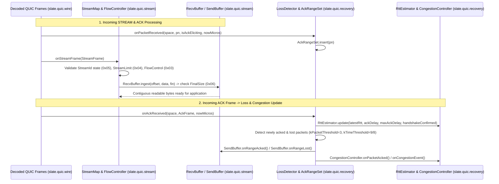

# Implementation Plan: `slate.quic.stream` & `slate.quic.recovery` — QUIC Streams, Flow Control & RFC 9002 Loss/Congestion Recovery

| Field | Value |
|---|---|
| **Owning Project** | `slate-dlang` (`slate-dlang/source/slate/quic/stream/` & `slate-dlang/source/slate/quic/recovery/`) |
| **Status** | `approved` |
| **Revision** | `1.1` |
| **Date** | `2026-10-14` |
| **Reference Specs** | RFC 9000 §2, §3, §4, §13.2, §13.3; RFC 9002 §5, §6, §7 |
| **Reference Implementations** | Rust `quinn-proto` (`connection/streams/`, `connection/spaces.rs`, `congestion/`) & Go `quic-go` (`internal/ackhandler/`, `internal/flowcontrol/`) |

---

## 1. Goal, Scope, and Non-Goals

### 1.1 Goal
Implement two Sans-I/O, deterministic, `@safe`/`@trusted @nogc nothrow` subsystems for QUIC:
1. **`slate.quic.stream`**: Stream ID classification, out-of-order byte-range reassembly (`RecvBuffer` for both `STREAM` and `CRYPTO` frames), retransmittable send buffer (`SendBuffer`), stream and connection flow control (`FlowController`), and stream lifecycle/concurrency enforcement (`StreamMap`) per **RFC 9000 §2–§4**.
2. **`slate.quic.recovery`**: Received packet number tracking and `AckFrame` generation (`AckRangeSet`), RTT estimation (`RttEstimator`), packet/time threshold loss detection and Probe Timeout (`LossDetector`), and NewReno congestion control (`CongestionController`) per **RFC 9002 §5–§7**.

### 1.2 Scope
1. **`slate.quic.stream` (`source/slate/quic/stream/`)**:
   - `id.d`: Stream ID bitfields (Client/Server initiator, Bidi/Uni directionality, 60-bit stream index), `SendStreamState` & `RecvStreamState` enums (RFC 9000 §2.1, §3.1, §3.2).
   - `recv_buffer.d`: Out-of-order byte-range assembler handling overlapping, duplicate, and adjacent chunks, `FIN` offset locking, and strict `FINAL_SIZE_ERROR (0x06)` validation (RFC 9000 §2.2, §4.5).
   - `send_buffer.d`: Retransmittable stream transmit buffer tracking unsent bytes, in-flight ranges, lost ranges (prioritized for retransmission per RFC 9000 §13.3), and acknowledged ranges.
   - `flow_control.d`: Per-stream and connection-level credit accounting, `FLOW_CONTROL_ERROR (0x03)` enforcement, monotonic `MAX_DATA` / `MAX_STREAM_DATA` updates, and window auto-tuning (`MAX_DATA` generation when $>50\%$ of window is consumed).
   - `stream_map.d`: Multiplexed stream table enforcing `STREAM_LIMIT_ERROR (0x04)`, `STREAM_STATE_ERROR (0x05)` (e.g., writing to a receive-only unidirectional stream or receiving data on a send-only unidirectional stream), implicit lower-index stream opening, and `RESET_STREAM` / `STOP_SENDING` state transitions.
2. **`slate.quic.recovery` (`source/slate/quic/recovery/`)**:
   - `ack_ranges.d`: Descending `AckRangeSet` with automatic interval coalescing, ack-eliciting packet counting (RFC 9000 §13.2.1 immediate ACK after 2 ack-eliciting packets), and `AckFrame` builder with encoded `ackDelay`.
   - `rtt.d`: RFC 9002 §5 `RttEstimator` (`initialRtt = 333ms`, `minRtt`, `smoothedRtt`, `rttVar`, `max_ack_delay` clamping, and `ptoBaseMicros`).
   - `congestion.d`: RFC 9002 §7 `CongestionController` (NewReno slow start, congestion avoidance, once-per-RTT recovery halving, `kMinimumWindow = 2 * maxDatagramSize`, and persistent congestion collapse).
   - `loss_detection.d`: RFC 9002 §6 `LossDetector` across the 3 packet number spaces (`Initial`, `Handshake`, `ApplicationData`), implementing `kPacketThreshold = 3`, `kTimeThreshold = 9/8`, Probe Timeout (`PTO`) timer calculation with exponential backoff (`1 << ptoCount`), and space discard (`bytesInFlight` reclamation per RFC 9002 §6.4).

### 1.3 Non-Goals
- Full `QuicConnection` packet-building loop and `QuicEndpoint` UDP routing (owned by Phase 4 `slate.quic.connection` & `slate.quic.endpoint`).
- HTTP/3 and QPACK (owned by Phase 5 `slate.h3`).

---

## 2. Evidence & Dataflow Analysis

### 2.1 Integration with Existing `slate.quic.wire` and `slate.quic.crypto`
- Consumes `AckFrame`, `AckRange`, `MAX_ACK_RANGES`, `StreamFrame`, `CryptoFrame`, `ResetStreamFrame`, `StopSendingFrame`, `MaxDataFrame`, `MaxStreamDataFrame`, `MaxStreamsFrame` from [`slate.quic.wire.frame`](../../slate-dlang/source/slate/quic/wire/frame.d).
- Consumes `TransportErrorCode` from [`slate.quic.wire.cid`](../../slate-dlang/source/slate/quic/wire/cid.d) and `TransportParameters` from [`slate.quic.wire.transport_params`](../../slate-dlang/source/slate/quic/wire/transport_params.d).
- Consumes `Side` and `EncryptionLevel` from [`slate.quic.crypto.kdf`](../../slate-dlang/source/slate/quic/crypto/kdf.d).

### 2.2 Stream & Recovery Dataflow



### 2.3 Failure Points (`F1`–`F6`)
- **`F1` (Final Size Violation — RFC 9000 §4.5)**:
  - Receiving data past an already known `finalSize`, receiving a second `FIN` at a different offset, or receiving a `FIN` (or `RESET_STREAM` `finalSize`) smaller than `highestReceivedOffset` must immediately fail with `TransportErrorCode.finalSizeError (0x06)`.
- **`F2` (Flow Control Overrun — RFC 9000 §4.1)**:
  - If `offset + data.length` exceeds the stream's `localMaxStreamData`, OR if the delta increase in `highestReceivedOffset` pushes the connection's total received bytes past `localMaxData`, the system must reject the frame with `TransportErrorCode.flowControlError (0x03)` without committing the overrun.
- **`F3` (Stream Limit & Directionality Violations — RFC 9000 §2.1 & §4.6)**:
  - Peer opening a stream with `streamIndex >= localMaxStreams` must fail with `TransportErrorCode.streamLimitError (0x04)`.
  - Peer sending `STREAM` or `RESET_STREAM` on a locally-initiated unidirectional stream, or sending `STOP_SENDING` on a remotely-initiated unidirectional stream, must fail with `TransportErrorCode.streamStateError (0x05)`.
- **`F4` (Overlapping Out-of-Order Chunk Corruption)**:
  - When `RecvBuffer.ingest` receives partially overlapping slices (e.g., `[0..10]`, `[15..25]`, then `[5..20]`), it must merge intervals and copy only non-overlapping byte regions without corrupting existing bytes or double-counting `highestReceivedOffset`.
- **`F5` (Spurious Multiple Congestion Reductions in One RTT — RFC 9002 §7.3.2)**:
  - When multiple packets sent in the same flight are declared lost by a single `ACK` frame, `CongestionController` must reduce `cwnd` only **once** for that recovery epoch (`timeSent <= congestionRecoveryStartTime` is ignored for subsequent losses in the same flight).
- **`F6` (`bytesInFlight` Accounting Leak on Space Discard — RFC 9002 §6.4)**:
  - When `Initial` or `Handshake` packet number spaces are discarded, any unacknowledged in-flight packets in that space must be subtracted from `bytesInFlight` so the congestion window does not permanently stall.

---

## 3. Proposed Design and Material Decisions (`D1`–`D3`)

### `D1`: C-Heap RAII Backing Buffers for `RecvBuffer` and `SendBuffer`
- **Problem**: Streams may buffer tens of kilobytes of out-of-order or unacknowledged data while remaining `@nogc nothrow`.
- **Selected Approach**: `RecvBuffer` and `SendBuffer` use non-copyable (`@disable this(this)`) RAII structs backed by `calloc`/`realloc`/`free` buffers and fixed inline interval arrays (`Interval[64]`), deterministic cleanup in `@nogc nothrow ~this()`, and explicit `moveFrom` support.

### `D2`: Explicit Monotonic Microsecond Timestamp (`ulong nowMicros`) Parameter
- **Problem**: Calling `MonoTime.currTime` inside `RttEstimator` or `LossDetector` makes unit testing time-threshold loss detection (`9/8 * RTT`) and `PTO` exponential backoff slow and non-deterministic.
- **Selected Approach**: Following `quinn-proto`, all recovery methods take an explicit `ulong nowMicros` monotonic timestamp parameter. Unit tests advance simulated time deterministically in microseconds with zero `Thread.sleep`.

---

## 4. EARS Requirements & Acceptance Scenarios

### 4.1 EARS Requirements

#### Ubiquitous Requirements
- **`U1`**: All functions across `slate.quic.stream` and `slate.quic.recovery` shall be `@safe` (or minimal verified `@trusted` for C-heap buffer management), `@nogc`, and `nothrow`.
- **`U2`**: All RAII structs owning C-heap memory (`RecvBuffer`, `SendBuffer`, `QuicStream`, `StreamMap`, `LossDetector`) shall disable copying (`@disable this(this)`) and release all memory in `@nogc nothrow ~this()`.
- **`U3`**: Every `unittest` block across `slate.quic.stream` and `slate.quic.recovery` shall carry a `// Spec:` (citing the RFC 9000 / RFC 9002 section) or `// Best practice:` comment header, a `/// Example:` DDoc block, and the `@nogc` attribute.

#### Event-Driven Requirements
- **`E1` (Out-of-Order Reassembly & Overlap Merging — RFC 9000 §2.2)**: When `RecvBuffer.ingest` receives out-of-order, duplicate, or partially overlapping byte chunks, it shall coalesce contiguous intervals and yield ordered bytes via `read()` up to the first missing byte gap, reporting `finReached = true` only when `readOffset == finalSize`.
- **`E2` (Retransmittable `SendBuffer` Priority — RFC 9000 §13.3)**: When `SendBuffer.pollTransmit` is called, it shall emit ranges marked lost via `onRangeLost` before emitting new unsent ranges, and shall mark the stream complete (`isAllAcked == true`) only after all written bytes and `FIN` are acknowledged via `onRangeAcked`.
- **`E3` (Flow Control & Stream Map — RFC 9000 §4)**: When `StreamMap` processes incoming `STREAM`, `RESET_STREAM`, `STOP_SENDING`, `MAX_DATA`, `MAX_STREAM_DATA`, and `MAX_STREAMS` frames, it shall update credit monotonically, implicitly open lower-indexed peer streams of the same type, and emit updated `MAX_DATA` / `MAX_STREAM_DATA` credits when $>50\%$ of the receive window has been consumed (`read`) by the application.
- **`E4` (`AckRangeSet` & `RttEstimator` — RFC 9000 §13.2 & RFC 9002 §5)**: When packet numbers are recorded in `AckRangeSet` and `ACK` frames are processed by `RttEstimator`, `AckRangeSet` shall coalesce contiguous packet numbers into descending `AckRange` intervals and encode `ackDelay`, while `RttEstimator` shall compute `minRtt`, `smoothedRtt`, `rttVar`, and `ptoBaseMicros` per RFC 9002 §5.3 & §6.2.
- **`E5` (Loss Detection, PTO & NewReno Congestion Control — RFC 9002 §6 & §7)**:
  - When an `ACK` frame acknowledges `largestAcked`, `LossDetector` shall declare unacknowledged packets lost if `largestAcked >= pn + 3` (`kPacketThreshold`) OR `nowMicros - timeSent >= (9 * max(latestRtt, smoothedRtt)) / 8` (`kTimeThreshold`).
  - When no `lossTime` is active and ack-eliciting packets are in flight, `LossDetector` shall arm the `PTO` timer at `lastAckElicitingTime + (ptoBase << ptoCount)`.
  - When packets are acknowledged or lost, `CongestionController` shall grow `cwnd` in Slow Start (`+ackedBytes`) or Congestion Avoidance (`+(maxDatagramSize * ackedBytes) / cwnd`), halve `cwnd` at most once per recovery RTT on loss, and reclaim `bytesInFlight` when a packet number space is discarded.

#### Unwanted-Behavior Requirements
- **`W1` (Final Size Violations — RFC 9000 §4.5)**: If a `STREAM` or `RESET_STREAM` frame changes an already known `finalSize`, writes beyond `finalSize`, or declares a `finalSize < highestReceivedOffset`, `RecvBuffer` / `StreamMap` shall return `TransportErrorCode.finalSizeError (0x06)` without modifying buffer state.
- **`W2` (Flow Control Overrun — RFC 9000 §4.1)**: If an incoming `STREAM` or `RESET_STREAM` frame exceeds the stream's `localMaxStreamData` or the connection's `localMaxData`, `FlowController` / `StreamMap` shall return `TransportErrorCode.flowControlError (0x03)` without advancing `highestReceived`.
- **`W3` (Stream Limit & State Violations — RFC 9000 §2.1, §3, §4.6)**:
  - If a peer opens a stream with `streamIndex >= localMaxStreams`, `StreamMap` shall return `TransportErrorCode.streamLimitError (0x04)`.
  - If a peer sends `STREAM`/`RESET_STREAM` on a locally-initiated unidirectional stream, or `STOP_SENDING` on a remotely-initiated unidirectional stream, `StreamMap` shall return `TransportErrorCode.streamStateError (0x05)`.

---

### 4.2 Acceptance Scenarios (`T1`–`T6`)

```gherkin
Scenario: T1 - Out-of-Order Reassembly, Overlapping Chunks & Final Size Validation (covers U1, U2, U3, E1, W1)
  Given a RecvBuffer
  When chunks at offsets [10..15] ("world"), [0..5] ("hello"), and overlapping [3..12] ("lo, wo") with FIN at offset 15 are ingested
  Then read() returns "hello, world" (15 bytes) only after the gap [5..10] is bridged and reports finReached == true
  And ingesting any byte at offset >= 15, a conflicting FIN at offset 14, or a FIN smaller than highestReceivedOffset returns TransportErrorCode.finalSizeError (0x06)

Scenario: T2 - SendBuffer Retransmission Priority & Full ACK Lifecycle (covers U1, U2, U3, E2)
  Given a SendBuffer with 1000 bytes written and FIN = true
  When [0..400] and [400..800] are transmitted via pollTransmit, and [0..400] is marked lost via onRangeLost
  Then the next pollTransmit(400) yields the lost range [0..400] BEFORE emitting the remaining unsent range [800..1000]
  And isAllAcked transitions to true only after [0..400], [400..800], and [800..1000]+FIN are acknowledged via onRangeAcked

Scenario: T3 - StreamMap Concurrency, Implicit Opening, Directionality & Flow Control (covers U1, U2, U3, E3, W2, W3)
  Given a Server StreamMap configured with initialMaxData = 100, initialMaxStreamDataBidiRemote = 60, initialMaxStreamsBidi = 2, initialMaxStreamsUni = 1
  When the Client sends a STREAM frame on bidirectional stream 4 (index 1)
  Then stream 0 (index 0) and stream 4 (index 1) are both opened
  And when the Client attempts to open bidirectional stream 8 (index 2), StreamMap returns TransportErrorCode.streamLimitError (0x04)
  And when the Client sends a STREAM frame on server-initiated unidirectional stream 3, StreamMap returns TransportErrorCode.streamStateError (0x05)
  And when the Client sends 65 bytes on stream 4 (> 60 limit) or 50 bytes on stream 0 + 55 bytes on stream 4 (> 100 connection limit), StreamMap returns TransportErrorCode.flowControlError (0x03)
  And when the Server reads > 50% of the window, FlowController signals a MAX_DATA / MAX_STREAM_DATA window update

Scenario: T4 - AckRangeSet Coalescing & RFC 9002 Section 5 RTT Estimator (covers U1, U3, E4)
  Given an AckRangeSet receiving packet numbers [0, 2, 5, 6, 7, 1] out of order
  When buildAckFrame is called after 16ms with ackDelayExponent = 3
  Then AckFrame contains 2 descending ranges ([5..7] and [0..2]) and encoded ackDelay = 2000 >> 3 = 250
  And when RttEstimator processes initial sample 100ms and second sample 120ms (with 20ms ackDelay, maxAckDelay 25ms, handshakeConfirmed = true)
  Then smoothedRtt, rttVar, minRtt, and ptoBaseMicros match RFC 9002 Section 5.3 formulas exactly

Scenario: T5 - RFC 9002 Section 6 Packet Threshold (k=3), Time Threshold (9/8 RTT), PTO & Space Discard (covers U1, U2, U3, E5)
  Given a LossDetector with 5 sent in-flight packets (PN 0..4) at t = 0..4ms and smoothedRtt = 80ms
  When an ACK for PN 4 arrives at t = 50ms
  Then PN 0 and PN 1 (4 - pn >= 3) are immediately declared lost via kPacketThreshold = 3
  And PN 2 and PN 3 remain in flight with lossTime armed at timeSent + (9 * 80ms) / 8 = timeSent + 90ms
  And when time advances to t = 95ms, detectLostPackets declares PN 2 and PN 3 lost via kTimeThreshold
  And when Initial/Handshake space is discarded via discardSpace, all unacked bytesInFlight in that space are reclaimed

Scenario: T6 - RFC 9002 Section 7 NewReno Congestion Control & Single-Reduction-Per-RTT Recovery (covers U1, U3, E5)
  Given a CongestionController with maxDatagramSize = 1200 (initial cwnd = 12000)
  When packets are acknowledged in Slow Start, cwnd grows by ackedBytes
  And when two packets (PN 5 and PN 6) sent before recovery are both declared lost at t = 100ms
  Then cwnd halves exactly ONCE to 6000 (ssthresh = 6000) rather than halving twice
  And subsequent ACKs grow cwnd linearly in Congestion Avoidance by (1200 * ackedBytes) / cwnd
```

### 4.3 Coverage Matrix

| Scenario | Requirement IDs | Target Module | Layer |
|---|---|---|---|
| `T1` | `U1`, `U2`, `U3`, `E1`, `W1` | `source/slate/quic/stream/recv_buffer.d` | Unit (`@nogc`) |
| `T2` | `U1`, `U2`, `U3`, `E2` | `source/slate/quic/stream/send_buffer.d` | Unit (`@nogc`) |
| `T3` | `U1`, `U2`, `U3`, `E3`, `W1`, `W2`, `W3` | `source/slate/quic/stream/flow_control.d`, `stream_map.d` | Unit & Integration (`@nogc`) |
| `T4` | `U1`, `U3`, `E4` | `source/slate/quic/recovery/ack_ranges.d`, `rtt.d` | Unit (`@nogc`) |
| `T5` | `U1`, `U2`, `U3`, `E5` | `source/slate/quic/recovery/loss_detection.d` | Unit (`@nogc`) |
| `T6` | `U1`, `U3`, `E5` | `source/slate/quic/recovery/congestion.d` | Unit (`@nogc`) |

---

## 5. Affected Files and Implementation Steps

| Action | Path | Purpose |
|---|---|---|
| `[NEW]` | `slate-dlang/source/slate/quic/stream/id.d` | Stream ID bitfields, initiator/directionality helpers, `SendStreamState` & `RecvStreamState` (RFC 9000 §2.1, §3). |
| `[NEW]` | `slate-dlang/source/slate/quic/stream/recv_buffer.d` | Out-of-order byte-range reassembly buffer with overlap merging and `FINAL_SIZE_ERROR` enforcement (`T1`). |
| `[NEW]` | `slate-dlang/source/slate/quic/stream/send_buffer.d` | Retransmittable stream send buffer with lost-range priority and ACK tracking (`T2`). |
| `[NEW]` | `slate-dlang/source/slate/quic/stream/flow_control.d` | Stream & connection `FlowController`, `FLOW_CONTROL_ERROR` checks, monotonic `MAX_DATA` updates, and window auto-tuning (`T3`). |
| `[NEW]` | `slate-dlang/source/slate/quic/stream/stream_map.d` | Multiplexed `StreamMap` enforcing `STREAM_LIMIT_ERROR`, `STREAM_STATE_ERROR`, implicit stream opening, and `RESET_STREAM`/`STOP_SENDING` (`T3`). |
| `[NEW]` | `slate-dlang/source/slate/quic/stream/package.d` | Public re-exports for `slate.quic.stream`. |
| `[NEW]` | `slate-dlang/source/slate/quic/recovery/ack_ranges.d` | `AckRangeSet` packet number tracker, interval coalescing, immediate-ACK counter, and `AckFrame` builder (`T4`). |
| `[NEW]` | `slate-dlang/source/slate/quic/recovery/rtt.d` | RFC 9002 §5 `RttEstimator` (`minRtt`, `smoothedRtt`, `rttVar`, `ptoBaseMicros`) (`T4`). |
| `[NEW]` | `slate-dlang/source/slate/quic/recovery/congestion.d` | RFC 9002 §7 `CongestionController` (NewReno Slow Start, Congestion Avoidance, once-per-RTT recovery, persistent congestion) (`T6`). |
| `[NEW]` | `slate-dlang/source/slate/quic/recovery/loss_detection.d` | RFC 9002 §6 `LossDetector` (`kPacketThreshold = 3`, `kTimeThreshold = 9/8`, `PTO` timer, space discard) (`T5`). |
| `[NEW]` | `slate-dlang/source/slate/quic/recovery/package.d` | Public re-exports for `slate.quic.recovery` + end-to-end Stream + Loss Recovery retransmission loop test. |

---

## 6. Verification Gates (`G1`–`G5`)

All commands run from `/home/developer/projects/slate/slate-dlang` with `PATH="/home/developer/dlang/dmd-2.113.0/linux/bin64:$PATH"`:

- **`G1` (`@safe`/`@trusted @nogc nothrow` Enforcement)**: Every function and `unittest` across `source/slate/quic/stream/` and `source/slate/quic/recovery/` compiles with `@nogc nothrow`.
- **`G2` (Zero Hardcoding / Authenticity)**: All reassembly, flow control, RTT, loss detection, and congestion control algorithms compute outputs dynamically from state.
- **`G3` (`UB-5` Doc Compliance)**: 100% of `unittest` blocks carry `// Spec:` (or `// Best practice:`) + `/// Example:` + `@nogc`.
- **`G4` (RAII Leak Check)**: High-iteration creation/destruction test of `RecvBuffer`, `SendBuffer`, `StreamMap`, and `LossDetector` verifies zero C-heap memory leaks.
- **`G5` (Build & Test Suite)**: `dub test --force`, `dub test --config=integration --force`, and `dub build --build=docs` exit 0.

---

## 7. Approval & Execution Handoff

- **Workflow**: Executed using the [`adversarial-tdd-workflow`](../skills/adversarial-tdd-workflow/SKILL.md) skill:
  1. **Implementor Subagent (`Model: "flash"`)**: Implements `slate.quic.stream` and `slate.quic.recovery` via TDD.
  2. **Fresh-Context Read-Only Adversarial Spec/TDD Reviewer (`Model: "inherit"` — Argon High)**: Audits anti-cheating, RFC 9000/9002 spec fidelity, and TDD coverage.
  3. **Fresh-Context Read-Only Security Auditor (`Model: "inherit"` — Argon High)**: Dedicated security audit for memory corruption (`@trusted` pointer arithmetic, buffer over-reads/over-writes, C-heap `realloc`/use-after-free/double-free), integer overflow/underflow in 62-bit stream offsets and flow-control math, DoS vectors (sparse stream creation exhaustion, interval fragmentation attacks in `RecvBuffer`/`SendBuffer`/`AckRangeSet`, optimistic ACK / ACK range exhaustion, unbounded allocations), and state-machine bypasses.

