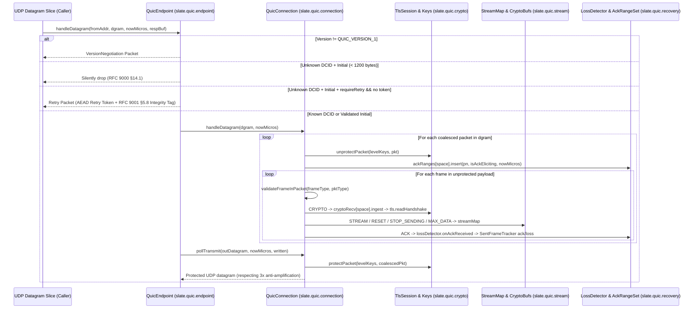

# Implementation Plan: `slate.quic.connection` & `slate.quic.endpoint` — Sans-I/O QUIC Connection State Machine & Server Endpoint

| Field | Value |
|---|---|
| **Owning Project** | `slate-dlang` (`slate-dlang/source/slate/quic/connection/` & `slate-dlang/source/slate/quic/endpoint/`) |
| **Status** | `approved` |
| **Revision** | `1.0` |
| **Date** | `2026-10-14` |
| **Reference Specs** | RFC 9000 §5–§15, §17–§20; RFC 9001 §4.9, §5.8, §6; RFC 9002 §6–§7 |
| **Reference Implementations** | Rust `quinn-proto` (`connection/mod.rs`, `endpoint.rs`) & Go `quic-go` (`connection.go`, `transport.go`) |

---

## 1. Goal, Scope, and Non-Goals

### 1.1 Goal
Assemble the completed `slate.quic.crypto`, `slate.quic.wire`, `slate.quic.stream`, and `slate.quic.recovery` subsystems into:
1. **`slate.quic.connection`**: A deterministic, Sans-I/O, `@safe`/`@trusted @nogc nothrow` `QuicConnection` state machine supporting both Server and Client roles, coalesced packet ingestion and packing, in-flight `CRYPTO`/`STREAM` frame loss retransmission, anti-amplification enforcement, RFC 9001 §4.9 key/space discard rules, path validation (`PATH_CHALLENGE` / `PATH_RESPONSE`), 1-RTT key updates, and `CLOSING`/`DRAINING` connection teardown.
2. **`slate.quic.endpoint`**: A deterministic, Sans-I/O Server `QuicEndpoint` multiplexer routing incoming UDP datagrams by Destination Connection ID (`DCID`), emitting `VersionNegotiation` packets, generating and verifying AEAD-authenticated stateless `Retry` tokens and `Retry` packets (RFC 9000 §8.1, RFC 9001 §5.8), and emitting Stateless Reset packets (RFC 9000 §10.3).

### 1.2 Scope
1. **`slate.quic.connection` (`source/slate/quic/connection/`)**:
   - `events.d`: Bounded `@nogc` event queue (`ConnectionEvent`, `ConnectionEventType`) for surfacing `handshakeConfirmed`, `streamReadable`, `streamWritable`, `streamFinished`, `streamReset`, `stopSending`, and `connectionClosed` events to higher layers (`slate.h3`).
   - `sent_frames.d`: Per-packet in-flight frame ledger (`SentFrameTracker`) mapping `(PacketNumberSpace, ulong pn)` to transmitted `CRYPTO` slices, `STREAM` slices, and `HANDSHAKE_DONE` flags so ACK and loss events from `LossDetector` automatically trigger `onRangeAcked` / `onRangeLost` on the appropriate `SendBuffer`.
   - `connection.d`: `QuicConnection` state machine (`handshaking`, `active`, `closing`, `draining`, `closed`) integrating `TlsSession`, `Keys[4]`, `KeyPhaseUpdater`, `TransportParameters`, `SendBuffer[3]` / `RecvBuffer[3]` for `CRYPTO` frames, `StreamMap`, `AckRangeSet[3]`, `LossDetector`, and `SentFrameTracker`.
   - `package.d`: Public re-exports and full Client $\leftrightarrow$ Server connection tests (handshake, stream multiplexing, packet loss recovery, key update, and close).
2. **`slate.quic.endpoint` (`source/slate/quic/endpoint/`)**:
   - `token.d`: `SocketAddr` value struct and `RetryTokenCodec` using `AeadKey` (`AES-256-GCM`) to seal and authenticate `(SocketAddr, ConnectionId origDcid, ConnectionId retryScid, ulong timestampMicros)` with token lifetime validation and tamper rejection (`TransportErrorCode.invalidToken = 0x0b`).
   - `endpoint.d`: `QuicEndpoint` server connection table routing by `DCID`, handling new Client `Initial` datagrams (< 1200-byte drop per RFC 9000 §14.1), `VersionNegotiation`, optional stateless `Retry`, and Stateless Reset.
   - `package.d`: Public re-exports and multi-client Server Endpoint integration tests.

### 1.3 Non-Goals
- HTTP/3 frame framing and QPACK header compression (owned by Phase 5 `slate.h3`).
- OS UDP socket event loop (owned by Phase 6 `slate.h3.server`).

---

## 2. Evidence & Dataflow Analysis

### 2.1 End-to-End Sans-I/O Connection & Endpoint Dataflow



### 2.2 Failure & Security Points (`F1`–`F7`)
- **`F1` (Pre-Validation 3x Amplification Attack — RFC 9000 §8.1)**:
  - Before a server has validated the client's address (via a valid `Retry` token or by successfully unprotecting a client `Handshake` packet), `QuicConnection` must strictly cap `totalBytesSent <= 3 * totalBytesReceived`.
- **`F2` (Undersized Client Initial Amplification — RFC 9000 §14.1)**:
  - A server receiving a UDP datagram carrying a Client `Initial` packet whose total UDP datagram size is `< 1200` bytes must silently drop the datagram without allocating a connection or sending a response.
- **`F3` (Tampered, Expired, or Replayed `Retry` Token — RFC 9000 §8.1.3 & §17.2.5)**:
  - If a Client `Initial` carries a non-empty token when `requireRetry == true` and AEAD decryption fails, the client `SocketAddr` or `retryScid` (`header.dcid`) mismatches, or the token timestamp is expired, the server must reject the connection with `TransportErrorCode.invalidToken (0x0b)`.
- **`F4` (Improper Key / Space Discard Timing — RFC 9001 §4.9)**:
  - Discarding `Initial` keys too late leaves the server vulnerable to forged `Initial` packets; discarding them without calling `lossDetector.discardSpace(PacketNumberSpace.initial)` leaks `bytesInFlight`. Server must discard `Initial` keys/space immediately upon processing the first valid Client `Handshake` packet, and Client must discard `Initial` keys/space immediately upon sending its first `Handshake` packet.
- **`F5` (Lost `CRYPTO` or `STREAM` Frame Deadlock — RFC 9000 §13.3)**:
  - If an `Initial`, `Handshake`, or `1-RTT` packet carrying `CRYPTO`, `STREAM`, or `HANDSHAKE_DONE` frames is declared lost by `LossDetector` (via packet threshold, time threshold, or PTO), `SentFrameTracker` must notify the corresponding `SendBuffer.onRangeLost` (or re-queue `HANDSHAKE_DONE`) so `pollTransmit` retransmits the lost data in a new packet.
- **`F6` (Forbidden Frame in Encryption Level — RFC 9000 §12.4 Table 3)**:
  - Receiving a `STREAM` or `HANDSHAKE_DONE` frame inside an `Initial` or `Handshake` packet (or any frame rejected by `isFrameAllowedInPacket`) must immediately transition the connection to `closing` with `TransportErrorCode.protocolViolation (0x0a)`.
- **`F7` (Unbounded In-Flight Frame Ledger or Connection Table DoS)**:
  - `SentFrameTracker` and `QuicEndpoint` must enforce hard capacity ceilings, compact retired entries upon ACK/loss, and free all C-heap buffers deterministically in `@nogc nothrow ~this()`.

---

## 3. Proposed Design and Material Decisions (`D1`–`D3`)

### `D1`: `SentFrameTracker` for Automatic `CRYPTO` & `STREAM` Loss Recovery
- **Problem**: `LossDetector` tracks packet numbers and byte sizes, while `SendBuffer` tracks byte offsets `[offset, offset + len)`. A bridge is needed to map lost/acked packet numbers back to the exact stream/crypto ranges sent in each packet.
- **Selected Approach**: `SentFrameTracker` maintains a bounded per-space table of `SentPacketRecord` entries (up to 8 frame descriptors per packet: `CryptoSlice`, `StreamSlice`, `HandshakeDone`, `MaxData`). When `LossDetector.onAckReceived` or `onTimeout` reports newly acked or newly lost packet numbers, `QuicConnection` looks up and retires the corresponding `SentPacketRecord`, invoking `onRangeAcked` or `onRangeLost` on the target `SendBuffer`.

### `D2`: Coalesced Datagram Packing in `QuicConnection.pollTransmit`
- **Problem**: During the handshake, a server must emit `Initial` (`ACK` + `ServerHello` `CRYPTO`) and `Handshake` (`EncryptedExtensions`..`Finished` `CRYPTO`) in a single coalesced UDP datagram (padded to 1200 bytes when containing `Initial`), respecting `maxUdpPayloadSize`, `cwnd - bytesInFlight`, and the 3x anti-amplification budget.
- **Selected Approach**: `pollTransmit` iterates through `EncryptionLevel.Initial`, `Handshake`, and `OneRtt`, packing pending frames into the remaining slice of `outDatagram`, adding required `PADDING` when an `Initial` packet is present on client (or ack-eliciting server response), encrypting each packet in-place with `protectPacket`, and recording the packet in `LossDetector` and `SentFrameTracker`.

### `D3`: AEAD-Authenticated Stateless `RetryTokenCodec`
- **Problem**: Stateless `Retry` tokens must bind the client's source address, the client's `original_destination_connection_id` (`ODCID`), and the server's `retry_source_connection_id` without storing server-side state.
- **Selected Approach**: `RetryTokenCodec` uses an `AeadKey` (`AES-256-GCM`) initialized with a random or caller-supplied 32-byte server secret and a 12-byte nonce to encrypt and authenticate `[addressBytes, origDcid, retryScid, issuedMicros]`. Upon receiving a Client `Initial` with a token, the server verifies the tag, expiry, `SocketAddr`, and `DCID == retryScid`, and sets `originalDestinationConnectionId` and `retrySourceConnectionId` in the server's `TransportParameters` per RFC 9000 §7.3.

---

## 4. EARS Requirements & Acceptance Scenarios

### 4.1 EARS Requirements

#### Ubiquitous Requirements
- **`U1`**: All connection and endpoint hot-path functions (`handleDatagram`, `pollTransmit`, `pollEvent`, `onTimeout`, `openStream`, `streamWrite`, `streamRead`, `close`) across `slate.quic.connection` and `slate.quic.endpoint` shall be `@safe` or `@trusted`, `@nogc`, and `nothrow`.
- **`U2`**: All RAII structs owning C-heap resources (`QuicConnection`, `SentFrameTracker`, `ConnectionEventQueue`, `QuicEndpoint`) shall disable copying (`@disable this(this)`), support `moveFrom`, and release all resources in `@nogc nothrow ~this()`.
- **`U3`**: Every `unittest` block across `slate.quic.connection` and `slate.quic.endpoint` shall carry a `// Spec:` (citing the RFC 9000 / 9001 / 9002 section) or `// Best practice:` comment header, a `/// Example:` DDoc block, and the `@nogc` attribute.

#### Event-Driven Requirements
- **`E1` (Full Sans-I/O Handshake & Key Discard — RFC 9000 §7 & RFC 9001 §4.9)**:
  - When a Client and Server `QuicConnection` exchange datagrams via `pollTransmit` and `handleDatagram`, they shall complete the TLS 1.3 handshake (`ALPN "h3"`), exchange and validate `TransportParameters` (applying peer flow-control and stream limits to `StreamMap`), discard `Initial` keys/space per RFC 9001 §4.9.1, emit and process `HANDSHAKE_DONE (0x1e)`, discard `Handshake` keys/space per RFC 9001 §4.9.2, and emit `ConnectionEventType.handshakeConfirmed`.
- **`E2` (Multiplexed Stream Dataflow, Loss Retransmission & PTO Probe — RFC 9000 §13.3 & RFC 9002 §6)**:
  - When application data is written via `streamWrite`, `pollTransmit` shall pack `STREAM` frames into `1-RTT` packets and record them in `LossDetector` and `SentFrameTracker`.
  - When a packet carrying `CRYPTO` or `STREAM` data is declared lost (via packet threshold, time threshold, or PTO), `QuicConnection` shall mark the affected byte ranges lost via `onRangeLost` and retransmit them in subsequent `pollTransmit` calls.
  - When a PTO timer fires in `onTimeout`, `QuicConnection` shall allow transmitting 1–2 ack-eliciting probe packets (`CRYPTO`, lost/unsent `STREAM`, or `PING`).
- **`E3` (Path Validation, Key Update & Graceful Close — RFC 9000 §8.2, §10.2 & RFC 9001 §6)**:
  - When `QuicConnection` receives a `PATH_CHALLENGE` frame, it shall queue a `PATH_RESPONSE` frame echoing the exact 8-byte challenge data.
  - When a peer toggles the 1-RTT `keyPhase` bit or local `initiateKeyUpdate()` is called, `QuicConnection` shall rotate 1-RTT keys via `KeyPhaseUpdater`.
  - When `close(errorCode, reason)` is called or a valid `CONNECTION_CLOSE` frame is received, `QuicConnection` shall transition to `closing` / `draining` and emit `CONNECTION_CLOSE` on `pollTransmit`.
- **`E4` (Server `QuicEndpoint` Routing, `VersionNegotiation`, `Retry` & Stateless Reset — RFC 9000 §6, §8.1, §10.3)**:
  - When `QuicEndpoint.handleDatagram` receives a packet with an unsupported version, it shall emit a `VersionNegotiation` packet.
  - When `requireRetry == true` and a Client `Initial` arrives with an empty token, `QuicEndpoint` shall emit a valid `Retry` packet containing an AEAD-sealed Retry token and RFC 9001 §5.8 Retry Integrity Tag without allocating connection state.
  - When the Client resends `Initial` with the valid `Retry` token, `QuicEndpoint` shall verify the token, spawn a Server `QuicConnection` with `peerAddressValidated = true` and `originalDestinationConnectionId` / `retrySourceConnectionId` populated, and complete the handshake.

#### Unwanted-Behavior & Security Requirements
- **`W1` (Anti-Amplification & Undersized Initial Enforcement — RFC 9000 §8.1, §14.1)**:
  - If a Server `QuicConnection` has not validated the peer's address (`!peerAddressValidated`), `pollTransmit` shall refuse to emit bytes that would cause `totalBytesSent > 3 * totalBytesReceived`.
  - If a Client `Initial` datagram is `< 1200` bytes, `QuicConnection` / `QuicEndpoint` shall drop it silently without state mutation.
- **`W2` (Protocol, Frame & Transport Parameter Violations — RFC 9000 §12.4, §18, §19)**:
  - If a packet contains a frame forbidden in its packet type (`validateFrameInPacket`), invalid transport parameters, a phantom ACK for an unsent packet number, or a flow-control/stream-state/final-size error, `QuicConnection` shall transition to `closing` with the corresponding `TransportErrorCode` and emit a `CONNECTION_CLOSE (0x1c)` packet on the next `pollTransmit`.
- **`W3` (Tampered or Expired `Retry` Token Rejection — RFC 9000 §8.1.3)**:
  - If a Client `Initial` presents a tampered, expired, or address-mismatched `Retry` token, `QuicEndpoint` / `RetryTokenCodec` shall reject it with `TransportErrorCode.invalidToken (0x0b)`.

---

### 4.2 Acceptance Scenarios (`T1`–`T6`)

```gherkin
Scenario: T1 - Full Sans-I/O Client <-> Server Handshake, Key Discard & Stream Exchange (covers U1, U2, U3, E1, E2)
  Given a Client QuicConnection and a Server QuicConnection configured with TLS 1.3 Contexts ("h3") and TransportParameters
  When datagrams are exchanged in memory via pollTransmit and handleDatagram
  Then Client Initial is padded to >= 1200 bytes
  And Server discards Initial keys upon processing Client Handshake packet
  And both sides reach ConnectionState.active, confirm handshake via HANDSHAKE_DONE, discard Handshake keys, and exchange bidirectional STREAM data with FIN

Scenario: T2 - Packet Drop & Automatic Loss Recovery of STREAM and CRYPTO Frames (covers U1, U2, U3, E2, F5)
  Given an active Client <-> Server QuicConnection pair
  When Client writes 5 chunks on Stream 0 across 5 1-RTT packets and packet #2 is dropped in transit
  Then Server's ACK for packets 0, 1, 3, 4 triggers LossDetector kPacketThreshold=3 on Client
  And Client's SentFrameTracker marks Stream 0's lost byte range via onRangeLost
  And Client's next pollTransmit automatically retransmits the lost Stream 0 range so Server reads the full contiguous stream

Scenario: T3 - 3x Anti-Amplification Limit & Undersized Client Initial Drop (covers U1, U3, W1, F1, F2)
  Given an unvalidated Server QuicConnection receiving a 1200-byte Client Initial
  When Server has > 3600 bytes queued to send before Client's Handshake packet arrives
  Then Server pollTransmit emits at most 3600 bytes (3 * 1200) until Client address is validated
  And a Client Initial datagram of 1199 bytes is silently dropped without response

Scenario: T4 - Protocol Violation, PATH_CHALLENGE/RESPONSE, 1-RTT Key Update & Connection Close (covers U1, U3, E3, W2, F6)
  Given an active Client <-> Server QuicConnection pair
  When Client sends PATH_CHALLENGE([1,2,3,4,5,6,7,8]), Server responds with PATH_RESPONSE([1,2,3,4,5,6,7,8])
  And when Client initiates a 1-RTT Key Update (toggling keyPhase), Server decrypts and rotates its 1-RTT keys seamlessly
  And when an invalid packet (e.g. STREAM frame inside an Initial/Handshake packet) is injected, the receiver transitions to closing with TransportErrorCode.protocolViolation (0x0a) and emits CONNECTION_CLOSE

Scenario: T5 - Server QuicEndpoint Stateless Retry, Token Verification & Tamper Rejection (covers U1, U2, U3, E4, W3, F3)
  Given a Server QuicEndpoint with requireRetry = true
  When a Client sends an Initial packet without a token
  Then QuicEndpoint emits a Retry packet with a valid Retry Integrity Tag and allocates 0 connections
  And when the Client resends Initial with the Retry token and updated DCID, QuicEndpoint validates the token, creates the Server QuicConnection with originalDestinationConnectionId set, and completes the handshake
  And when an attacker tampers with the Retry token or replays it from a different IP/port, QuicEndpoint rejects it with TransportErrorCode.invalidToken (0x0b)

Scenario: T6 - Server QuicEndpoint Version Negotiation, Multi-Client Routing & Stateless Reset (covers U1, U2, U3, E4)
  Given a Server QuicEndpoint managing multiple concurrent Client QuicConnections
  When an unknown version packet arrives, QuicEndpoint emits a VersionNegotiation packet
  And when an unknown Short Header packet arrives, QuicEndpoint emits a Stateless Reset ending with the 16-byte StatelessResetToken
```

---

## 5. Affected Files and Implementation Steps

| Action | Path | Purpose |
|---|---|---|
| `[NEW]` | `slate-dlang/source/slate/quic/connection/events.d` | Bounded `@nogc` `ConnectionEventQueue` and `ConnectionEvent` types (`E1`–`E3`). |
| `[NEW]` | `slate-dlang/source/slate/quic/connection/sent_frames.d` | `SentFrameTracker` mapping `(PacketNumberSpace, pn)` to `CRYPTO`/`STREAM` ranges for automatic ACK and loss dispatch (`E2`, `F5`, `T2`). |
| `[NEW]` | `slate-dlang/source/slate/quic/connection/connection.d` | Sans-I/O `QuicConnection` state machine (`T1`–`T4`, `W1`, `W2`). |
| `[NEW]` | `slate-dlang/source/slate/quic/connection/package.d` | Public re-exports and end-to-end `QuicConnection` unit & integration tests. |
| `[NEW]` | `slate-dlang/source/slate/quic/endpoint/token.d` | `SocketAddr` and `RetryTokenCodec` (`AES-256-GCM` stateless Retry token seal/open) (`E4`, `W3`, `T5`). |
| `[NEW]` | `slate-dlang/source/slate/quic/endpoint/endpoint.d` | Server `QuicEndpoint` connection router, `VersionNegotiation`, `Retry`, and Stateless Reset (`E4`, `T5`, `T6`). |
| `[NEW]` | `slate-dlang/source/slate/quic/endpoint/package.d` | Public re-exports and multi-client `QuicEndpoint` integration tests. |

---

## 6. Verification Gates (`G1`–`G5`)

- **`G1` (`@safe`/`@trusted @nogc nothrow` Enforcement)**: Every hot-path method and `unittest` across `source/slate/quic/connection/` and `source/slate/quic/endpoint/` compiles with `@nogc nothrow`.
- **`G2` (Zero Hardcoding / Authenticity)**: All handshakes, packet protections, loss recovery loops, Retry tokens, and frame dispatches execute dynamically over real `slate.quic.crypto`, `wire`, `stream`, and `recovery` primitives.
- **`G3` (`UB-5` Doc Compliance)**: 100% of `unittest` blocks carry `// Spec:` (or `// Best practice:`) + `/// Example:` + `@nogc`.
- **`G4` (RAII & Security Bounds Check)**: High-iteration creation/destruction test of `QuicConnection` and `QuicEndpoint` verifies zero C-heap leaks, and fuzz/boundary tests verify anti-amplification, phantom ACK, and malformed packet resilience.
- **`G5` (Build & Test Suite)**: `dub test --force`, `dub test --config=integration --force`, and `dub build --build=docs` exit 0.

---

## 7. Approval & Execution Handoff

- **Workflow**: Executed via [`adversarial-tdd-workflow`](../skills/adversarial-tdd-workflow/SKILL.md):
  1. **Flash 3.8 TDD Implementor (`Model: "flash"`)**
  2. **Fresh-Context Read-Only Adversarial Spec/TDD Reviewer (`Model: "inherit"` — Gemini 4 Argon High)**
  3. **Fresh-Context Read-Only Dedicated Security Auditor (`Model: "inherit"` — Gemini 4 Argon High)**
