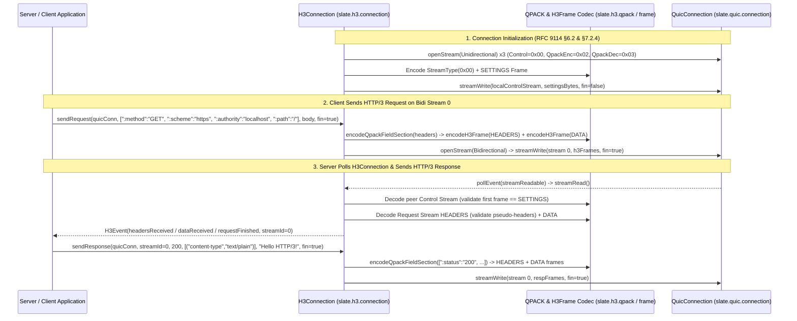

# Implementation Plan: `slate.h3` — HTTP/3 Framing, QPACK Header Compression & Sans-I/O HTTP/3 Connection (RFC 9114 & RFC 9204)

| Field | Value |
|---|---|
| **Owning Project** | `slate-dlang` (`slate-dlang/source/slate/h3/`) |
| **Status** | `in-review` |
| **Revision** | `1.0` |
| **Date** | `2026-10-15` |
| **Reference Specs** | RFC 9114 (HTTP/3 §4, §6, §7, §8), RFC 9204 (QPACK §4, §5, §6, Appendix A), RFC 7541 Appendix B (Huffman Code) |
| **Reference Implementations** | Rust `h3` / `quiche::h3` (`qpack/`, `frame.rs`, `connection.rs`) & Go `quic-go/http3` |

---

## 1. Goal, Scope, and Non-Goals

### 1.1 Goal
Implement a deterministic, Sans-I/O, `@safe`/`@trusted @nogc nothrow` **HTTP/3 (RFC 9114) and QPACK (RFC 9204)** protocol layer in `slate.h3` on top of `slate.quic`:
1. **`slate.h3.error`**: All RFC 9114 §8.1 HTTP/3 error codes (`0x0100..0x0110`), RFC 9204 §6 QPACK error codes (`0x0200..0x0202`), and unidirectional stream type identifiers (`0x00..0x03`).
2. **`slate.h3.qpack`**: Complete RFC 9204 QPACK header compression/decompression engine featuring the full 99-entry Static Table (RFC 9204 Appendix A), $N$-bit prefixed integer codec, RFC 7541 Appendix B canonical Huffman encoder/decoder with strict EOS padding validation, and field section encoder/decoder.
3. **`slate.h3.frame`**: HTTP/3 frame codec (`DATA`, `HEADERS`, `CANCEL_PUSH`, `SETTINGS`, `PUSH_PROMISE`, `GOAWAY`, `MAX_PUSH_ID`), GREASE frame/setting skipping, forbidden HTTP/2 frame/setting detection, and partial/incremental frame header + payload reader.
4. **`slate.h3.connection`**: Sans-I/O `H3Connection` state machine managing local and remote Control (`0x00`), QPACK Encoder (`0x02`), and QPACK Decoder (`0x03`) unidirectional streams, mandatory initial `SETTINGS` exchange, bidirectional HTTP/3 request/response stream framing, RFC 9114 §4.3 pseudo-header & message validation, and graceful `GOAWAY` shutdown.

### 1.2 Scope
1. **`source/slate/h3/error.d`**: `H3ErrorCode`, `H3UniStreamType`, `isGreaseValue`.
2. **`source/slate/h3/qpack.d`**: `H3HeaderField`, `QpackStaticEntry`, 99-entry static table, prefixed-int codec, Huffman encoder/decoder, `encodeQpackFieldSection`, `decodeQpackFieldSection`.
3. **`source/slate/h3/frame.d`**: `H3FrameType`, `H3SettingId`, `H3Settings`, `H3FrameHeader`, `encodeH3FrameHeader`, `decodeH3FrameHeader`, `encodeSettingsPayload`, `decodeSettingsPayload`, `encodeGoawayPayload`, `decodeGoawayPayload`.
4. **`source/slate/h3/connection.d`**: `H3EventType`, `H3Event`, `H3StreamTracker`, `H3Connection` driving `QuicConnection` (plus updating `StreamMap.hasPendingWritable` in `slate.quic.stream.stream_map` to include `resetQueued || stopSendingQueued`).
5. **`source/slate/h3/package.d`**: Public re-exports and full Client $\leftrightarrow$ Server HTTP/3 over QUIC end-to-end tests.

### 1.3 Non-Goals
- OS UDP socket server event loop and CLI binary (owned by Phase 6 `slate.h3.server`).

---

## 2. Evidence & Dataflow Analysis

### 2.1 HTTP/3 over QUIC Dataflow



### 2.2 Failure & Security Points (`F1`–`F7`)
- **`F1` (Missing or Duplicate `SETTINGS` on Control Stream — RFC 9114 §7.2.4)**:
  - If the first frame received on the peer's Control Stream is anything other than `SETTINGS (0x04)`, `H3Connection` must abort with `H3ErrorCode.missingSettings (0x010a)`.
  - If a second `SETTINGS` frame arrives on the Control Stream, `H3Connection` must abort with `H3ErrorCode.frameUnexpected (0x0105)`.
- **`F2` (Duplicate or Closed Critical Unidirectional Streams — RFC 9114 §6.2.1)**:
  - If a peer opens more than one Control (`0x00`), QPACK Encoder (`0x02`), or QPACK Decoder (`0x03`) stream, `H3Connection` must abort with `H3ErrorCode.streamCreationError (0x0103)`.
  - If the peer closes (`FIN`) or resets any of those 3 critical streams, `H3Connection` must abort with `H3ErrorCode.closedCriticalStream (0x0104)`.
- **`F3` (Forbidden HTTP/2 Frames & Settings — RFC 9114 §7.2.4.1 & §7.2.8)**:
  - Receiving reserved HTTP/2 frame types (`0x02`, `0x06`, `0x08`, `0x09`), receiving `DATA`/`HEADERS`/`PUSH_PROMISE` on the Control Stream, or receiving `SETTINGS`/`GOAWAY`/`MAX_PUSH_ID`/`CANCEL_PUSH` on a bidirectional request stream must fail with `H3ErrorCode.frameUnexpected (0x0105)`.
  - Receiving reserved HTTP/2 settings (`0x00`, `0x02`, `0x03`, `0x04`, `0x05`) or duplicate setting IDs must fail with `H3ErrorCode.settingsError (0x0109)`.
- **`F4` (Invalid QPACK Huffman Padding, EOS Symbol, or Out-of-Bounds Index — RFC 9204 §4.1.2 & RFC 7541 §5.2)**:
  - A Huffman-encoded string containing the EOS symbol (`256`), padding longer than 7 bits, or padding bits not all `1`s, or referencing a static table index `> 98` (or dynamic table when capacity is `0`) must fail with `H3ErrorCode.qpackDecompressionFailed (0x0200)`.
- **`F5` (Malformed HTTP/3 Pseudo-Headers or `Content-Length` Mismatch — RFC 9114 §4.1.2, §4.3, §10.3)**:
  - Requests missing `:method`, `:scheme`, or `:path` (for non-`CONNECT`), responses missing `:status`, pseudo-headers appearing after regular headers, duplicate pseudo-headers, uppercase characters in header names, CR/LF/NUL injection in header names/values, or `DATA` byte total mismatching `content-length` must fail with `H3ErrorCode.messageError (0x010e)`.
- **`F6` (QPACK Decompression Bomb / Excessive Field Section Size — RFC 9114 §7.2.4.1)**:
  - `decodeQpackFieldSection` and `H3Connection` must enforce `maxFieldSectionSize` and bounded header counts (`MAX_H3_HEADERS = 64`) so a compressed QPACK payload cannot expand into unbounded memory or CPU exhaustion.
- **`F7` (Fragmented / Multi-Chunk HTTP/3 Frame Delivery over QUIC Streams)**:
  - A single `HEADERS` or `DATA` frame may arrive split across multiple `QuicConnection` `streamRead` calls, or multiple HTTP/3 frames (`HEADERS` + `DATA` + trailing `HEADERS`) may arrive in a single `streamRead`. `H3Connection`'s per-stream parser must buffer and parse across arbitrary byte boundaries.

---

## 3. EARS Requirements & Acceptance Scenarios

### 3.1 EARS Requirements

#### Ubiquitous Requirements
- **`U1`**: All functions across `slate.h3` shall be `@safe` (or minimal verified `@trusted`), `@nogc`, and `nothrow`.
- **`U2`**: All RAII structs owning C-heap memory (`H3Connection`, per-stream buffers) shall disable copying (`@disable this(this)`), support `moveFrom`, and free all memory in `@nogc nothrow ~this()`.
- **`U3`**: Every `unittest` block across `slate.h3` shall carry a `// Spec:` (citing the RFC 9114 / RFC 9204 / RFC 7541 section) or `// Best practice:` comment header, a `/// Example:` DDoc block, and the `@nogc` attribute.

#### Event-Driven Requirements
- **`E1` (QPACK Static Table, Prefixed Int & Huffman Codec — RFC 9204 §4 & Appendix A)**:
  - When `encodeQpackFieldSection` encodes HTTP headers, it shall use exact static table matches (`Indexed Field Line`), static name matches (`Literal Field Line With Name Reference`), or literal names (`Literal Field Line With Literal Name`) with optional RFC 7541 Huffman compression, and `decodeQpackFieldSection` shall losslessly reconstruct the exact header fields.
- **`E2` (HTTP/3 Frame & Settings Codec — RFC 9114 §7)**:
  - When `H3Frame` and `H3Settings` are encoded and decoded, they shall preserve all RFC 9114 frame types and settings, and transparently skip unknown/GREASE frame types and setting IDs (`0x1f * N + 0x21`).
- **`E3` (Control Stream Initialization & Mandatory `SETTINGS` — RFC 9114 §6.2 & §7.2.4)**:
  - When `H3Connection.initConnection(quicConn)` is called, it shall open local Control (`0x00`), QPACK Encoder (`0x02`), and QPACK Decoder (`0x03`) unidirectional streams and queue the local `SETTINGS` frame as the first frame on the Control Stream.
- **`E4` (End-to-End Request/Response Multiplexing over `QuicConnection` — RFC 9114 §4.1)**:
  - When a Client `H3Connection` calls `sendRequest` and exchanges QUIC datagrams with a Server `H3Connection`, the Server shall emit `headersReceived`, `dataReceived`, and `requestFinished` events, and when the Server calls `sendResponse`, the Client shall receive the response status, headers, body, and completion event.

#### Unwanted-Behavior & Security Requirements
- **`W1` (Control Stream & Critical Stream Violations — RFC 9114 §6.2.1 & §7.2.4)**:
  - If the peer's first Control Stream frame is not `SETTINGS`, `H3Connection` shall close the QUIC connection with `H3ErrorCode.missingSettings (0x010a)`.
  - If the peer sends a second `SETTINGS` frame, sends `DATA`/`HEADERS` on the Control Stream, or sends `SETTINGS`/`GOAWAY` on a request stream, `H3Connection` shall close with `H3ErrorCode.frameUnexpected (0x0105)`.
  - If the peer opens duplicate critical unidirectional streams (`0x00`, `0x02`, `0x03`), `H3Connection` shall close with `H3ErrorCode.streamCreationError (0x0103)`; if the peer closes (`FIN`) or resets a critical stream, `H3Connection` shall close with `H3ErrorCode.closedCriticalStream (0x0104)`.
- **`W2` (Forbidden HTTP/2 Settings & QPACK Decompression Security — RFC 9114 §7.2.4.1 & RFC 9204 §4)**:
  - If a `SETTINGS` payload contains forbidden HTTP/2 setting IDs (`0x00`, `0x02`, `0x03`, `0x04`, `0x05`) or duplicate setting IDs, `decodeSettingsPayload` shall return `H3ErrorCode.settingsError (0x0109)`.
  - If a QPACK field section contains invalid Huffman padding, an EOS symbol in data, a static index `> 98`, a dynamic reference when `maxTableCapacity == 0`, or exceeds `maxFieldSectionSize`, `decodeQpackFieldSection` shall return `H3ErrorCode.qpackDecompressionFailed (0x0200)`.
- **`W3` (Malformed HTTP/3 Pseudo-Headers & Header Injection — RFC 9114 §4.1.2, §4.3, §10.3)**:
  - If a request/response field section has missing required pseudo-headers, unknown/duplicate pseudo-headers, pseudo-headers after regular headers, uppercase header names, CR/LF/NUL characters in names/values, or a `content-length` mismatch with received `DATA` bytes, `H3Connection` shall reject the message with `H3ErrorCode.messageError (0x010e)`.

---

### 3.2 Acceptance Scenarios (`T1`–`T6`)

```gherkin
Scenario: T1 - QPACK 99-Entry Static Table, Prefixed Int & Huffman Codec Verification (covers U1, U3, E1, W2, F4, F6)
  Given the QPACK encoder and decoder in slate.h3.qpack
  When encoding and decoding all 99 RFC 9204 Appendix A static entries, literal name references, and Huffman-compressed strings (e.g. "www.example.com", "custom-key: custom-value")
  Then decoded headers match the inputs byte-for-byte
  And invalid Huffman padding (non-1 bits or > 7 bits), out-of-bounds static index 99, dynamic index with capacity 0, and oversized field sections return H3ErrorCode.qpackDecompressionFailed (0x0200)

Scenario: T2 - HTTP/3 Frame & SETTINGS Codec, GREASE Skipping & Forbidden HTTP/2 Rejection (covers U1, U3, E2, W1, W2, F3)
  Given the HTTP/3 frame and SETTINGS codec in slate.h3.frame
  When encoding and decoding DATA, HEADERS, SETTINGS, GOAWAY, CANCEL_PUSH, PUSH_PROMISE, MAX_PUSH_ID, and GREASE frames/settings (0x21, 0x40)
  Then all valid frames round-trip and GREASE settings are ignored cleanly
  And reserved HTTP/2 frame types (0x02, 0x06, 0x08, 0x09) return H3ErrorCode.frameUnexpected (0x0105)
  And reserved HTTP/2 setting IDs (0x00, 0x02, 0x03, 0x04, 0x05) and duplicate setting IDs return H3ErrorCode.settingsError (0x0109)

Scenario: T3 - End-to-End HTTP/3 Client <-> Server Request/Response Multiplexing over QuicConnection (covers U1, U2, U3, E3, E4, F7)
  Given an active Client QuicConnection + H3Connection and Server QuicConnection + H3Connection
  When both initialize H3Connection, exchange SETTINGS over Control Streams, and Client sends a GET "/" request and a POST "/api/echo" request with body (including fragmented delivery)
  Then Server receives peerSettingsReceived, headersReceived, dataReceived, and requestFinished events
  And when Server sends 200 OK responses with headers and bodies, Client receives the complete 200 OK responses and bodies

Scenario: T4 - Control Stream & Critical Stream Protocol Violation Enforcement (covers U1, U2, U3, W1, F1, F2)
  Given an active H3Connection
  When the peer sends DATA or GOAWAY as the FIRST frame on its Control Stream (before SETTINGS)
  Then H3Connection aborts with H3ErrorCode.missingSettings (0x010a)
  And when the peer sends a second SETTINGS frame or DATA on its Control Stream, H3Connection aborts with H3ErrorCode.frameUnexpected (0x0105)
  And when the peer opens a second Control Stream (0x00) or closes (FIN) its Control Stream, H3Connection aborts with streamCreationError (0x0103) / closedCriticalStream (0x0104)

Scenario: T5 - HTTP/3 Message & Pseudo-Header Security Validation (covers U1, U2, U3, W3, F5)
  Given an active Server H3Connection
  When a Client sends a HEADERS frame with missing :path, pseudo-header after a regular header, duplicate :method, uppercase header name "Accept", CRLF injection in a header value, or DATA length mismatching content-length
  Then H3Connection rejects the malformed request with H3ErrorCode.messageError (0x010e)

Scenario: T6 - Graceful HTTP/3 GOAWAY & Server QuicEndpoint Integration (covers U1, U2, U3, E4)
  Given a Server QuicEndpoint + H3Connection serving a Client
  When Server sends GOAWAY and completes in-flight requests
  Then Client receives H3EventType.goawayReceived with the expected stream ID
```

---

## 4. Affected Files and Implementation Steps

| Action | Path | Purpose |
|---|---|---|
| `[MODIFY]` | `slate-dlang/source/slate/quic/stream/stream_map.d` | Include `resetQueued \|\| stopSendingQueued` in `hasPendingWritable()` so control-only 1-RTT packets are transmitted immediately. |
| `[NEW]` | `slate-dlang/source/slate/h3/error.d` | RFC 9114 §8.1 & RFC 9204 §6 `H3ErrorCode`, `H3UniStreamType`, and GREASE helpers. |
| `[NEW]` | `slate-dlang/source/slate/h3/qpack.d` | RFC 9204 QPACK codec: 99-entry Static Table, prefixed integers, RFC 7541 Appendix B Huffman encoder/decoder, and field section encoder/decoder (`T1`). |
| `[NEW]` | `slate-dlang/source/slate/h3/frame.d` | RFC 9114 §7 HTTP/3 frame & `SETTINGS` codec, GREASE skipping, and forbidden HTTP/2 detection (`T2`). |
| `[NEW]` | `slate-dlang/source/slate/h3/connection.d` | Sans-I/O `H3Connection` state machine, stream framing, critical stream & message validation (`T3`–`T6`). |
| `[NEW]` | `slate-dlang/source/slate/h3/package.d` | Public re-exports and end-to-end HTTP/3 over QUIC tests (`T1`–`T6`, `G4`). |

---

## 5. Verification Gates (`G1`–`G5`)

- **`G1` (`@safe`/`@trusted @nogc nothrow` Enforcement)**: Every function and `unittest` across `source/slate/h3/` compiles with `@nogc nothrow`.
- **`G2` (Zero Hardcoding / Authenticity)**: All 99 QPACK static table entries, Huffman bit-packing/tree-decoding, and HTTP/3 stream framing operate dynamically without stubs.
- **`G3` (`UB-5` Doc Compliance)**: 100% of `unittest` blocks carry `// Spec:` (or `// Best practice:`) + `/// Example:` + `@nogc`.
- **`G4` (RAII & Decompression Bomb Security Check)**: High-iteration creation/destruction test of `H3Connection` and fuzz/truncation tests across QPACK and HTTP/3 frame decoders verify zero leaks and zero out-of-bounds accesses.
- **`G5` (Build & Test Suite)**: `dub test --force`, `dub test --config=integration --force`, and `dub build --build=docs` exit 0.

---

## 6. Approval & Execution Handoff

- **Workflow**: Executed via [`adversarial-tdd-workflow`](../skills/adversarial-tdd-workflow/SKILL.md):
  1. **TDD Implementor (`Model: "pro"` with Low Thinking)**
  2. **Fresh-Context Read-Only Adversarial Spec/TDD Reviewer (`Model: "inherit"` — Gemini 4 Argon High)**
  3. **Fresh-Context Read-Only Dedicated Security Auditor (`Model: "inherit"` — Gemini 4 Argon High)**
