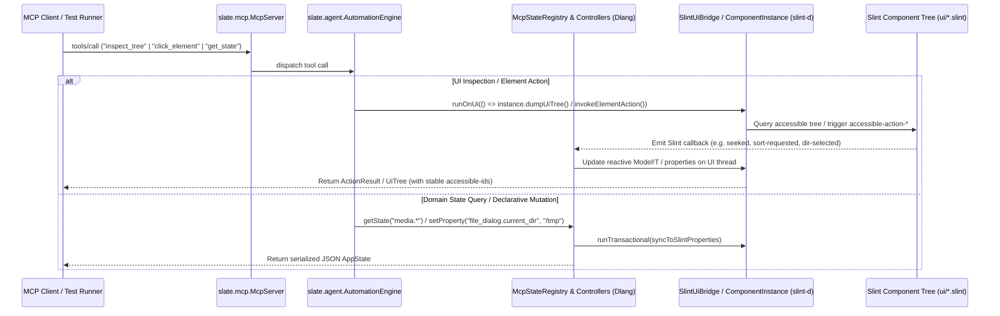

# Plan: Default Layouts, Data Representations, Media Player, File/Drop Components & Declarative MCP Integration (Dlang + Slint)

- **Owning Projects**: `ui/`, `slint-d/`, `slate-dlang/`
- **Status**: `approved`
- **Revision**: 2
- **Timestamp**: 2026-10-15T15:40:00Z
- **Author**: Antigravity

---

## 1. Goal, Scope, and Non-Goals

### Goal
Provide Slate with a comprehensive, batteries-included library of default **Layouts**, **Data Representations**, a **Media Player (`SlateMediaPlayer`)**, and **File/Upload/Drag-and-Drop (`SlateDropzone`, `SlateDragDrop`, `SlateFileDialog`)** components built in **Slint (`ui/`)** and driven by **Dlang (`slint-d` + `slate-dlang`)**, with first-class **three-tier testability** and **trait/interface-based declarative Model Context Protocol (MCP) control integration**.

### Scope
1. **Trait/Interface-Driven MCP & Accessibility Bridge (`slint-d` + `slate-dlang` + `ui/components/mcp.slint`)**:
   - **Dlang MCP Capability Interfaces & Mixin Traits (`slate.agent.traits`)**:
     - Define runtime capability interfaces (`McpControllable`, `McpBindable`, `McpSeekable`, `McpSortable`, `McpFilterable`, `McpExpandable`, `McpDropReceiver`, `McpSelectable`) paired with `mixin template McpControllableMixin()` (which auto-implements the interface via compile-time UDA reflection over `@McpState`, `@McpWritable`, `@McpAction`) and Design-by-Introspection (DbI) trait templates (`isMcpControllable!T`).
   - **Slint Declarative MCP Trait Primitives (`ui/components/mcp.slint`)**:
     - Define `export global SlateMcp` (shared callback bus between `.slint` components and Dlang) and composable trait wrapper components (`SlateMcpControl`, `SlateMcpRegion`, `SlateMcpValueTarget`) that standardize `accessible-id`, `accessible-description` capability tags, and `accessible-action-*` forwarding.
   - **C-ABI Semantic Actions (`slint-d`)**:
     - Extend [slint-d/bridge/src/lib.rs](../../slint-d/bridge/src/lib.rs) and [slint-d/source/slint/instance.d](../../slint-d/source/slint/instance.d) with full semantic accessibility action dispatch (`SetValue`, `Increment`, `Decrement`, `Expand`), `id_stable` provenance reporting, and W2 duplicate-`accessible-id` rejection in `dumpUiTree()`.
   - Implement `slate.agent.slint_backend` (`SlintUiInspector`, `SlintElementController`, `SlintVisualRenderer`) and `McpStateRegistry` in `slate-dlang`.
   - Add compile-time struct-to-`SlintStruct` mapping (`toSlintStruct!T` / `fromSlintStruct!T`) in [slint-d/source/slint/value.d](../../slint-d/source/slint/value.d).
2. **Layouts (`ui/layouts/` + Dlang Layout Controllers)**:
   - **Core P0 Layouts**: `SlateSplitView` (upgrading [ui/layouts/resizable_panel_group.slint](../../ui/layouts/resizable_panel_group.slint)), `SlateMasterDetailLayout`, `SlatePageHeader` + `SlateBreadcrumbs`, `SlateBentoGrid`.
   - **P1/P2 Workspace & Flow Layouts**: `SlateDockLayout` (Left/Right/Bottom collapsible tool docks + center tabbed workspace), `SlateFormLayout` + `SlateFieldGroup`, `SlateStatusBar` + `SlateToolbar`, `SlateWizardLayout` (multi-step stepper), `SlateWrapLayout`.
3. **Data Representations (`ui/components/` + Dlang Reactive Models)**:
   - **Core P0 Data Views**: `SlateDataGrid` (dynamic columns, sort indicators, row selection, filter bar, pagination; paired with `DataGridController!T`), `SlateTreeView` (expandable hierarchical tree; paired with flattened `TreeModel!T`), `SlateDescriptionList` (key-value inspector with copy actions), `SlateStatGroup` (KPI strip with delta badges and sparklines).
   - **P1/P2 Visual & Stream Data Views**: `SlateSparkline`, `SlateBarChart`, `SlateLineChart`, `SlateDonutChart` (driven by pure-D SVG path generator `slate.utils.chart`), `SlateTimeline` (chronological activity feed), `SlateLogViewer` (backed by `RingBufferLogModel`), `SlateKanbanBoard`, `SlateTagList`.
4. **General, Media & File System Components (`ui/components/` + Dlang Controllers)**:
   - **`SlateMediaPlayer`**: Unified video/audio/mini-bar player with video `Image` viewport, audio waveform/artwork fallback, 3-layer scrubber (track, buffered, playhead) with chapter markers, transport controls, volume/mute slider, playback speed/repeat/shuffle toggles, and `MediaPlayerController` with pluggable `MediaBackend` (`SimulatedMediaBackend` default).
   - **`SlateDropzone` (`SlateUploadBox`)**: Drag-and-drop upload box (`hero` and `compact` variants) with `idle`, `drag-active`, and `drag-invalid` states, staged file upload queue with per-file progress and status badges, and `UploadQueueController`.
   - **`SlateDragDrop`**: `SlateDraggable` and `SlateDropTarget` Slint wrappers with drag threshold detection, ghost preview, and drop target insertion indicators.
   - **`SlateFileDialog`**: In-app modal/split-view file and directory picker (`open-file`, `open-multiple`, `select-directory`, `save-file`) with places sidebar, breadcrumbs, search filter, sortable file table, extension filter, and `FileDialogController` backed by a `FileSystemProvider` interface (`LocalFileSystem` via `std.file`/`std.path` + `VirtualFileSystem` for deterministic tests).

### Non-Goals
- Native audio/video codec decoding or encoding (FFmpeg/GStreamer/AV1 integration is deferred; `SlateMediaPlayer` uses the `MediaBackend` interface and `SimulatedMediaBackend` for now).
- Modifying the legacy Python/FastAPI/React stack under `backend/`, `frontend/`, or `api/`.
- Introducing unapproved external third-party dependencies in `dub.json` or `Cargo.toml`.

---

## 2. Evidence and Current Behavior

### Repository Evidence
- **Slint UI Registry ([ui/index.slint](../../ui/index.slint))**: Currently exports 31 components and 8 layouts.
  - [ui/components/table.slint](../../ui/components/table.slint) (`SlateTable`) is hardcoded to at most 4 fixed fields on `SlateTableRow` (`name`, `category`, `status`, `value`) and lacks column sorting, multi-selection, or dynamic column schemas.
  - [ui/components/slider.slint](../../ui/components/slider.slint) demonstrates Slate's Phase 3 (D3) accessibility contract: `accessible-role: slider`, `accessible-id: root.automation-id != "" ? root.automation-id : root.label`, `accessible-action-increment`, `accessible-action-decrement`, and `accessible-action-set-value(v)`.
  - [ui/components/icons.slint](../../ui/components/icons.slint) uses pure 24x24 `Path` vector icons without external icon fonts.
- **Dlang Slint Bindings ([slint-d/](../../slint-d/dub.json))**:
  - [slint-d/bridge/src/lib.rs](../../slint-d/bridge/src/lib.rs) exposes `slint_instance_dump_ui_tree`, `slint_instance_find_element`, and `slint_instance_invoke_element_action`, which currently only dispatches `AccessibilityAction::Default` (falling back to pointer click at element center) and does not yet expose `SetValue`, `Increment`, `Decrement`, `Expand`, or W2 duplicate-ID validation.
  - [slint-d/source/slint/model.d](../../slint-d/source/slint/model.d) provides `@safe` `Model!T`, `ArrayModel!T`, `FilterModel!T`, `SortModel!T`, `MapModel!T`, and `ReverseModel!T`, but lacks a hierarchical `TreeModel!T` and automatic D `struct` ↔ `SlintStruct` conversion.
- **Dlang Framework & MCP Stack ([slate-dlang/](../../slate-dlang/dub.json))**:
  - [slate-dlang/source/slate/agent/bridge.d](../../slate-dlang/source/slate/agent/bridge.d) provides `SlintUiBridge` (with `runOnUi` and `runTransactional` rollback guards) and `ComponentBridge`.
  - [slate-dlang/source/slate/agent/builder.d](../../slate-dlang/source/slate/agent/builder.d) explicitly notes at lines 9–12 that `slate.agent.slint_backend` is the next module needed to connect `slint-d`'s `ComponentInstance` to `UiInspector`, `ElementController`, and `VisualRenderer`.
  - [slate-dlang/source/slate/mcp/server.d](../../slate-dlang/source/slate/mcp/server.d) and [slate-dlang/source/slate/mcp/tools/](../../slate-dlang/source/slate/mcp/tools/package.d) implement the 5 canonical MCP tools (`inspect_tree`, `click_element`, `send_keys`, `get_state`, `get_screenshot`) over `stdio` and `MemoryTransport`.

### Dataflow Analysis



### Failure Points (`F<n>`)
- **`F1` (Duplicate or Unstable `accessible-id`s)**: Repeating rows in `SlateDataGrid`, `SlateTreeView`, `SlateDropzone`, or `SlateFileDialog` could collide if unscoped. Every repeating child must prefix its `accessible-id` with `root.automation-id` + row/node index, and `dumpUiTree` must flag duplicate explicit IDs.
- **`F2` (Pointer-Coordinate Fragility on Sliders/Scrubbers/Splitters)**: Driving `SlateMediaPlayer`'s scrubber or `SlateSplitView` via synthetic `(x, y)` clicks breaks when window dimensions change. Semantic `accessible-action-set-value`, `accessible-action-increment`, and `accessible-action-decrement` eliminate coordinate math.
- **`F3` (UI-Thread Race / Failed Partial Mutation)**: Mutating Slint properties or models from an MCP background thread without `SlintUiBridge.runTransactional` can panic or leave controller state out of sync with Slint properties.
- **`F4` (Filesystem Coupling in Tests)**: If `SlateFileDialog` directly calls OS `std.file.dirEntries` without an abstraction seam, tests become OS-dependent and slow. A `FileSystemProvider` interface with `VirtualFileSystem` + `LocalFileSystem` isolates tests while keeping production behavior native.
- **`F5` (Deep Tree Stack Overflow / Layout Lag)**: Recursive Slint component instantiation isn't supported and deep nesting lags. `SlateTreeView` must render a flat `Model!SlateTreeNodeRow` with indentation computed from `node.depth * 16px`.

---

## 3. Proposed Design and Material Decisions

### D1: Trait & Interface Architecture for MCP Control (Dlang + Slint)
- **Problem**: With many rich components (`SlateMediaPlayer`, `SlateDataGrid`, `SlateTreeView`, `SlateFileDialog`, `SlateDropzone`), we want MCP capabilities to behave as composable **traits/interfaces** in both Dlang and Slint so components declare *what capabilities they satisfy* rather than hand-wiring imperative glue code.
- **Options**:
  - *Option A (Imperative per-app callback wiring)*: Every app manually registers property getters/setters in `DefaultStateProvider`.
  - *Option B (Hybrid Trait/Interface System across Dlang & Slint)*:
    1. **Dlang Side (`slate.agent.traits` + `slate.agent.declarative`)**:
       - **Runtime Capability Interfaces**:
         - `interface McpControllable`: `string mcpNamespace()`, `JSONValue mcpSnapshot()`, `bool mcpSetProperty(string key, JSONValue val)`, `JSONValue mcpInvokeAction(string action, JSONValue params)`
         - `interface McpBindable`: `void bindToSlint(ComponentInstance inst, SlintUiBridge bridge)`
         - Domain capability sub-interfaces: `interface McpSeekable` (`seekTo(double)`, `positionSeconds()`, `durationSeconds()`), `interface McpSortable` (`sortByColumn(size_t, SortDirection)`), `interface McpFilterable` (`setFilterQuery(string)`), `interface McpExpandable` (`toggleExpand(size_t)`), `interface McpDropReceiver` (`dropFiles(const(string)[])`), `interface McpSelectable` (`selectIndex(size_t)`).
       - **Default Trait Implementation via `mixin template McpControllableMixin(string defaultPrefix = "")`**:
         - D interfaces cannot hold state, but `mixin template` injects the full `McpControllable` implementation into any `class` or `struct` using compile-time reflection (`__traits(allMembers, typeof(this))`, `std.traits.getUDAs`) over `@McpState`, `@McpWritable`, and `@McpAction` members.
       - **Compile-Time Design-by-Introspection (DbI) Traits**:
         - `enum bool isMcpControllable(T)`, `enum bool isMcpSeekable(T)`, etc., plus `auto asMcpControllable(T)(T target)` adapter so even value-type D `struct` controllers can be registered in `McpStateRegistry` without heap class inheritance overhead if desired.
    2. **Slint Side (`ui/components/mcp.slint`)**:
       - While `.slint` does not have a `trait` keyword, it supports **3 trait-equivalent composition patterns**:
         - **Built-in Accessibility Trait (`accessible-*` & `accessible-action-*`)**: Every Slint element with `accessible-role != none` implements Slint's native `ItemRc` accessibility trait (`accessible-id`, `accessible-value`, `accessible-action-default`, `accessible-action-set-value`, `accessible-action-increment`, `accessible-action-decrement`, `accessible-action-expand`).
         - **Composable Slint Trait Wrappers (`SlateMcpControl`, `SlateMcpValueTarget`, `SlateMcpExpandable`, `SlateMcpDropTarget`)**: Reusable base/wrapper components in `ui/components/mcp.slint` that enforce non-empty scoped `accessible-id`, attach structured capability metadata in `accessible-description` (e.g. `"mcp:seekable,controllable"`), and forward semantic actions uniformly.
         - **Global Interface Bus (`export global SlateMcp`)**: A Slint global singleton declaring `callback dispatch-action(string /* id */, string /* action */, string /* payload */) -> string;` and `callback state-changed(string /* id */, string /* value */);` that Dlang binds once via `instance.setGlobalCallback("SlateMcp", ...)`.
- **Decision**: **Option B**. Combines D's `interface` + `mixin template` + compile-time DbI introspection with Slint's `export global SlateMcp` and `SlateMcp*` trait wrappers.

### D2: Semantic Accessibility Actions across the `slint-d` C ABI
- **Problem**: [slint-d/bridge/src/lib.rs](../../slint-d/bridge/src/lib.rs) currently only invokes `AccessibilityAction::Default`. Slint components like `SlateSlider`, `SlateMediaPlayer` scrubber, `SlateTreeView` expand toggles, and `SlateDropzone` file injection need `SetValue`, `Increment`, `Decrement`, and `Expand`.
- **Options**:
  - *Option A (Simulate mouse drags and key presses for all controls)*: Fragile and resolution-dependent.
  - *Option B (Expose `slint_instance_invoke_element_accessibility_action` supporting `Default`, `SetValue(str)`, `Increment`, `Decrement`, `Expand`)*: Directly invokes `i_slint_core::accessibility::AccessibilityAction` on the matched `ItemRc`.
- **Decision**: **Option B**. Matches Slint's native accessibility architecture and makes `ElementController.setValue`, `increment`, `decrement`, and `expand` deterministic.

### D3: Flattened `TreeModel!T` for `SlateTreeView`
- **Problem**: Slint does not permit recursive component definitions, yet users need arbitrarily nested trees (file trees, JSON inspectors, AST views).
- **Options**:
  - *Option A (Fixed 3-level nested `for` loops in `.slint`)*: Cannot represent arbitrary depth and bloats the Slint DOM.
  - *Option B (Flattened visible-row `TreeModel!T` in `slint.model`)*: Dlang stores the hierarchical tree and exposes a flat `Model!SlintStruct` of currently visible nodes (`id`, `label`, `secondary`, `icon`, `depth`, `has_children`, `expanded`, `selected`). Toggling expansion inserts/removes visible descendant slices and fires `notifyRowsAdded` / `notifyRowsRemoved`.
- **Decision**: **Option B**. Supports arbitrary depth, $O(\text{visible})$ rendering in Slint, and full keyboard/MCP expand/collapse actions.

### D4: Pure-D SVG Path Generation for Charts (`slate.utils.chart`)
- **Problem**: Data representations require `SlateSparkline`, `SlateLineChart`, `SlateBarChart`, and `SlateDonutChart` without adding external C/Rust plotting libraries.
- **Options**:
  - *Option A (Software pixel-buffer rasterization on CPU)*: Heavy memory traffic, blurry on HiDPI scaling, not inspectable in the Slint element tree.
  - *Option B (Slint `Path` + `Rectangle` primitives driven by a pure `@safe` Dlang SVG path generator `slate.utils.chart`)*: D computes normalized polyline `M x y L ...`, closed area polygons, and circular SVG arc `M ... A r r 0 large-arc 1 x y` strings, binding them to Slint `Path { commands: ... }`.
- **Decision**: **Option B**. Resolution-independent, GPU/software-renderer accelerated by Slint, zero external dependencies, and trivial to unit-test in pure D.

### D5: `SlateMediaPlayer` UI / Backend Separation
- **Problem**: We need a complete, great-looking `SlateMediaPlayer` component now, while deferring native media decoding/encoding to a future milestone.
- **Decision**: Define `SlateMediaPlayer` in `ui/components/media_player.slint` with complete transport, timeline scrubber, buffered indicator, chapter markers, volume/mute, speed/repeat/shuffle controls, video `Image` frame slot, and audio visualizer bars. Pair it in `slate.media` with `MediaPlayerController` and an abstract `interface MediaBackend` + default `SimulatedMediaBackend` that advances playback state and generates procedural waveform/frame updates deterministically.

### D6: `SlateFileDialog` & `SlateDropzone` with `FileSystemProvider` Seam
- **Problem**: Desktop apps need consistent, theme-aware file/directory picking and upload dropzones that MCP agents can inspect and automate (unlike native OS portal dialogs, which are invisible to Slint's accessibility tree).
- **Decision**: Build `SlateFileDialog` (`ui/components/file_dialog.slint`) and `SlateDropzone` (`ui/components/dropzone.slint`) as pure Slint components backed by `slate.fs.FileDialogController` and `slate.fs.UploadQueueController`. `FileDialogController` depends on `interface FileSystemProvider`, shipping with both `LocalFileSystem` (`std.file` / `std.path`) and `InMemoryFileSystem` (for hermetic unit and MCP E2E tests).

---

## 4. Requirements and Acceptance Tests

### EARS Requirements

#### Accessibility, MCP Bridge & Declarative State
- **`U1`**: Every interactive component and layout in `ui/` shall accept an `in property <string> automation-id` and assign deterministic, scoped `accessible-id` values (`<automation-id>-<subpart>`) to all interactive child elements.
- **`W1`**: If duplicate explicit `accessible-id` values exist in the active Slint window tree, then `slint_instance_dump_ui_tree` / `SlintUiInspector.inspectTree()` shall throw `AgentError.duplicateAccessibleId` naming the colliding ID and element roles.
- **`E1`**: When `ElementController.setValue(target, value)` is called on a Slint element supporting `accessible-action-set-value`, the `slint-d` bridge shall invoke `AccessibilityAction::SetValue(value)` on the UI thread.
- **`U2`**: All Dlang component controllers shall implement `McpControllable` (via `mixin McpControllableMixin`) and domain capability interfaces (`McpSeekable`, `McpSortable`, `McpFilterable`, `McpExpandable`, `McpDropReceiver`), and `McpStateRegistry` shall expose their `@McpState`, `@McpWritable`, and `@McpAction` members via `StateProvider.getState` and `StateProvider.setProperty`.
- **`W2`**: If a `@McpWritable` mutation callback throws an exception on the UI thread, then `SlintUiBridge.runTransactional` shall execute the controller's rollback handler and propagate `AgentError`.

#### Layouts
- **`E2`**: When the user or MCP agent drags or invokes `accessible-action-set-value` / `increment` / `decrement` on `SlateSplitView`, the layout shall update `split-ratio` clamped within `[min-ratio, max-ratio]` and emit `ratio-changed(float)`.
- **`S1`**: While `selected-id` is empty in `SlateMasterDetailLayout`, the detail pane shall render the configured empty-selection `SlateStatusPage` placeholder instead of detail content.
- **`U3`**: `SlateBentoGrid`, `SlateDockLayout`, `SlateFormLayout`, `SlateWizardLayout`, `SlatePageHeader` + `SlateBreadcrumbs`, `SlateStatusBar`, `SlateToolbar`, and `SlateWrapLayout` shall render theme-consistent containers using `SlateTheme` tokens and expose scoped `accessible-id`s for all navigation, dock-toggle, and step controls.

#### Data Representations & Dlang Models
- **`E3`**: When a column header in `SlateDataGrid` is clicked (or triggered via MCP `click_element`), `DataGridController!T` shall cycle the column's sort state (`none` → `asc` → `desc`), re-sort the underlying model, and update the Slint view.
- **`E4`**: When the filter query or page index changes in `SlateDataGrid`, `DataGridController!T` shall filter rows matching the query, update total page count, and expose only the active page slice to Slint.
- **`E5`**: When a parent node in `SlateTreeView` is toggled (via click or `accessible-action-expand`), `TreeModel!T` shall insert or remove its visible descendant rows and emit `ModelNotify` row notifications without resetting the entire model.
- **`U4`**: `slate.utils.chart` shall compute valid, finite SVG path command strings (`M`/`L`/`Z`/`A`) for `SlateSparkline`, `SlateLineChart`, `SlateBarChart`, and `SlateDonutChart` from arbitrary `const(double)[]` series, handling empty and single-point inputs without NaN or division by zero (`W3`).
- **`U5`**: `SlateDescriptionList`, `SlateStatGroup`, `SlateTimeline`, `SlateLogViewer` (`RingBufferLogModel`), `SlateKanbanBoard`, and `SlateTagList` shall bind to `slint-d` models and expose their items in the accessibility tree.

#### General, Media & File System Components
- **`E6`**: When Play/Pause, Stop, Next, Previous, Mute, Speed, or Repeat is triggered on `SlateMediaPlayer` (via UI or MCP), `MediaPlayerController` shall transition `SlatePlaybackState`, invoke the active `MediaBackend`, and synchronize `@McpState` properties (`media.state`, `media.position_seconds`, `media.volume`, `media.muted`, `media.rate`).
- **`E7`**: When `SlateMediaPlayer`'s scrubber receives a seek interaction or `accessible-action-set-value`, `MediaPlayerController` shall clamp `position-seconds` to `[0.0, duration-seconds]` and emit `seeked(float)`.
- **`E8`**: When files are dropped onto `SlateDropzone` (via pointer drop or MCP `setValue` on `<id>-drop-target`), `UploadQueueController` shall validate each file against `accepted-extensions` and `max-file-size-bytes`, enqueuing valid files and setting `drag-invalid = true` + error status for rejected files (`W4`).
- **`E9`**: When `SlateFileDialog` navigates to a directory, searches by glob/substring, or changes extension filters, `FileDialogController` shall query its `FileSystemProvider`, sort directories before files, and update the visible entry model and breadcrumb trail.
- **`W5`**: If `SlateFileDialog` attempts to open a non-existent or unreadable directory in `FileDialogController`, then it shall keep the current valid directory, set `error-message`, and never throw an unhandled exception on the UI thread.

---

### Acceptance Scenarios

```gherkin
Scenario: T1 - Declarative MCP controller traits, mixin reflection, and transactional mutation (covers U2, W2)
  Given a MediaPlayerController (implementing McpControllable, McpSeekable via McpControllableMixin) and FileDialogController registered with McpStateRegistry under "media" and "file_dialog"
  Then static assert(isMcpControllable!MediaPlayerController) and static assert(isMcpSeekable!MediaPlayerController) hold
  When an MCP client calls get_state with keys ["media.state", "file_dialog.current_dir"]
  Then the response contains JSON values for "media.state" ("stopped") and "file_dialog.current_dir"
  When the MCP client calls setProperty("media.volume", 0.75)
  Then MediaPlayerController.volume equals 0.75 and the bound Slint property is updated
  When the MCP client calls setProperty("media.volume", -5.0) which fails validation
  Then SlintUiBridge rolls back the state and MediaPlayerController.volume remains 0.75

Scenario: T2 - Semantic accessibility actions and W2 duplicate ID guard in slint-d (covers U1, W1, E1)
  Given a native Slint window containing SlateMediaPlayer (automation-id: "player") and SlateSplitView (automation-id: "split")
  When dumpUiTree is invoked on the ComponentInstance
  Then every interactive node reports id_stable: true and zero duplicate accessible-ids
  When setElementValue("player-scrubber", "42.5") is invoked via SlintElementController
  Then player.position-seconds updates to 42.5 without pointer coordinate calculation

Scenario: T3 - SlateDataGrid sorting, filtering, selection, and pagination via DataGridController (covers E3, E4)
  Given a DataGridController!ServerRow populated with 25 rows and pageSize = 10
  When the user or MCP agent clicks column header "grid-col-header-2" (CPU)
  Then the grid sorts ascending by CPU and displays the top 10 rows on page 1
  When the filter input receives "db-prod"
  Then only matching rows are shown and total pages updates to 1

Scenario: T4 - SlateTreeView hierarchical expand and collapse via TreeModel (covers E5)
  Given a TreeModel!TreeNode with 2 root folders, the first containing 3 child files (initially collapsed)
  Then rowCount() is 2
  When toggleExpand(0) or accessible-action-expand on "tree-node-0" is triggered
  Then notifyRowsAdded(1, 3) fires and rowCount() becomes 5 with child depths equal to 1
  When toggleExpand(0) is triggered again
  Then notifyRowsRemoved(1, 3) fires and rowCount() returns to 2

Scenario: T5 - Chart SVG path generation edge cases and rendering (covers U4, W3)
  Given slate.utils.chart path builders for sparkline, line, bar, and donut charts
  When given an empty slice [] or single-element slice [42.0] or constant slice [5.0, 5.0, 5.0]
  Then buildLinePath and buildSparklinePath return valid SVG path strings with no NaN or infinity
  And given a multi-point series [10.0, 40.0, 25.0, 80.0], the generated path starts with "M " and stays within the viewbox bounds

Scenario: T6 - SlateMediaPlayer transport, scrubber seek, and track queue (covers E6, E7)
  Given a SlateMediaPlayer bound to MediaPlayerController with a 3-track playlist (track 0 duration: 180s)
  When "media_player-play-pause" is clicked via MCP click_element
  Then playback-state becomes playing
  When "media_player-scrubber" is set to "95.0" via MCP setValue
  Then position-seconds equals 95.0 and formatted time reads "01:35 / 03:00"
  When "media_player-next" is clicked
  Then active-track-index advances to 1 and position-seconds resets to 0.0

Scenario: T7 - SlateDropzone file drop validation and upload queue progression (covers E8, W4)
  Given a SlateDropzone configured with acceptedExtensions = [".mp4", ".wav", ".json"] and maxFileSizeBytes = 10_000_000
  When files ["/tmp/clip.mp4" (4 MB), "/tmp/malware.exe" (1 MB)] are dropped onto "dropzone-drop-target"
  Then "clip.mp4" is added to the upload queue with status "queued"
  And "malware.exe" is rejected with drag-invalid = true and a validation error message

Scenario: T8 - SlateFileDialog navigation, filtering, breadcrumb jump, and error recovery (covers E9, W5)
  Given a SlateFileDialog backed by an InMemoryFileSystem containing "/workspace/src/main.d", "/workspace/src/utils.d", and "/workspace/README.md"
  When opened at "/workspace"
  Then "src" (directory) appears before "README.md" (file)
  When double-clicking or invoking default action on "file_dialog-entry-0-src"
  Then current-directory becomes "/workspace/src" and breadcrumbs show ["/", "workspace", "src"]
  When extension filter "*.d" is active
  Then both "main.d" and "utils.d" are listed
  When navigating to "/nonexistent/path"
  Then current-directory remains "/workspace/src" and error-message is populated without throwing

Scenario: T9 - SlateSplitView, SlateMasterDetailLayout, and SlateDockLayout interactions (covers E2, S1, U3)
  Given a SlateMasterDetailLayout with selected-id = ""
  Then the empty-state SlateStatusPage is visible
  When an item is selected (selected-id = "item-1")
  Then the detail content slot becomes visible
  And when SlateDockLayout toggles its left, right, or bottom dock panels via MCP click_element
  Then the respective dock panel collapses/expands and updates WorkspaceState

Scenario: T10 - Full MCP Loopback E2E across all new components (covers U1, U2, U3, U5)
  Given a headless SlintNative showcase window hosting the new layouts, data representations, media player, dropzone, and file dialog connected to McpServer over MemoryTransport
  When the MCP client runs tools/call "inspect_tree", "click_element", "send_keys", "get_state", and "get_screenshot"
  Then all JSON-RPC responses succeed with valid payloads and a non-empty PNG screenshot
```

### Coverage Matrix

| Scenario | Requirement IDs | Target Test File / Suite | Layer |
| :--- | :--- | :--- | :--- |
| `T1` | `U2`, `W2` | `slate-dlang/source/slate/agent/traits.d` & `slate-dlang/source/slate/agent/declarative.d` (`unittest`) | Unit (Pure D) |
| `T2` | `U1`, `W1`, `E1` | `slint-d/source/slint/instance.d` & `slate-dlang/source/slate/agent/slint_backend.d` (`unittest`) | Integration (`SlintNative`) |
| `T3` | `E3`, `E4` | `slate-dlang/source/slate/components/datagrid.d` (`unittest`) | Unit + `SlintNative` |
| `T4` | `E5` | `slint-d/source/slint/model.d` (`TreeModel` `unittest`) | Unit (Pure D + `SlintNative`) |
| `T5` | `U4`, `W3` | `slate-dlang/source/slate/utils/chart.d` (`unittest`) | Unit (Pure D) |
| `T6` | `E6`, `E7` | `slate-dlang/source/slate/components/media.d` (`unittest`) | Unit + `SlintNative` |
| `T7` | `E8`, `W4` | `slate-dlang/source/slate/components/dropzone.d` (`unittest`) | Unit + `SlintNative` |
| `T8` | `E9`, `W5` | `slate-dlang/source/slate/components/file_dialog.d` (`unittest`) | Unit + `SlintNative` |
| `T9` | `E2`, `S1`, `U3`, `U5` | `slate-dlang/source/slate/components/layouts.d` (`unittest`) | Unit + `SlintNative` |
| `T10` | `U1`–`U5`, `E1`–`E9` | `slate-dlang/source/slate/mcp/component_e2e_test.d` (`unittest`) | E2E (`SlintNative` + MCP) |

---

## 5. Affected Files and Implementation Steps

Every phase follows **Red → Green → Iterate** TDD: write failing unit/integration tests first, implement the minimal passing code, and verify both pure-D (`dub test`) and native (`dub test -c native`) builds.

### Phase 1: `slint-d` & `slate-dlang` Trait/Interface MCP & Model Foundation
1. **`[NEW]` `ui/components/mcp.slint`**:
   - Define `export global SlateMcp` (with `callback dispatch-action(string, string, string) -> string;` and `callback notify-state(string, string);`).
   - Define reusable Slint MCP trait wrappers: `SlateMcpControl` (standardizes `automation-id`, `mcp-capabilities`, `accessible-action-default`), `SlateMcpValueTarget` (standardizes `accessible-action-set-value`, `increment`, `decrement`), and `SlateMcpExpandable` (standardizes `accessible-expandable`, `accessible-expanded`, `accessible-action-expand`).
2. **`[MODIFY]` [slint-d/bridge/src/lib.rs](../../slint-d/bridge/src/lib.rs)**:
   - Add `slint_instance_invoke_element_accessibility_action(instance, target, action_kind, value_str)` supporting `Default (0)`, `Increment (1)`, `Decrement (2)`, `Expand (3)`, and `SetValue (4)`.
   - Enhance `collect_accessible_value` / `slint_instance_dump_ui_tree` to include `"id_stable": bool`, `"description": string` (carrying MCP capability tags), and W2 duplicate explicit `accessible-id` validation.
3. **`[MODIFY]` [slint-d/source/slint/capi.d](../../slint-d/source/slint/capi.d) & [slint-d/source/slint/instance.d](../../slint-d/source/slint/instance.d)**:
   - Expose `setElementValue(string target, string value)`, `incrementElement(string target)`, `decrementElement(string target)`, and `expandElement(string target)` on `ComponentInstance`.
4. **`[MODIFY]` [slint-d/source/slint/value.d](../../slint-d/source/slint/value.d) & [slint-d/source/slint/model.d](../../slint-d/source/slint/model.d)**:
   - Add compile-time `toSlintStruct!T(const T val)` and `fromSlintStruct!T(const SlintStruct s)` template helpers (converting camelCase D fields to kebab-case Slint struct fields automatically).
   - Add `TreeModel!T` in [slint-d/source/slint/model.d](../../slint-d/source/slint/model.d) implementing `McpExpandable` semantics (`toggleExpand(size_t flatRow)`, `expandAll()`, `collapseAll()`, and flattened visible-row projection).
5. **`[NEW]` `slate-dlang/source/slate/agent/traits.d` & `slate-dlang/source/slate/agent/declarative.d`**:
   - Define runtime capability interfaces (`McpControllable`, `McpBindable`, `McpSeekable`, `McpSortable`, `McpFilterable`, `McpExpandable`, `McpDropReceiver`, `McpSelectable`), compile-time DbI traits (`isMcpControllable!T`, `isMcpSeekable!T`, etc.), `mixin template McpControllableMixin()`, and `McpStateRegistry : StateProvider`.
6. **`[NEW]` `slate-dlang/source/slate/agent/slint_backend.d`**:
   - Implement `SlintUiInspector`, `SlintElementController`, and `SlintVisualRenderer` backed by `ComponentBridge` and `ComponentInstance`.
   - Update [slate-dlang/source/slate/agent/builder.d](../../slate-dlang/source/slate/agent/builder.d) with `AgentBuilder.forWindow(ComponentInstance window, StateProvider state = null)`.

### Phase 2: Default Layouts (`ui/layouts/` + `slate-dlang`)
1. **`[MODIFY]` [ui/components/icons.slint](../../ui/components/icons.slint)**:
   - Add vector `Path` icons for media, files, layouts, and data views: `SlatePlayIcon`, `SlatePauseIcon`, `SlateStopIcon`, `SlateSkipPrevIcon`, `SlateSkipNextIcon`, `SlateVolumeIcon`, `SlateFullscreenIcon`, `SlateRepeatIcon`, `SlateShuffleIcon`, `SlateUploadIcon`, `SlateFolderIcon`, `SlateFileIcon`, `SlateSortIcon`, `SlateCopyIcon`, `SlateFilterIcon`, `SlateSidebarIcon`.
2. **`[MODIFY]` [ui/layouts/resizable_panel_group.slint](../../ui/layouts/resizable_panel_group.slint)**:
   - Add full 2-pane `SlateSplitView` component with horizontal/vertical orientation, `split-ratio`, `min-ratio`, `max-ratio`, collapse snapping, and `accessible-action-set-value` / `increment` / `decrement`.
3. **`[NEW]` `ui/layouts/master_detail_layout.slint`**:
   - `SlateMasterDetailLayout` with master list pane, resizable/fixed divider, detail header, empty-selection `SlateStatusPage` fallback, and detail `@children` slot.
4. **`[NEW]` `ui/layouts/page_header.slint`**:
   - `SlateBreadcrumbs` (`[SlateBreadcrumbItem]`) and `SlatePageHeader` (breadcrumbs, title, subtitle, status badge, action slots).
5. **`[NEW]` `ui/layouts/bento_grid.slint`**:
   - `SlateBentoGrid` & `SlateBentoTile` for responsive dashboard layouts.
6. **`[NEW]` `ui/layouts/dock_layout.slint`**:
   - `SlateDockLayout` with collapsible Left, Right, and Bottom tool panels, central workspace slot, and header/status bar slots.
7. **`[NEW]` `ui/layouts/form_layout.slint`**:
   - `SlateFormLayout` and `SlateFieldGroup` with label alignment, validation error banner/field messages, and dirty-state Save/Reset footer.
8. **`[NEW]` `ui/layouts/toolbar_status_bar.slint`**:
   - `SlateToolbar` and `SlateStatusBar` (displaying live status items, task progress, and theme/connection state).
9. **`[NEW]` `ui/layouts/wizard_layout.slint`**:
   - `SlateWizardLayout` (`SlateWizardStep` array, step indicator header, Back/Next/Finish footer bar with step validation gate).
10. **`[NEW]` `ui/layouts/wrap_layout.slint`**:
    - `SlateWrapLayout` flow container for tags/chips/cards.
11. **`[NEW]` `slate-dlang/source/slate/components/layouts.d`**:
    - Dlang controllers `WorkspaceDockController`, `WizardController`, and `MasterDetailController` with `@McpState` / `@McpWritable` annotations.

### Phase 3: Data Representations (`ui/components/` + `slate-dlang`)
1. **`[NEW]` `slate-dlang/source/slate/utils/chart.d`**:
   - Pure `@safe` SVG path builders: `buildSparklinePath`, `buildAreaPath`, `buildLinePath`, `buildDonutArcPath`, and axis tick normalizers.
2. **`[NEW]` `ui/components/data_grid.slint` & `slate-dlang/source/slate/components/datagrid.d`**:
   - `SlateDataGrid` with sortable column headers (`[SlateGridColumn]`), filter bar, selectable rows (`[SlateGridRow]`), bulk selection bar, and embedded `SlatePagination`.
   - `DataGridController!T` in Dlang managing `ArrayModel!T` → filter → sort → page slice + MCP state.
3. **`[NEW]` `ui/components/tree_view.slint`**:
   - `SlateTreeView` rendering flattened `[SlateTreeNodeRow]` with depth indentation, expand/collapse chevron (`accessible-action-expand`), icon kind (`folder`/`file`/`item`), selection highlight, and keyboard navigation.
4. **`[NEW]` `ui/components/description_list.slint`**:
   - `SlateDescriptionList` (`[SlateKeyValueItem]`) with label, value, optional badge, monospace mode, and copy callback.
5. **`[NEW]` `ui/components/stat_group.slint` & `ui/components/sparkline.slint`**:
   - `SlateSparkline` (SVG line + area fill) and `SlateStatGroup` (`[SlateStatItem]` strip with value, delta badge, and inline sparkline).
6. **`[NEW]` `ui/components/charts.slint`**:
   - `SlateBarChart`, `SlateLineChart`, and `SlateDonutChart` (`SlateGauge`) with legends, axis labels, and accessible data summaries.
7. **`[NEW]` `ui/components/timeline.slint`**:
   - `SlateTimeline` (`[SlateTimelineEvent]`) with vertical rail, status node indicators, timestamps, and descriptions.
8. **`[NEW]` `ui/components/log_viewer.slint` & `slate-dlang/source/slate/components/log_viewer.d`**:
   - `SlateLogViewer` with severity filter (`ALL`, `INFO`, `WARN`, `ERROR`), search filter, monospace line numbers, and `RingBufferLogModel` in Dlang.
9. **`[NEW]` `ui/components/kanban_board.slint` & `ui/components/tag_list.slint`**:
   - `SlateKanbanBoard` (4-lane board with card models and move callbacks) and `SlateTagList` (removable/selectable chip group).

### Phase 4: Media Player, Dropzone, Drag-and-Drop & File Dialog (`ui/components/` + `slate-dlang`)
1. **`[NEW]` `ui/components/media_player.slint` & `slate-dlang/source/slate/components/media.d`**:
   - `SlateMediaPlayer` supporting `video`, `audio-deck`, and `mini-bar` modes, video `Image` frame slot, animated equalizer/waveform fallback, 3-layer scrubber with `[SlateMediaMarker]` ticks, transport buttons, volume slider, speed/repeat/shuffle toggles, and playlist queue drawer.
   - `MediaPlayerController`, `MediaBackend` interface, and `SimulatedMediaBackend` in `slate.components.media` with `@McpState` / `@McpWritable` hooks.
2. **`[NEW]` `ui/components/drag_drop.slint`**:
   - `SlateDraggable` and `SlateDropTarget` components with pointer drag threshold, ghost indicator, and drop target hover highlights.
3. **`[NEW]` `ui/components/dropzone.slint` & `slate-dlang/source/slate/components/dropzone.d`**:
   - `SlateDropzone` (`hero` & `compact` modes) with dashed drop target (`accessible-action-set-value` for programmatic/MCP file drops), "Browse Files" trigger, and `[SlateUploadItem]` progress queue list.
   - `UploadQueueController` in Dlang validating extensions and byte size limits, tracking per-file upload progress, and exposing `@McpState` queue state.
4. **`[NEW]` `ui/components/file_dialog.slint` & `slate-dlang/source/slate/components/file_dialog.d`**:
   - `SlateFileDialog` modal/panel supporting `open-file`, `open-multiple`, `select-directory`, and `save-file` modes, bookmarks sidebar, clickable path breadcrumbs, search box, sortable file/folder list, and extension filter selector.
   - `FileDialogController` in Dlang backed by `FileSystemProvider` (`LocalFileSystem` using `std.file`/`std.path` + `InMemoryFileSystem` for hermetic testing).

### Phase 5: Registry Exports, Showcase & End-to-End MCP Verification
1. **`[MODIFY]` [ui/index.slint](../../ui/index.slint) & [slate-dlang/source/slate/package.d](../../slate-dlang/source/slate/package.d)**:
   - Re-export all new Slint layouts, components, structs, and enums in `ui/index.slint`, and all new Dlang controllers/models in `slate/package.d`.
2. **`[NEW]` `slate-dlang/source/slate/mcp/component_e2e_test.d`**:
   - Comprehensive headless `SlintNative` + `McpServer` (`MemoryTransport`) E2E test suite verifying `T1`–`T10`, W2 duplicate-ID checks, semantic accessibility actions, and PNG snapshot generation across all new components.

---

## 6. Verification

### Prerequisite Build (`slint-d` Rust C-ABI Bridge)
- **Working directory**: `/home/developer/projects/slate/slint-d/bridge`
- **Command**: `cargo build`
- **Expected outcome**: Compiles `libslint_d_bridge.so` / `libslint_d_bridge.a` with zero errors.

### Tier 1 — Pure D Unit Tests (No Display / No Native Runtime Required)
- **Working directory**: `/home/developer/projects/slate/slint-d`
  - **Command**: `dub test`
  - **Expected outcome**: All `slint-d` unit tests pass, including `TreeModel!T` and `toSlintStruct!T` / `fromSlintStruct!T`.
- **Working directory**: `/home/developer/projects/slate/slate-dlang`
  - **Command**: `dub test`
  - **Expected outcome**: All pure-D controller tests (`MediaPlayerController`, `FileDialogController` with `InMemoryFileSystem`, `UploadQueueController`, `DataGridController!T`, `RingBufferLogModel`, `slate.utils.chart`, `McpStateRegistry`) pass.

### Tier 2 & Tier 3 — Headless Native Slint + MCP Loopback & Snapshot Tests
- **Working directory**: `/home/developer/projects/slate/slint-d`
  - **Command**: `dub test -c native`
  - **Expected outcome**: Verifies C-ABI accessibility actions (`SetValue`, `Increment`, `Decrement`, `Expand`) and W2 duplicate-ID detection against compiled `.slint` components.
- **Working directory**: `/home/developer/projects/slate/slate-dlang`
  - **Command**: `dub test -c native`
  - **Expected outcome**: Compiles [ui/index.slint](../../ui/index.slint) with all new layouts and components, runs MCP JSON-RPC loopback tests (`inspect_tree`, `click_element`, `send_keys`, `get_state`, `get_screenshot`), and verifies offscreen RGBA8 PNG snapshots.

### Rust Workspace Regression Check
- **Working directory**: `/home/developer/projects/slate/slate-rust`
  - **Command**: `cargo test --workspace`
  - **Expected outcome**: Ensures additions to [ui/index.slint](../../ui/index.slint) and [ui/components/icons.slint](../../ui/components/icons.slint) remain 100% compatible with `slate-rust`.

---

## 7. Risks and Delivery

- **Slint Interpreter Property/Struct Naming (`kebab-case` vs `snake_case`)**: Slint normalizes `-` and `_` in property lookups, while struct field names in `SlintStruct` preserve the `.slint` declaration. `toSlintStruct!T` in `slint-d` will support both `camelCase` → `kebab-case` conversion and an optional `@SlintField("custom-name")` UDA override.
- **W2 Duplicate `accessible-id` Strictness**: Every repeating element in `SlateDataGrid`, `SlateTreeView`, `SlateFileDialog`, `SlateDropzone`, `SlateTimeline`, `SlateKanbanBoard`, and `SlateMediaPlayer` will include both the parent `automation-id` prefix and the item index (`\{root.automation-id}-row-\{idx}`) so multiple instances on the same screen never collide.
- **Zero External Dependencies**: All icons use pure Slint `Path` vector commands, charts use `slate.utils.chart` SVG path strings, and filesystem operations use D's standard `std.file` and `std.path`.

---

## 8. Assumptions, Open Questions, and Approval

### Assumptions
- **A1**: `SlateMediaPlayer` will ship with `SimulatedMediaBackend` (plus raw RGBA8 `Image` frame injection support) in this milestone; hardware/FFmpeg decoding will be added in a subsequent milestone by implementing `MediaBackend`.
- **A2**: OS-level native window file drag-and-drop events can be simulated or bridged into `SlateDropzone` via both pointer drop events and the semantic `accessible-action-set-value` hook on `<automation-id>-drop-target`.

### Open Questions
- None blocking.

### Approval & Handoff
- **Canonical Plan Path**: `.agents/plans/20261015-152600-dlang-slint-layouts-data-media-mcp.md`
- **Status**: `in-review` (Awaiting user approval to begin Phase 1–5 implementation).
