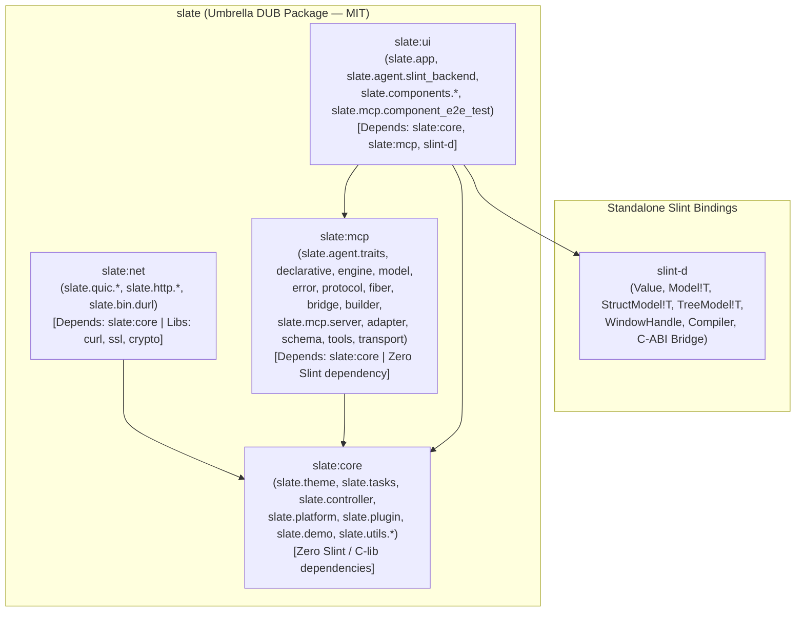

# Plan: Split `slate` into Modular DUB SubPackages (`slate:core`, `slate:net`, `slate:mcp`, `slate:ui`) and Standalone `slint-d` under MIT License

## 1. Investigation & Change Boundary

### 1.1 Goal & Success Criteria
Split the monolithic [`slate-dlang`](../../slate-dlang/dub.json) DUB package (`slate`) into an umbrella package with four cleanly layered DUB `subPackages` (`slate:core`, `slate:net`, `slate:mcp`, `slate:ui`) and decouple all non-UI sub-libraries from [`slint-d`](../../slint-d/dub.json), while standardizing licensing on the **MIT License** across `slate`, its sub-packages, and `slint-d`.

Observable success criteria:
1. `slate:core`, `slate:net`, and `slate:mcp` compile and pass 100% of their unit test suites (`dub test :core`, `dub test :net`, `dub test :mcp`) with **zero dependency on `slint-d`**.
2. `slate:ui` depends on `slate:core`, `slate:mcp`, and `slint-d`, providing the Slint UI backend (`slate.agent.slint_backend`), `AppBuilder` (`slate.app`), and Slint component controllers (`slate.components.*`), and passes both pure-D (`dub test :ui`) and `SlintNative` (`SLINT_BACKEND=software dub test :ui --config=native`) test suites.
3. The root umbrella package `slate` (`dub test` and `SLINT_BACKEND=software dub test --config=native`) re-exports all four sub-packages so existing callers importing `import slate;` continue to work without source changes.
4. Root `LICENSE`, `slate-dlang/LICENSE`, and `slint-d/LICENSE` contain the MIT license text, and all `dub.json` manifests declare `"license": "MIT"`.

### 1.2 Current Coupling Evidence (`grep -rn "import slint" slate-dlang/source/`)
Inspection of all 81 modules in `slate-dlang/source/` shows that only 12 files import `slint.*`:
- **Core (`slate.tasks`)**: [`slate-dlang/source/slate/tasks.d`](../../slate-dlang/source/slate/tasks.d) imports `slint : invokeFromEventLoop` inside `version (SlintNative)` on line 185.
- **Networking (`slate.http.http_task`)**: [`slate-dlang/source/slate/http/http_task.d`](../../slate-dlang/source/slate/http/http_task.d) imports `slint : invokeFromEventLoop` inside `version (SlintNative)` on line 298.
- **Agent / MCP (`slate.agent.*`)**:
  - [`slate-dlang/source/slate/agent/traits.d`](../../slate-dlang/source/slate/agent/traits.d) imports `slint.instance : ComponentInstance` and `slate.agent.bridge : SlintUiBridge` solely for `interface McpBindable`.
  - [`slate-dlang/source/slate/agent/bridge.d`](../../slate-dlang/source/slate/agent/bridge.d) imports `slint.instance : ComponentInstance` and `slint : invokeFromEventLoop`.
  - [`slate-dlang/source/slate/agent/builder.d`](../../slate-dlang/source/slate/agent/builder.d) imports `slint.instance` and `slate.agent.slint_backend` in `AgentBuilder.forWindow`.
  - [`slate-dlang/source/slate/agent/slint_backend.d`](../../slate-dlang/source/slate/agent/slint_backend.d) implements `SlintUiInspector`, `SlintInputInjector`, and `SlintFrameGrabber` on top of `slint-d`.
- **UI Components & E2E Tests (`slate.components.*`, `slate.mcp.component_e2e_test`)**:
  - `datagrid.d`, `file_dialog.d`, `dropzone.d`, `log_viewer.d`, `media.d`, `layouts.d`, and `component_e2e_test.d` bind directly to `slint.instance.ComponentInstance`, `slint.model.ArrayModel`, and `slint.value.SlintField`.

### 1.3 Dependency & Dataflow Architecture



### 1.4 Seam Decoupling Strategy (`F1`–`F3`)
- **`F1` (Event-loop dispatch seam in `slate.tasks`)**:
  - Replace hardcoded `import slint : invokeFromEventLoop;` in `slate.tasks` (`slate:core`), `slate.http.http_task` (`slate:net`), and `slate.agent.bridge` (`slate:mcp`) with a thread-safe global UI event-loop dispatcher hook in `slate.tasks`:
    - `alias UiDispatchFn = void delegate(void delegate());`
    - `void setUiEventLoopDispatcher(UiDispatchFn fn)` / `UiDispatchFn getUiEventLoopDispatcher()` / `void dispatchToUiEventLoop(void delegate() job)`
  - When `slate:ui` initializes (e.g., via a module constructor `shared static this()` in `slate.agent.slint_backend` under `version (SlintNative)`), it registers `(void delegate() job) { import slint : invokeFromEventLoop; invokeFromEventLoop(job); }` as the dispatcher.
- **`F2` (`McpBindable` & `ComponentBridge` seam in `slate:mcp`)**:
  - In `slate.agent.traits` (`slate:mcp`), `McpBindable` is either templated (`interface McpBindableT(ComponentHandle)` or `McpBindable` moved to `slate.agent.slint_backend` in `slate:ui` and publicly re-exported by `slate.components` and `slate.agent.slint_backend`), keeping `slate.agent.traits` 100% free of `slint.instance`.
  - In `slate.agent.bridge` (`slate:mcp`), `ComponentBridge` is templated as `final class ComponentBridgeT(Handle = Object)` (with `alias ComponentBridge = ComponentBridgeT!Object;` in `slate:mcp` and `ComponentInstance` support in `slate:ui`), and `SlintUiBridge` dispatches through `slate.tasks.dispatchToUiEventLoop` inside `version (SlintNative)`.
- **`F3` (`AgentBuilder.forWindow` seam between `slate:mcp` and `slate:ui`)**:
  - In `slate.agent.builder` (`slate:mcp`), `AgentBuilder.forWindow(typeof(null) window, McpStateRegistry registry = null)` handles the headless/null window case using `NoopInspector`, `NoopElementController`, `NoopVisualRenderer`, and `McpStateRegistry`.
  - In `slate.agent.slint_backend` (`slate:ui`), provide UFCS/helper overload `AgentBuilder forWindow( inout / ComponentInstance window, McpStateRegistry registry = null)` (or template `AgentBuilder.forWindow(WindowT)(WindowT window, McpStateRegistry registry = null)` that resolves `SlintUiInspector` / `SlintInputInjector` / `SlintFrameGrabber` when `WindowT` is `ComponentInstance`), so both `AgentBuilder.forWindow(null, registry)` and `AgentBuilder.forWindow(win, registry)` work identically!

---

## 2. Material Decisions (`D1`–`D2`)

- **`D1` — Licensing (`MIT`)**:
  - **Selected**: **MIT License** (`"license": "MIT"`) across `slate`, `slate:core`, `slate:net`, `slate:mcp`, `slate:ui`, and `slint-d`.
  - **Rationale**: User explicitly selected MIT for universal familiarity across D, Rust, C, and web ecosystems.
- **`D2` — Package Structure (`Umbrella slate + DUB subPackages + standalone slint-d`)**:
  - **Selected**: Umbrella `slate` package (`slate-dlang/dub.json`) with 4 sub-packages under `slate-dlang/packages/{core,net,mcp,ui}` + standalone `slint-d` (`slint-d/dub.json`).
  - **Rationale**: Giving each sub-package its own subfolder (`slate-dlang/packages/<name>/dub.json` + `source/slate/...`) guarantees strict compiler-enforced dependency boundaries (`dub test :core`, `dub test :net`, `dub test :mcp`, `dub test :ui`) while preserving the single `slate` umbrella package.

---

## 3. EARS Requirements & Acceptance Scenarios

### 3.1 Requirements
- **`U1`**: The repository shall include an MIT `LICENSE` file at the root, `slate-dlang/LICENSE`, and `slint-d/LICENSE`, and every `dub.json` manifest (`slate`, `slate:core`, `slate:net`, `slate:mcp`, `slate:ui`, `slint-d`) and `slint-d/bridge/Cargo.toml` shall specify `"license": "MIT"` (or `license = "MIT"`).
- **`U2`**: The `slate:core` sub-package (`slate-dlang/packages/core`) shall contain `slate.theme`, `slate.tasks`, `slate.controller`, `slate.platform`, `slate.plugin`, `slate.demo`, and `slate.utils.*` with zero external DUB or C library dependencies.
- **`U3`**: The `slate:net` sub-package (`slate-dlang/packages/net`) shall contain `slate.quic.*`, `slate.http.*`, and `slate.bin.durl`, depending only on `slate:core` (and system `curl`, `ssl`, `crypto`).
- **`U4`**: The `slate:mcp` sub-package (`slate-dlang/packages/mcp`) shall contain `slate.agent.{traits,declarative,engine,model,error,protocol,fiber,bridge,builder}` and `slate.mcp.{server,adapter,schema,resources,error,tools,transport}`, depending only on `slate:core` with zero dependency on `slint-d`.
- **`U5`**: The `slate:ui` sub-package (`slate-dlang/packages/ui`) shall contain `slate.app`, `slate.agent.slint_backend`, `slate.components.*`, and `slate.mcp.component_e2e_test`, depending on `slate:core`, `slate:mcp`, and `slint-d`.
- **`E1`**: When `dub test :core`, `dub test :net`, or `dub test :mcp` is executed, DUB shall compile and pass all unit tests in that sub-package without compiling or linking `slint-d`.
- **`E2`**: When `dub test :ui` or `SLINT_BACKEND=software dub test :ui --config=native` is executed, DUB shall compile and pass all pure-D and `SlintNative` UI & E2E MCP component tests.
- **`E3`**: When `dub build` or `dub test` is executed on the root `slate` umbrella package (`slate-dlang`), DUB shall build and re-export `slate:core`, `slate:net`, `slate:mcp`, and `slate:ui`.
- **`W1`**: If any module in `slate:core`, `slate:net`, or `slate:mcp` attempts to `import slint`, the build of that sub-package (`dub build :core`, `:net`, or `:mcp`) shall fail at compile time due to `slint-d` not being in its dependency graph.

### 3.2 Acceptance Scenarios

```gherkin
Scenario: T1 - MIT License compliance across all packages (covers U1)
  Given the repository root, slate-dlang, and slint-d directories
  When inspecting LICENSE files and dub.json / Cargo.toml manifests
  Then LICENSE, slate-dlang/LICENSE, and slint-d/LICENSE exist with MIT license text
  And all dub.json files declare "license": "MIT"

Scenario: T2 - Isolated compilation and testing of Slint-free sub-packages (covers U2, U3, U4, E1, W1)
  Given slate-dlang/packages/{core,net,mcp}
  When running `dub test :core`, `dub test :net`, and `dub test :mcp`
  Then each sub-package compiles and passes all unit tests without slint-d in its dependency tree
  And zero occurrences of `import slint` exist in `packages/core`, `packages/net`, or `packages/mcp`

Scenario: T3 - UI sub-package and root umbrella native & pure-D test execution (covers U5, E2, E3)
  Given slate-dlang/packages/ui and root slate-dlang/dub.json
  When running `dub test :ui`, `SLINT_BACKEND=software dub test :ui --config=native`, and root `dub test`
  Then all UI component controllers, Slint backends, and E2E MCP tests pass in both pure-D and SlintNative modes
```

---

## 4. Implementation Steps (TDD: Red -> Green -> Iterate)

1. **Step 1 — Add MIT `LICENSE` files and update manifests (`U1`, `T1`)**:
   - Create root `LICENSE`, `slate-dlang/LICENSE`, and `slint-d/LICENSE` with the MIT License.
   - Update `slint-d/dub.json`, `slint-d/bridge/Cargo.toml`, and `slate-dlang/dub.json` to `"license": "MIT"`.
2. **Step 2 — Decouple UI Event Loop Dispatch & Agent Seams (`F1`–`F3`, `W1`)**:
   - In `slate.tasks`, add `setUiEventLoopDispatcher` / `dispatchToUiEventLoop` with unit tests verifying custom and fallback dispatchers.
   - Update `slate.tasks.spawnCompute`, `slate.http.http_task.spawnHttpTask`, and `slate.agent.bridge.SlintUiBridge` to use `dispatchToUiEventLoop` instead of importing `slint`.
   - Move `McpBindable` (or alias `ComponentInstance` binding) and `Slint`-specific `AgentBuilder.forWindow` wiring so `slate.agent.traits`, `slate.agent.bridge`, and `slate.agent.builder` have zero `slint` imports while `AgentBuilder.forWindow(win, registry)` continues to work seamlessly with both `null` and `ComponentInstance`.
3. **Step 3 — Split `slate-dlang` into `packages/{core,net,mcp,ui}` DUB SubPackages (`U2`–`U5`, `E1`–`E3`, `T2`, `T3`)**:
   - Move modules via `git mv` into:
     - `slate-dlang/packages/core/source/slate/` (`theme.d`, `tasks.d`, `controller.d`, `platform.d`, `plugin.d`, `demo.d`, `utils/`)
     - `slate-dlang/packages/net/source/slate/` (`quic/`, `http/`, `bin/durl.d`) + `slate-dlang/packages/net/test/`
     - `slate-dlang/packages/mcp/source/slate/` (`agent/{traits,declarative,engine,model,error,protocol,fiber,bridge,builder,package}.d`, `mcp/{server,adapter,schema,resources,error,package,tools,transport}`)
     - `slate-dlang/packages/ui/source/slate/` (`app.d`, `agent/slint_backend.d`, `components/`, `mcp/component_e2e_test.d`)
   - Create `dub.json` for `packages/core`, `packages/net`, `packages/mcp`, and `packages/ui`, and update root `slate-dlang/dub.json` with `subPackages`.
   - Update `Justfile` and `README.md` with sub-package recipes (`just slate-test-core`, `just slate-test-net`, `just slate-test-mcp`, `just slate-test-ui`) and verify all test suites pass.
