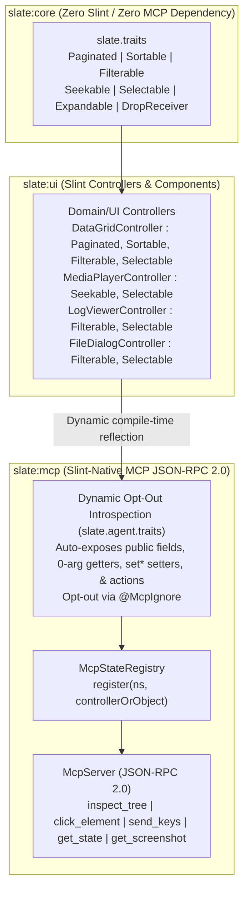

# Plan: Standalone Domain Traits, Opt-Out Dynamic MCP & Protocol Simplification

## 1. Context & Evidence-Driven Investigation

An architectural review of `slate-dlang` (`slate:core`, `slate:mcp`, `slate:ui`) identified three sources of accidental complexity:

1. **Domain Capability Traits Coupled to MCP (`slate-dlang/packages/mcp/source/slate/agent/traits.d`)**:
   - Capability interfaces (`McpSeekable`, `McpSortable`, `McpFilterable`, `McpExpandable`, `McpDropReceiver`, `McpSelectable`) currently live inside `slate:mcp` with `Mcp*` prefixes, and pagination (`currentPage`, `totalPages`, `pageSize`, `nextPage`, `prevPage`, `goToPage`) is implemented ad-hoc on `DataGridController` without a shared `Paginated` trait.
   - Domain and UI components in `slate:core` and `slate:ui` should implement standalone domain traits (`Paginated`, `Sortable`, `Filterable`, `Seekable`, `Selectable`, `Expandable`, `DropReceiver`) defined in `slate:core` (`slate.traits`), with zero dependency on MCP.

2. **Verbose Opt-In UDA Clutter (`@McpState`, `@McpWritable`, `@McpAction`)**:
   - Every controller in `slate:ui` (`datagrid.d`, `media.d`, `file_dialog.d`, `dropzone.d`, `log_viewer.d`, `layouts.d`) must manually decorate dozens of public getters, setters, and action methods with `@McpState("...")`, `@McpWritable("...")`, and `@McpAction("...")`, and explicitly inherit from `McpControllable` + `mixin McpControllableMixin`.
   - D's compile-time reflection (`__traits(allMembers, T)`, `__traits(getProtection, ...)`) can automatically expose all `public` fields, 0-arg getters, `set*` 1-arg setters, and action methods (including methods from `Sortable`, `Paginated`, `Seekable`, etc.) using automatic `camelCase` → `snake_case` conversion (`positionSeconds` → `"position_seconds"`, `setVolume` → `"volume"`), requiring only `@McpIgnore` to **opt out**!
   - Furthermore, `McpStateRegistry` can dynamically wrap any plain D `class` or `struct` via `register(namespace, target)` (`asMcpControllable`) without requiring the target type to inherit from `McpControllable` at all.

3. **Legacy `slate.agent.protocol` Indirection (`protocol.d`, `builder.d`, `adapter.d`)**:
   - `slate.agent.protocol` (`AgentProtocolAdapter`, `ProtocolServerHandle`) and `AdapterSlotImpl` in `slate.agent.builder` are remnants of an older multi-protocol abstraction before the codebase standardized on the Slint-native Model Context Protocol (`slate.mcp`, JSON-RPC 2.0 `2024-11-05` backed by `slint-d`'s native accessibility tree and software renderer).
   - Removing `slate.agent.protocol` and wiring `McpServer` / `McpServerHandle` directly in `slate.mcp` + `AgentBuilder` deletes an entire layer of type-erased wrapper classes (`AdapterSlot`, `AdapterSlotImpl`, `Wrap`).

---

## 2. Material Alternatives Considered

| Option | Summary | Pros | Cons | Decision |
|---|---|---|---|---|
| **Option A: Keep Opt-In UDAs & `Mcp*` Traits** | Keep `McpSortable` etc. in `slate:mcp` and require `@McpState`/`@McpAction` on every member. | No changes needed. | Couples domain traits to MCP; verbose annotation tax on every controller; cannot register plain D classes without `McpControllable`. | Rejected |
| **Option B: Add More Mixins (`SlintBindableMixin`, `Signal!T`)** | Layer reactive wrapper structs and auto-binding mixins on top of existing UDAs. | Less manual `setProperty` code. | Increases hidden framework magic and debugging complexity ("spooky action at a distance"). | Rejected |
| **Option C (Selected): Standalone `slate.traits` in `slate:core` + Opt-Out Dynamic MCP (`@McpIgnore`) + Single Standard MCP** | Move clean domain traits (`Paginated`, `Sortable`, `Filterable`, `Seekable`, `Selectable`, `Expandable`, `DropReceiver`) to `slate:core`. Make `slate:mcp` dynamically reflect all `public` members by default with `@McpIgnore` opt-out, and remove `slate.agent.protocol`. | Domain traits stand on their own; zero UDA clutter needed on controllers; plain D classes/structs work with MCP out of the box; deletes legacy protocol indirection. | Requires careful compile-time filtering of `Object` methods (`toString`, `toHash`, `opCmp`, `opEquals`, `Monitor`) and internal hooks (`bindToSlint`). | **Selected** |

---

## 3. Architecture & Dataflow

---

## 4. EARS Requirements

### Ubiquitous Requirements
- **U1 (Standalone Domain Traits in `slate:core`)**: `slate-dlang/packages/core/source/slate/traits.d` SHALL define the standalone capability interfaces `Paginated`, `Sortable`, `Filterable`, `Seekable`, `Selectable`, `Expandable`, and `DropReceiver`, along with compile-time Design-by-Introspection (DbI) traits (`isPaginated!T`, `isSortable!T`, `isFilterable!T`, `isSeekable!T`, `isSelectable!T`, `isExpandable!T`, `isDropReceiver!T`) and `detectCapabilities!T()`, with zero dependency on `slate:mcp` or `slint-d`.
- **U2 (Opt-Out Dynamic MCP Introspection)**: `slate.agent.traits` in `slate:mcp` SHALL dynamically introspect all `public` members of any registered class or struct by default (converting `camelCase` member names to `snake_case` keys, stripping leading `is`/`get` on boolean/getter methods only when explicitly configured or keeping `camelToSnake` on getters and stripping `set` on 1-arg `set*` setters), while excluding `Object` built-in members, `McpControllable` meta-methods, UI binding hooks (`bindToSlint`, `syncToSlint`), and any member annotated with `@McpIgnore`.
- **U3 (Zero-Intrusion Class & Struct Registration)**: `McpStateRegistry` SHALL support registering any plain D `class` or `struct*` (even if it does not inherit from `McpControllable` or use `mixin McpControllableMixin`) via `asMcpControllable(target, namespace)` / `registry.register(namespace, target)`, dynamically exposing its `public` state, setters, actions, and detected `slate.traits` capabilities (`paginated`, `sortable`, `filterable`, `seekable`, `selectable`, `expandable`, `drop-receiver`).
- **U4 (Single Slint-Native MCP Protocol)**: The legacy `slate.agent.protocol` (`AgentProtocolAdapter`) layer SHALL be removed, and `AgentBuilder` + `slate.mcp` SHALL manage `McpServer` lifecycle handles directly.

### Event-Driven Requirements
- **E1 (Dynamic Trait Action Invocation)**: WHEN `mcpInvokeAction` is called on a controller or adapted object (including 0-arg, 1-arg, or 2-arg methods such as `next_page`, `go_to_page`, `sort_by_column`, `seek_to`, `set_filter_query`, `select_index`), THE introspection layer SHALL unmarshal JSON arguments (single value, JSON array `[arg0, arg1]`, or JSON object named parameters) and invoke the underlying public method.
- **E2 (Dynamic Setter & Field Mutation with Transactional Rollback)**: WHEN `mcpSetProperty` is called for a public field or `public` 1-arg `set*` method (e.g., `"volume"` -> `setVolume(double)` or `"split_ratio"` -> `setSplitRatio(double)`), THE introspection layer SHALL validate and apply the update and support full snapshot restoration via `mcpRestoreSnapshot` if a batch update fails.

### Unwanted Behavior Requirements
- **W1 (No Private/Protected or `@McpIgnore` Leakage)**: IF a class or struct member is `private`, `protected`, `package`, an `Object` built-in (`toString`, `toHash`, `opCmp`, `opEquals`, `Monitor`, `factory`), a UI lifecycle hook (`bindToSlint`, `syncToSlint`), or annotated with `@McpIgnore`, THEN dynamic MCP introspection SHALL NOT expose it in `mcpSnapshot`, `mcpSetProperty`, or `mcpInvokeAction`.

---

## 5. Test-Driven Implementation Steps

1. **Step 1: Create Standalone `slate.traits` in `slate:core`**:
   - Create `slate-dlang/packages/core/source/slate/traits.d` with `Paginated`, `Sortable`, `Filterable`, `Seekable`, `Selectable`, `Expandable`, `DropReceiver`, compile-time DbI predicates (`isPaginated!T`, etc.), `detectCapabilities!T()`, and `camelToSnake(string)`.
   - Export `public import slate.traits;` in `slate-dlang/packages/core/source/slate/core/package.d` and `slate-dlang/source/slate/package.d`.
   - Write unit tests in `slate/traits.d` verifying capability detection and `camelToSnake` conversion.

2. **Step 2: Implement Opt-Out Dynamic MCP Introspection (`@McpIgnore` & `ClassMcpAdapter!T`) in `slate:mcp`**:
   - Update `slate-dlang/packages/mcp/source/slate/agent/traits.d` to publicly import `slate.traits`, add `struct McpIgnore {}`, implement opt-out `public` member introspection (supporting 0-arg, 1-arg, and 2-arg actions, `set*` 1-arg setters, and 0-arg getters/fields while honoring optional `@McpState`/`@McpWritable`/`@McpAction` key overrides), and add `ClassMcpAdapter!T` so `asMcpControllable(target, ns)` works for any plain `class` or `struct*`.
   - Add `McpStateRegistry.register(T)(string namespace, T target)` in `slate/agent/declarative.d`.
   - Write unit tests proving a plain D class implementing `Sortable, Paginated` with **zero `@Mcp*` annotations** is automatically snapshotted, mutated, rolled back, and invoked via `McpStateRegistry`, while `@McpIgnore` members remain hidden.

3. **Step 3: Update `slate:ui` Controllers to Use Standalone `slate.traits` & Remove UDA Clutter**:
   - Update `DataGridController` (`Paginated, Sortable, Filterable, Selectable`), `MediaPlayerController` (`Seekable, Selectable`), `LogViewerController` (`Filterable, Selectable`), `FileDialogController` (`Filterable, Selectable`), and `UploadQueueController` (`DropReceiver, Selectable`) to implement the standalone interfaces from `slate.traits` and remove redundant opt-in UDAs where automatic reflection applies (using `@McpIgnore` on internal helpers where needed).

4. **Step 4: Remove Legacy `slate.agent.protocol` & Flatten `AgentBuilder` ↔ `McpServer`**:
   - Delete `slate-dlang/packages/mcp/source/slate/agent/protocol.d`.
   - Simplify `slate.agent.builder` and `slate.mcp.adapter` so `McpServerHandle` / `ServerHandle` is managed directly without `AgentProtocolAdapter` or `AdapterSlotImpl`.
   - Verify all 9 test targets and `just lint` pass with zero warnings.

---

## 6. Acceptance Scenarios (`T1`–`T5`)

- **Scenario `T1` (Standalone `slate.traits` in `slate:core`)**:
  - **Given** a domain struct or class in `slate:core` implementing `Paginated`, `Sortable`, `Filterable`, `Seekable`, `Selectable`, `Expandable`, or `DropReceiver`
  - **When** `detectCapabilities!T()` and `camelToSnake(...)` are evaluated in `slate:core`
  - **Then** `slate:core` compiles and passes `just slate-test-core` with zero dependency on `slate:mcp` or `slint-d`, and `detectCapabilities!T()` returns the expected capability array.

- **Scenario `T2` (Opt-Out Dynamic MCP Introspection & Zero-Intrusion Registration)**:
  - **Given** a plain D class `PlainGrid : Paginated, Sortable` with **zero `@McpState` / `@McpWritable` / `@McpAction` annotations** and one `public` helper annotated with `@McpIgnore`
  - **When** registered via `registry.register("plain_grid", grid)` in `McpStateRegistry`
  - **Then**:
    - `getState` automatically includes `plain_grid.current_page`, `plain_grid.total_pages`, `plain_grid.page_size`, `plain_grid.sort_column`, `plain_grid.sort_ascending`, and `plain_grid._capabilities` containing `["controllable", "paginated", "sortable"]`.
    - The `@McpIgnore` member is absent from `getState`, rejected by `setProperty`, and rejected by `invokeControllerAction`.
    - Calling `registry.invokeControllerAction("plain_grid", "next_page", ...)` and `registry.invokeControllerAction("plain_grid", "sort_by_column", ...)` (both 0-arg and 2-arg methods!) dynamically invokes `grid.nextPage()` and `grid.sortByColumn(col, dir)`.

- **Scenario `T3` (Dynamic 1-Arg Setter Mutation & Transactional Rollback)**:
  - **Given** a plain D class or controller with a `public` 1-arg setter `setVolume(double v)` (or mutable field) and a `public` 0-arg getter `volume()`
  - **When** `registry.setProperty("player.volume", JSONValue(0.45))` or batch `registry.applyProperties(...)` is called
  - **Then** `setVolume(0.45)` is dynamically invoked, and if a subsequent property in `applyProperties` throws `AgentError.invalidParams`, `volume()` is rolled back to its prior snapshot value.

- **Scenario `T4` (`slate:ui` Controllers Cleaned of Redundant UDA Clutter)**:
  - **Given** `DataGridController`, `MediaPlayerController`, `LogViewerController`, `FileDialogController`, `UploadQueueController`, `MasterDetailController`, and `WorkspaceDockController` in `slate:ui`
  - **When** updated to implement standalone `slate.traits` (`Paginated`, `Sortable`, `Filterable`, `Seekable`, `Selectable`, `DropReceiver`, `Expandable`) and rely on opt-out dynamic reflection (keeping only `@McpIgnore` or explicit key alias overrides where needed)
  - **Then** all existing unit tests and the 6-step `component_e2e_test.d` MCP showcase workflow pass identically.

- **Scenario `T5` (Removal of Legacy `slate.agent.protocol` Layer)**:
  - **Given** `slate-dlang/packages/mcp/source/slate/agent/protocol.d` is deleted and `AgentBuilder` / `slate.mcp.adapter` manage `McpServerHandle` directly
  - **When** `AgentBuilder.forWindow(win, registry)` and `startMcp(builder, McpAdapterConfig.inMemory(sock))` are executed
  - **Then** the MCP server starts, processes JSON-RPC 2.0 requests, and stops cleanly with zero references to `slate.agent.protocol`.

---

## 7. Failure Modes (`F1`–`F3`) & Verification Gates (`G1`–`G5`)

- **`F1` (`Object` Built-in Member Collision)**: `__traits(allMembers, T)` on a D `class` returns `Object` methods (`toString`, `toHash`, `opCmp`, `opEquals`, `Monitor`, `factory`). Calling or serializing these during `introspectMcpSnapshot` or `introspectMcpInvokeAction` must be prevented via a compile-time `isExcludedMcpMember!(T, member)` guard.
- **`F2` (Overload & Setter/Getter Pairing for Rollback)**: When a controller exposes `double volume() const` and `void setVolume(double v)` without `@McpWritable`, `introspectMcpSetProperty` and `introspectMcpRestoreSnapshot` must match key `"volume"` to `setVolume` so transactional rollback restores setter-backed properties accurately.
- **`F3` (Multi-Argument Action Unmarshaling)**: `Sortable.sortByColumn(size_t col, string dir)` takes 2 parameters. `introspectMcpInvokeAction` must support 2-parameter methods (accepting either a JSON array `[col, dir]` or a JSON object matching parameter names / positional keys).

### Verification Gates
- **`G1` (Zero Slint / Zero MCP Leakage in `slate:core`)**: `! grep -rn "import slint\|import slate\.agent\|import slate\.mcp" slate-dlang/packages/core` returns 0 matches.
- **`G2` (Legacy Protocol Removal)**: `test ! -f slate-dlang/packages/mcp/source/slate/agent/protocol.d` and `! grep -rn "slate\.agent\.protocol" slate-dlang/packages/` return 0 matches.
- **`G3` (File Size Ceiling)**: Every `.d` and `.rs` file in `slint-d/` and `slate-dlang/` remains `<= 1,150` lines.
- **`G4` (Test Spec & Example Headers)**: 100% of every `unittest` block in newly created or modified modules includes a `// Spec:` (or `// Best practice:`) header and a `/// Example:` Ddoc block.
- **`G5` (Full Lint & Test Matrix)**: `just lint` and all 9 test suites (`just d-test`, `just d-test-native`, `just slate-test-core`, `just slate-test-net`, `just slate-test-mcp`, `just slate-test-ui`, `just slate-test-ui-native`, `just slate-test`, `just slate-test-native`) pass with 0 errors.
