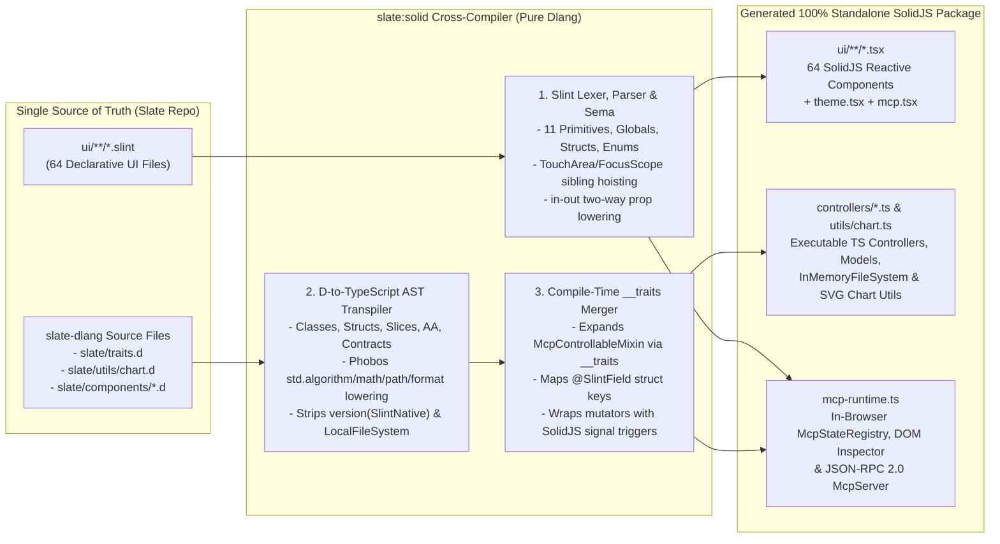

# Plan: Slate `.slint` + Dlang to SolidJS Cross-Compiler (`slate:solid`)

- **Owning Project**: `slate-dlang` (`packages/solid/`) & `ui/`
- **Status**: `in-review`
- **Revision**: `2` *(Updated: Full 100% standalone feature completeness by compiling Dlang controllers, models, chart utilities, and MCP runtime directly to TypeScript/JS alongside `.slint` → SolidJS `.tsx`)*
- **Date**: `2026-10-16`

---

## 1. Goal, Scope, and Non-Goals

### Goal
Build a deterministic, pure-Dlang cross-compiler subpackage (`slate:solid`, with CLI entrypoint `slint2solid`) that achieves **100% standalone feature completeness in the browser** by compiling:
1. **Declarative UI (`ui/**/*.slint` → SolidJS `.tsx`)**: All 64 `.slint` files in [`ui/`](../../ui/index.slint) into fine-grained reactive SolidJS TypeScript JSX components and CSS theme variables.
2. **Dlang Controllers, Models & Utilities (`slate-dlang/**/*.d` → Executable TypeScript `.ts`)**: All Dlang UI controllers ([`DataGridController`](../../slate-dlang/packages/ui/source/slate/components/datagrid.d), [`MediaPlayerController` + `SimulatedMediaBackend`](../../slate-dlang/packages/ui/source/slate/components/media.d), [`FileDialogController` + `InMemoryFileSystem`](../../slate-dlang/packages/ui/source/slate/components/file_dialog.d), [`UploadQueueController`](../../slate-dlang/packages/ui/source/slate/components/dropzone.d), [`RingBufferLogModel`](../../slate-dlang/packages/ui/source/slate/components/log_viewer.d), [`WorkspaceDockController`, `WizardController`, `MasterDetailController`](../../slate-dlang/packages/ui/source/slate/components/layouts.d)), data models (`ArrayModel<T>`, `TreeModel<T>`), domain traits ([`slate.traits`](../../slate-dlang/packages/core/source/slate/traits.d)), and SVG vector chart utilities ([`slate.utils.chart`](../../slate-dlang/packages/core/source/slate/utils/chart.d)) into native, executable TypeScript classes wired directly to SolidJS signals (`createSignal` / `createMemo`).
3. **In-Browser + Remote MCP Runtime (`slate:mcp` → `mcp-runtime.ts`)**: Full in-browser `McpStateRegistry` and `McpServer` (`JSON-RPC 2.0`) supporting `inspect_tree`, `click_element`, `send_keys`, `get_state`, transactional `set_property` rollback, and `invoke_action` standalone in the browser DOM, with optional remote bridge sync to a native Dlang backend.

### Observable Success Criteria
1. **Complete `.slint` Primitive & Grammar Lowering (64/64 files)**: All 11 Slint built-in primitives used across the 64 files in [`ui/`](../../ui/index.slint) (`Window`, `Rectangle`, `Text`, `TextInput`, `Image`, `Path`, `TouchArea`, `FocusScope`, `Flickable`, `Timer`, `HorizontalLayout`, `VerticalLayout`) plus `export enum`, `export struct`, `export global`, `if`/`for` control flow, `@children` slots, `animate` transitions, and `accessible-*` MCP bindings compile to valid SolidJS `.tsx` modules.
2. **Executable Dlang-to-TypeScript Controller & Utility Compilation**: Dlang controller classes, method bodies (e.g., `DataGridController.recompute`, `cycleSortColumn`, `MediaPlayerController.seekTo`, `FileDialogController.navigateTo`, `isPathWithinSandbox`, `UploadQueueController.dropFiles`, `RingBufferLogModel.append`, `buildSparklinePath`, `buildDonutArcPath`), D contracts (`in`/`out` assertions), `scope(exit)`/`scope(failure)` guards, and Phobos slice/range idioms compile to executable TypeScript with identical behavior to native D unit tests.
3. **Hybrid AST + Compile-Time `__traits` Expansion**: D `mixin McpControllableMixin` and `@SlintField` annotations are expanded at compile time via D's `__traits(allMembers, T)` and merged with the transpiled TypeScript class bodies, giving every compiled TypeScript controller automatic `mcpSnapshot()`, transactional `mcpSetProperty()`, `mcpRestoreSnapshot()`, `mcpInvokeAction()`, and fine-grained SolidJS signal reactivity.
4. **100% Standalone Browser + MCP Parity**: The generated SolidJS bundle runs completely standalone in the browser without requiring a backend process or WebAssembly binary, while exposing the exact same MCP JSON-RPC 2.0 tool surface (`inspect_tree`, `click_element`, `send_keys`, `get_state`).

### Scope
- New DUB subpackage `slate:solid` at `slate-dlang/packages/solid/`:
  - `.slint` compiler pipeline: `slate.solid.lexer`, `slate.solid.parser`, `slate.solid.ast`, `slate.solid.sema`, `slate.solid.codegen_tsx`.
  - D-to-TypeScript compiler pipeline: `slate.solid.d_lexer`, `slate.solid.d_parser`, `slate.solid.d_ast`, `slate.solid.d_to_ts`, `slate.solid.codegen_controller` (hybrid AST + `__traits` reflection).
  - Workspace batch compiler & CLI: `slate.solid.compiler` and `slate.bin.slint2solid`.
- Canonical `Justfile` recipes: `just slate-test-solid` and `just solid-codegen`.

### Non-Goals
- **Compiling Dlang to WebAssembly (`.wasm`)**: Excluded by design (`D3`) because `dmd` lacks a WASM backend, `ldc2` bare `wasm32` only supports `-betterC` (no D classes, GC slices, or exceptions), and WASM linear-memory marshaling adds unnecessary overhead compared to direct TypeScript/SolidJS signal execution.
- **Transpiling low-level OS/C bindings (`libcurl`, `OpenSSL`, `std.file.dirEntries` in `LocalFileSystem`)**: Host OS I/O classes like `LocalFileSystem` are automatically substituted in the browser bundle by the existing `@safe pure` virtual provider (`InMemoryFileSystem` / browser File API provider).

---

## 2. Evidence and Current Behavior

### Repository Evidence
1. **Bounded `.slint` Grammar in [`ui/`](../../ui/index.slint)**:
   - An audit of all **64 `.slint` files** in [`ui/components/`](../../ui/components/) and [`ui/layouts/`](../../ui/layouts/) confirms that every component in Slate is composed from **11 built-in Slint primitives**:
     - Layout containers: `HorizontalLayout`, `VerticalLayout`, `Flickable`
     - Visual primitives: `Window`, `Rectangle`, `Text`, `Image`, `Path`
     - Interactive & lifecycle primitives: `TouchArea`, `FocusScope`, `TextInput`, `Timer`
   - [`ui/components/theme.slint`](../../ui/components/theme.slint) defines `export global SlateTheme` with `in-out property <bool> is-dark: true;` and reactive `out property <color>` / `<length>` tokens.
   - [`ui/components/mcp.slint`](../../ui/components/mcp.slint) defines `export global SlateMcp` and declarative trait wrappers (`SlateMcpControl`, `SlateMcpValueTarget`, `SlateMcpExpandable`, `SlateMcpDropTarget`) using `@children` and `accessible-*` bindings.

2. **Clean, Deterministic D2 Subset in [`slate.components`](../../slate-dlang/packages/ui/source/slate/components/) and [`slate.utils.chart`](../../slate-dlang/packages/core/source/slate/utils/chart.d)**:
   - Inspection of all 6 controller modules ([`datagrid.d`](../../slate-dlang/packages/ui/source/slate/components/datagrid.d), [`media.d`](../../slate-dlang/packages/ui/source/slate/components/media.d), [`file_dialog.d`](../../slate-dlang/packages/ui/source/slate/components/file_dialog.d), [`dropzone.d`](../../slate-dlang/packages/ui/source/slate/components/dropzone.d), [`log_viewer.d`](../../slate-dlang/packages/ui/source/slate/components/log_viewer.d), [`layouts.d`](../../slate-dlang/packages/ui/source/slate/components/layouts.d)) and [`chart.d`](../../slate-dlang/packages/core/source/slate/utils/chart.d) shows:
     - All controllers already separate pure virtual backends from host OS/FFI backends: `media.d` provides `SimulatedMediaBackend : MediaBackend`, `file_dialog.d` provides `InMemoryFileSystem : FileSystemProvider`, and native Slint FFI calls are isolated inside `version (SlintNative)` blocks.
     - Controller method bodies use a well-defined, `@safe` subset of D2: `struct`, `class`, `interface`, `enum`, generics (`DataGridController(T = GridRowData)`), dynamic arrays/slices (`~=`, `.dup`, `.length`, `arr[a .. b]`, `arr[$ - 1]`), associative arrays (`V[K]`, `k in map`), `foreach`, `switch`, `try`/`catch`/`throw`, `scope(exit)`/`scope(failure)`, `in`/`out` contracts, and standard Phobos functions (`min`, `max`, `clamp`, `canFind`, `sort`, `toLower`, `strip`, `startsWith`, `baseName`, `dirName`, `extension`, `format`, `formattedWrite`, `appender`, `isFinite`, `isNaN`, `sin`, `cos`, `PI`).

### Dataflow & Compilation Pipeline



### Failure Points (`F1`–`F5`)
- **`F1` (Sibling `TouchArea` / `FocusScope` Z-Stacking)**: In Slint, placing `touch := TouchArea {}` and `rect := Rectangle {}` as siblings overlays `touch` across the component bounds while `rect` reads `touch.has-hover` and `touch.pressed`.
  - *Mitigation*: `slate.solid.sema` hoists sibling `TouchArea` and `FocusScope` event handlers onto the enclosing element and synthesizes `touch_hasHover` / `touch_pressed` signals.
- **`F2` (`in-out property` Two-Way Binding Semantics)**: Slint components mutate `in-out` properties internally while parent components also bind to them.
  - *Mitigation*: Lower `in-out property <T> foo` to `createInOutProp(() => props.foo, (v) => props.onChangeFoo?.(v), defaultValue)`.
- **`F3` (D Slice Semantics & `$` Indexing in D-to-TS)**: D uses `arr[0 .. pos] ~ arr[pos + 1 .. $]`, `norm[] = 0.5`, and `foreach (i, ref item; arr)`.
  - *Mitigation*: The D-to-TS AST expression emitter lowers `a .. b` inside index expressions to `.slice(a, b)`, replaces `$` with `<arrayExpr>.length`, lowers `arr[] = val` to `arr.fill(val)`, and lowers `~` / `~=` on arrays/strings appropriately (`[...a, ...b]` / `.push()` or `+` / `+=`).
- **`F4` (D `mixin McpControllableMixin` and `static if` inside Controllers)**: Parsing arbitrary D `mixin` templates or `__traits` purely syntactically is complex.
  - *Mitigation*: Hybrid compilation! The D-to-TS AST transpiler skips `mixin McpControllableMixin!...` declarations and `static if` blocks inside `toGridRowData`, while `slate.solid.codegen_controller` uses D's native compile-time `__traits` evaluation to emit the exact expanded `mcpSnapshot()`, `mcpSetProperty()`, `mcpRestoreSnapshot()`, and `mcpInvokeAction()` TypeScript methods.
- **`F5` (Triggering Fine-Grained SolidJS UI Updates When D Controller Methods Mutate State)**: When `ctrl.sortByColumn(0, "asc")` or `ctrl.nextPage()` runs on a transpiled controller class, SolidJS components reading `ctrl.visibleRows()` or `ctrl.currentPage()` must re-render automatically.
  - *Mitigation*: Every transpiled controller class embeds a reactive version signal (`private _reactiveTick = createSignal(0)`): getters read `this._track()` and mutators/actions call `this._notify()`, making every controller method call natively reactive inside SolidJS JSX and `createMemo`!

---

## 3. Proposed Design and Material Decisions (`D1`–`D3`)

### Decision `D1`: Compiler Implementation Language & Architecture
- **Problem**: How should `.slint` files and Dlang controller source files be compiled to SolidJS `.tsx` and `.ts`?
- **Options Considered**:
  1. **Option 1A (Selected): Pure-Dlang Hybrid AST + `__traits` Compiler (`slate:solid` in `slate-dlang/packages/solid/`)**: Implement `.slint` and D2 subset AST parsers + TypeScript/SolidJS code emitters in pure `@safe` Dlang, augmented by D's native compile-time `__traits` reflection.
  2. **Option 1B: Rust `i-slint-compiler` + External D-Scanner/libdparse CLI**: Split across Rust and external C/D binaries.
- **Rationale**: Option 1A has zero external dependencies, runs inside `dub test :solid` in milliseconds, and uniquely combines AST transpilation of D method bodies with compile-time `__traits` expansion of `McpControllableMixin` and `@SlintField`.

### Decision `D2`: Slint Reactivity & Layout Lowering to SolidJS DOM
- **Selected Mapping Contract**:
  - **Globals (`SlateTheme`, `SlateMcp`)**: Lowered to reactive SolidJS singleton stores (`createSignal`) exported from `theme.tsx` and `mcp.tsx`, paired with CSS custom properties (`--slate-surface-1`, etc.).
  - **Properties**:
    - `in property <T> name: default;` → optional prop `name?: T` accessed via `const name = () => props.name ?? default;`
    - `in-out property <T> name: default;` → prop `name?: T` + `onChangeName?: (v: T) => void` backed by `createInOutProp`
    - Private/derived `property <T> name: expr;` → `const name = createMemo(() => expr);` (or `createSignal` if mutated in callbacks/functions).
  - **Primitives**: `Rectangle`/`Window` → `<div>`, `HorizontalLayout`/`VerticalLayout` → flex `<div>`, `Flickable` → scrollable `<div>`, `Text` → `<span>`, `TextInput` → `<input>`, `Image` → ``, `Path` → `<svg><path /></svg>`, `Timer` → `createEffect` + `setInterval`, `if` → `<Show>`, `for` → `<For>`, `@children` → `{props.children}`.

### Decision `D3`: Compiling D Controllers to Executable TypeScript vs. WebAssembly
- **Problem**: Should Dlang controller logic (`DataGridController`, `MediaPlayerController`, `FileDialogController`, `UploadQueueController`, `RingBufferLogModel`, `WorkspaceDockController`, `WizardController`, `MasterDetailController`, `chart.d`) be packaged as WebAssembly (`.wasm`) or compiled to TypeScript/JS (`.ts`)?
- **Options Considered**:
  1. **Option 3A: WebAssembly via `ldc2 -mtriple=wasm32-unknown-unknown-wasm`**:
     - *Rejected*: `dmd` has no WASM backend, and standard `ldc2` on bare `wasm32` only supports `-betterC` (disallowing D2 `class`es, `new`, `throw`/`catch` exceptions, dynamic array `~=` appends, and `std.json`). Moreover, copying structs across WASM linear memory on every UI frame breaks fine-grained SolidJS signal ergonomics.
  2. **Option 3B: TypeScript Interfaces + Remote RPC Stubs Only (Revision 1)**:
     - *Rejected*: Requires a live backend Dlang process for sorting, filtering, pagination, file navigation, or chart path calculation; not standalone feature-complete in the browser.
  3. **Option 3C (Selected): Hybrid D-to-TypeScript AST Transpilation + Compile-Time `__traits` Reflection**:
     - *Selected*: Transpiles the `@safe` D2 controller classes, structs, enums, contracts (`in`/`out`), `scope` guards, array/slice operations, and Phobos calls directly into executable, reactive TypeScript classes, while using D's compile-time `__traits` to emit the `McpControllable` snapshot/mutation/action methods and `@SlintField` mappings.

---

## 4. Requirements and Acceptance Tests (EARS)

### Ubiquitous Requirements
- **`U1` (Lexer & AST Completeness for `ui/*.slint`)**: The `slate:solid` `.slint` parser SHALL lex and parse all 64 `.slint` files in `ui/` (including `import`, `export`, `enum`, `struct`, `global`, `component`, properties, callbacks, functions, `if`/`else`, `for`, `@children`, `animate`, and `accessible-*` bindings) into a typed AST without syntax errors.
- **`U2` (Fine-Grained SolidJS Code Generation)**: The `slate:solid` `.slint` code generator SHALL emit valid TypeScript JSX (`.tsx`) using SolidJS primitives (`createSignal`, `createMemo`, `createEffect`, `onCleanup`, `<Show>`, `<For>`) with zero React/VDOM dependencies.
- **`U3` (Executable D-to-TypeScript Controller & Utility Compilation)**: The `slate:solid` D-to-TypeScript transpiler SHALL compile Dlang structs, enums, interfaces, classes, methods, `in`/`out` contracts, `scope(exit)`/`scope(failure)` guards, slice/range expressions (`a .. b`, `$`, `~=`, `.dup`), and Phobos helpers in `slate.traits`, `slate.utils.chart`, and `slate.components.*` into executable TypeScript modules (`chart.ts`, `datagrid.ts`, `media.ts`, `file_dialog.ts`, `dropzone.ts`, `log_viewer.ts`, `layouts.ts`).
- **`U4` (Hybrid `__traits` MCP & SolidJS Signal Wiring)**: Every compiled TypeScript controller SHALL include auto-generated `mcpNamespace()`, `mcpCapabilities()`, `mcpSnapshot()`, `mcpSetProperty()`, `mcpRestoreSnapshot()`, and `mcpInvokeAction()` methods derived via D's `__traits(allMembers, T)` (honoring `@SlintField`, `@McpState`, `@McpWritable`, `@McpAction`, and `@McpIgnore`) and SHALL trigger fine-grained SolidJS signal updates when state mutates.
- **`U5` (Standalone In-Browser MCP Server & DOM Accessibility Parity)**: The generated SolidJS runtime (`slate-runtime.tsx` / `mcp-runtime.ts`) SHALL provide an in-browser `McpStateRegistry`, `ArrayModel<T>`, `TreeModel<T>`, DOM accessibility tree inspector (`data-mcp-id`, `role`, `data-mcp-capabilities`), and `McpServer` JSON-RPC 2.0 handler supporting `inspect_tree`, `click_element`, `send_keys`, and `get_state`.

### Event-Driven Requirements
- **`E1` (Sibling `TouchArea` & `FocusScope` Hoisting)**: WHEN a `.slint` component declares a named `TouchArea` or `FocusScope` whose state (`has-hover`, `pressed`) or events (`clicked`, `moved`, `pointer-event`, `key-pressed`) are referenced by sibling elements, THE compiler SHALL hoist the pointer/keyboard event handlers to the enclosing interactive element and synthesize reactive `hasHover` / `pressed` signals.
- **`E2` (`in-out` Two-Way Property Binding)**: WHEN a `.slint` component declares an `in-out property <T> prop-name`, THE compiler SHALL generate a two-way reactive accessor/setter pair (`propName()` / `setPropName(val)`) that updates internal state and invokes `props.onChangePropName?.(val)` when mutated.
- **`E3` (Host/Native Block Substitution in D-to-TS)**: WHEN the D-to-TypeScript compiler encounters `version (SlintNative)` blocks or host OS `LocalFileSystem` (`std.file`), IT SHALL strip native FFI calls or replace them with browser-safe equivalents (`InMemoryFileSystem` / SolidJS binding hooks).
- **`E4` (CLI Batch Compilation of `ui/` + `slate-dlang` Controllers)**: WHEN `slint2solid` is invoked, THE CLI SHALL compile all 64 `.slint` files in `ui/` and all D controller/utility modules in `slate-dlang` into a complete, self-contained SolidJS TypeScript directory.

### Unwanted Behavior Requirements
- **`W1` (Malformed `.slint` or D Diagnostics)**: IF a `.slint` or `.d` source file contains a syntax error, THEN the parser SHALL throw a structured `SlintParseError` or `DParseError` containing the file path, 1-based line number, column number, and offending token.
- **`W2` (`@McpIgnore` & Private Member Exclusion)**: IF a Dlang controller member is `private`, `protected`, or annotated with `@McpIgnore`, THEN the generated `mcpSnapshot`, `mcpSetProperty`, and `mcpInvokeAction` tables SHALL NOT expose that member to MCP clients.

### Acceptance Scenarios (`T1`–`T6`)

```gherkin
Scenario: T1 - Parse and compile core Slint primitives, globals, and enums to SolidJS TSX (covers U1, U2, E1, E2)
  Given the Slint source files "ui/components/theme.slint" and "ui/components/button.slint"
  When the slate:solid compiler parses and lowers them to SolidJS TSX
  Then "theme.tsx" exports the reactive "SlateTheme" store with "isDark" signal and derived color/length tokens
  And "button.tsx" exports "SlateButtonVariant", "SlateButtonSize", and the "SlateButton" SolidJS component
  And "SlateButton" synthesizes "touch_hasHover" and "touch_pressed" signals wired to pointer events and keyboard focus

Scenario: T2 - Compile complex Slint data components with loops, conditionals, and two-way bindings (covers U1, U2, E2)
  Given "ui/components/data_grid.slint" containing structs, "if" conditionals, "for row[idx] in root.rows", and "in-out" properties
  When the slate:solid compiler lowers "data_grid.slint" to SolidJS TSX
  Then the generated TSX exports TypeScript interfaces "SlateGridColumn" and "SlateGridRow"
  And renders conditional blocks via SolidJS "<Show when={...}>" and row loops via "<For each={...}>"
  And exposes two-way bindings for "filterText", "sortColumn", "sortDirection", and "currentPage"

Scenario: T3 - Full 64-file ui/ workspace compilation without errors (covers U1, U2, E4)
  Given all 64 ".slint" files in "ui/components/", "ui/layouts/", and "ui/index.slint"
  When the slate:solid batch compiler processes the "ui/" directory
  Then all 64 files parse into ASTs and emit corresponding ".tsx" modules and "index.ts" with zero errors

Scenario: T4 - Compile Dlang controller and chart utility bodies to executable TypeScript (covers U3, E3)
  Given "slate/utils/chart.d" and the D controllers in "slate/components/" ("datagrid.d", "media.d", "file_dialog.d", "dropzone.d", "log_viewer.d", "layouts.d")
  When the D-to-TypeScript transpiler compiles their ASTs
  Then it emits executable TypeScript functions ("buildSparklinePath", "buildDonutArcPath", "isPathWithinSandbox", "formatMediaTime") and controller classes ("DataGridController", "MediaPlayerController", "FileDialogController", "InMemoryFileSystem", "UploadQueueController", "RingBufferLogModel", "WorkspaceDockController", "WizardController", "MasterDetailController")
  And translates D slices ("a .. b", "$", "~="), "foreach" loops, "scope" guards, and "in"/"out" contracts into valid TypeScript
  And executes the compiled TypeScript in Node/tsx to verify identical runtime outputs on sorting, filtering, pagination, sandboxed file navigation, and SVG path generation

Scenario: T5 - Hybrid __traits MCP reflection, @McpIgnore exclusion, and in-browser JSON-RPC 2.0 execution (covers U4, U5, W2)
  Given the compiled TypeScript controllers and "mcp-runtime.ts"
  When an in-browser "McpStateRegistry" registers "DataGridController" and "MediaPlayerController" and executes JSON-RPC 2.0 "get_state", "set_property", and "invoke_action" calls
  Then "get_state" returns the live controller snapshots with capabilities "paginated", "sortable", "filterable", "seekable", "selectable"
  And "invoke_action" ("sort_by_column", "next_page", "seek_to") mutates controller state and triggers SolidJS signal subscribers
  And failed "set_property" calls transactionally roll back the controller snapshot while "@McpIgnore" members remain unexposed

Scenario: T6 - Structured syntax error reporting on malformed Slint or D input (covers W1)
  Given a malformed ".slint" or ".d" snippet with an unclosed brace on line 4
  When the slate:solid parser parses the snippet
  Then it throws a structured parse error reporting line 4 and the unexpected token
```

### Coverage Matrix

| Scenario | Requirement IDs | Target Test File / Suite | Layer |
|---|---|---|---|
| `T1` | `U1`, `U2`, `E1`, `E2` | `slate-dlang/packages/solid/source/slate/solid/codegen_test.d` | Unit |
| `T2` | `U1`, `U2`, `E2` | `slate-dlang/packages/solid/source/slate/solid/codegen_test.d` | Unit |
| `T3` | `U1`, `U2`, `E4` | `slate-dlang/packages/solid/source/slate/solid/workspace_e2e_test.d` | Integration / E2E |
| `T4` | `U3`, `E3` | `slate-dlang/packages/solid/source/slate/solid/d_to_ts_test.d` | Unit / Integration |
| `T5` | `U4`, `U5`, `W2` | `slate-dlang/packages/solid/source/slate/solid/controller_codegen_test.d` | Integration / E2E |
| `T6` | `W1` | `slate-dlang/packages/solid/source/slate/solid/parser_test.d` | Unit |

---

## 5. Affected Files and Implementation Steps

### Affected Files
- `[NEW]` `slate-dlang/packages/solid/dub.json` — DUB subpackage manifest for `slate:solid` (depends on `slate:core`, `slate:mcp`, `slate:ui`, `slint-d`).
- `[NEW]` `slate-dlang/packages/solid/source/slate/solid/package.d` — Public package exports for `slate:solid`.
- `[NEW]` `slate-dlang/packages/solid/source/slate/solid/ast.d` — Typed `.slint` AST definitions (`SlintModule`, `SlintImport`, `SlintExport`, `SlintEnum`, `SlintStruct`, `SlintGlobal`, `SlintComponent`, `SlintProperty`, `SlintCallback`, `SlintFunction`, `SlintElement`, `SlintIf`, `SlintFor`, `SlintAnimate`, `SlintExpr`).
- `[NEW]` `slate-dlang/packages/solid/source/slate/solid/lexer.d` — `.slint` tokenizer (keywords, kebab-case identifiers, `#rrggbbaa` hex colors, dimensional units `px`/`ms`/`%`/`rem`, string interpolations `"\{...}"`, comments, operators).
- `[NEW]` `slate-dlang/packages/solid/source/slate/solid/parser.d` — Recursive-descent `.slint` parser converting token streams into `SlintModule` ASTs with line/column diagnostics (`SlintParseError`).
- `[NEW]` `slate-dlang/packages/solid/source/slate/solid/sema.d` — Semantic analysis pass: resolves `TouchArea`/`FocusScope` sibling references, classifies properties (signal vs memo vs prop), and maps `accessible-*` attributes to MCP metadata.
- `[NEW]` `slate-dlang/packages/solid/source/slate/solid/codegen_tsx.d` — SolidJS `.tsx` emitter (components, globals, structs, enums, CSS style bindings, `<Show>`, `<For>`, `createSignal`, `createMemo`, `SlateMcp` registration).
- `[NEW]` `slate-dlang/packages/solid/source/slate/solid/d_to_ts.d` — Dlang-to-TypeScript source transpiler converting D2 structs, enums, interfaces, classes, method bodies, slices (`..`, `$`, `~=`, `.dup`), `foreach`, `scope` guards, `in`/`out` contracts, and Phobos calls into executable TypeScript.
- `[NEW]` `slate-dlang/packages/solid/source/slate/solid/codegen_controller.d` — Hybrid compiler combining `d_to_ts` method transpilation with D compile-time `__traits` reflection (`McpControllableMixin` expansion, `@SlintField` struct mappers, and SolidJS reactive signal triggers).
- `[NEW]` `slate-dlang/packages/solid/source/slate/solid/compiler.d` — Batch workspace compiler (`compileSlintDirectory`, `compileDControllers`, `slate-runtime.tsx`, `mcp-runtime.ts`).
- `[NEW]` `slate-dlang/packages/solid/source/slate/bin/slint2solid.d` — CLI entrypoint compiling `ui/` and `slate-dlang` controllers/utilities into a standalone SolidJS TypeScript project.
- `[NEW]` `slate-dlang/packages/solid/source/slate/solid/parser_test.d`, `codegen_test.d`, `d_to_ts_test.d`, `controller_codegen_test.d`, `workspace_e2e_test.d` — TDD test suites covering `T1`–`T6`.
- `[MODIFY]` `slate-dlang/dub.json` — Register `./packages/solid` subpackage and `slint2solid` executable configuration.
- `[MODIFY]` `Justfile` — Add `just slate-test-solid` and `just solid-codegen` recipes.

### Test-Driven Implementation Steps (Red → Green → Iterate)

1. **Step 1: Scaffold `slate:solid` Subpackage & Implement `.slint` Lexer + AST (`T6`)**:
   - *Red*: Write `parser_test.d` testing tokenization of `.slint` kebab-case identifiers, `#0f1117` hex colors, `120ms`/`16px` units, `"\{expr}"` string interpolations, and structured `SlintParseError` on malformed input.
   - *Green*: Implement `ast.d`, `lexer.d`, and `parser.d` to parse `import`, `export`, `enum`, `struct`, `global`, `component`, properties, callbacks, functions, elements, `if`/`else`, `for`, `@children`, and expressions.
   - *Iterate*: Format with `dfmt` and verify zero warnings with `dscanner`.

2. **Step 2: Implement `.slint` Semantic Analysis & SolidJS `.tsx` Code Generator (`T1`, `T2`)**:
   - *Red*: Write `codegen_test.d` asserting that `theme.slint`, `button.slint`, and `data_grid.slint` compile into SolidJS `.tsx` with `SlateTheme` signal store, `TouchArea` hover/press signal hoisting (`E1`), `in-out` property two-way helpers (`E2`), `<Show>` conditionals, `<For>` loops, and `data-mcp-id` accessibility attributes (`U5`).
   - *Green*: Implement `sema.d` and `codegen_tsx.d`.

3. **Step 3: Implement D-to-TypeScript AST Transpiler + Hybrid `__traits` Controller Merger (`T4`, `T5`)**:
   - *Red*: Write `d_to_ts_test.d` and `controller_codegen_test.d` testing compilation of `chart.d`, `datagrid.d`, `media.d`, `file_dialog.d`, `dropzone.d`, `log_viewer.d`, and `layouts.d` into executable TypeScript, verifying D slice/range lowering, `scope` guards, `in`/`out` contracts, `version(SlintNative)` stripping, `@McpIgnore` exclusion, and runtime execution of the generated TypeScript controllers + `McpStateRegistry`.
   - *Green*: Implement `d_to_ts.d` and `codegen_controller.d`.

4. **Step 4: Implement Batch Workspace Compiler, `slint2solid` CLI & Full 64-File `ui/` + Controller E2E Verification (`T3`, `T4`, `T5`)**:
   - *Red*: Write `workspace_e2e_test.d` compiling all 64 `.slint` files in `ui/` and all D controller/chart modules into a temporary SolidJS package directory, verifying that all 64 `.tsx` components and all compiled TypeScript controllers/utilities are emitted and execute cleanly.
   - *Green*: Implement `compiler.d` and `slint2solid.d`, wire `slate-dlang/dub.json` and `Justfile` (`just slate-test-solid`, `just solid-codegen`), and run the full verification suite.

---

## 6. Verification

### Planned Verification Commands
```bash
# 1. Run the new slate:solid unit & E2E test suite (T1-T6, including all 64 ui/*.slint files + D controller TS execution)
just slate-test-solid

# 2. Run the CLI cross-compiler to emit the standalone SolidJS package into target/solid-ui
just solid-codegen

# 3. Run full D-Scanner static analysis, Rust bridge clippy, and all DUB builds
just d-lint
just lint

# 4. Run existing pure-D and native Slint E2E test suites to confirm zero regressions
just slate-test
just slate-test-native
```

---

## 7. Risks and Delivery

- **D2 Phobos & Slice Idioms in Controller Bodies**:
  - *Risk*: Controllers use D idioms like `foreach (i, ref item; items)`, `arr[0 .. foundPos] ~ arr[foundPos + 1 .. $]`, `formattedWrite(buf, "M %.2f %.2f", x, y)`, and `list.sort!((a, b) => compareCellValues(...))`.
  - *Mitigation*: `d_to_ts.d` provides a dedicated D2 runtime shim (`d-runtime.ts` with `dFormat`, `dSort`, `ArrayModel<T>`, `TreeModel<T>`, `AgentError`, `normalizeVirtualPath`) and AST rules specifically tested against all real controller files in `T4`.
- **Zero Impact on Existing Packages**:
  - `slate:solid` is an isolated DUB subpackage (`packages/solid/`), so `slate:core`, `slate:net`, `slate:mcp`, and `slate:ui` incur zero extra dependencies or binary size.

---

## 8. Assumptions, Open Questions, and Approval

- **Assumptions**:
  - `A1`: The generated SolidJS `.tsx` and `.ts` files target SolidJS (`solid-js` `^1.8.0` / `^1.9.0`) and standard ES2022 TypeScript.
  - `A2`: Host-only classes (`LocalFileSystem` using `std.file`) are omitted from the browser bundle in favor of `InMemoryFileSystem` (and pluggable `FileSystemProvider` implementations).
- **Open Questions / Blockers**: None.
- **Review Status**: Ready for user review (`in-review`, `Revision: 2`). Approve to begin TDD implementation of `slate:solid`.
