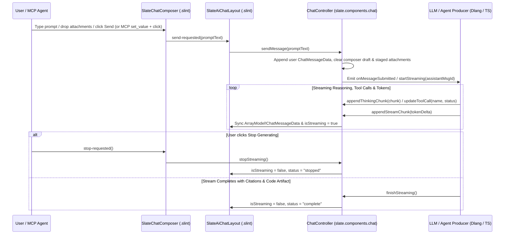

# Plan: Base AI Chat Components & Workspace Layout (ChatGPT / Onyx / Gemini Style)

- **Owning Projects**: `ui/`, `slate-dlang/` (`slate:ui`, `slate:solid`)
- **Status**: `in-review`
- **Revision**: 1
- **Timestamp**: 2026-10-17T10:05:00Z
- **Author**: Antigravity

---

## 1. Goal, Scope, and Non-Goals

### Goal
Provide Slate with a cohesive, production-grade suite of declarative **AI Chat Base Components** (`ui/components/chat_*.slint`), a full **AI Chat Application Layout** (`ui/layouts/ai_chat_layout.slint`), and a reactive **Dlang MCP Controller** (`ChatController` in `slate.components.chat`) inspired by the best patterns from **ChatGPT** (floating multi-modal composer, clean assistant turns, Canvas/Artifact split pane), **Onyx / Danswer** (numbered RAG source citations, knowledge-base scope pills, agent tool-call trace badges), and **Google Gemini** (collapsible chain-of-thought reasoning blocks, empty-state greeting hero with starter prompt cards, model/mode selector pills). Every component must work natively on desktop via `slint-d` and cross-compile 1:1 to SolidJS (`.tsx`) and TypeScript (`.ts`) via `slate:solid` (`slint2solid`).

### Scope
1. **Vector Icons for AI & Chat (`ui/components/icons.slint`)**:
   - Add pure 24x24 `Path` vector icons: `SlateSparkleIcon` (AI/Gemini assistant badge), `SlateSendIcon` (up-arrow send action), `SlatePaperclipIcon` (file/context attachment), `SlateThumbUpIcon`, `SlateThumbDownIcon`, `SlateRefreshIcon` (regenerate turn), `SlateCodeIcon` (code/artifact toggle), `SlateTerminalIcon` (tool call execution), `SlateBookOpenIcon` (RAG citation/source), and `SlateMessageIcon` (thread item).
2. **Base AI Chat Primitives (`ui/components/`)**:
   - **`SlateChatComposer` ([NEW] `ui/components/chat_composer.slint`)**:
     - Elevated pill/card prompt box (`SlateTheme.surface-1` / `surface-2`, `radius-lg`, focus ring on active input) with multi-line `TextInput` wrapped in `SlateMcpValueTarget`.
     - Staged attachment chips bar (`SlateChatAttachment`: filename, kind badge, size, remove callback) and `SlateMcpDropTarget` support for headless file drop injection.
     - Bottom toolbar row with:
       - Left: Attach button (`+` / paperclip), Model selector pill (`model-id`, e.g. `"Gemini 2.5 Pro"`), Reasoning/Deep-Search mode toggle pills (`search-enabled`, `thinking-enabled`).
       - Right: Character/token status hint and morphing **Send (`↑`) / Stop Streaming (`■`)** primary button.
   - **`SlateChatMessage` & Sub-Blocks ([NEW] `ui/components/chat_message.slint`)**:
     - **`SlateChatThinking` (Gemini / DeepSeek R1 / o3 style)**: Collapsible chain-of-thought disclosure (`SlateMcpExpandable`) showing `"Thinking..."` with `SlateSpinner` while active or `"Thought for 4s"` when complete, expanding to reveal a left-bordered reasoning trace.
     - **`SlateChatToolCall` (Onyx / Agentic MCP style)**: Compact status pill for tool invocations (`running`, `completed`, `error`) displaying tool name, summary (`"Searched 14 docs in Knowledge Base"`), duration badge, and optional expandable input/output preview.
     - **`SlateChatCodeBlock` (ChatGPT / Claude style)**: Monospace fenced code card with header bar (language badge, line count, `Copy` button with `SlateCopyIcon`, and `Open in Canvas / Apply` action button).
     - **`SlateChatCitations` (Onyx / Gemini / Perplexity style)**: Horizontal strip of numbered source citation chips (`[1] architecture.md`, `[2] server.d`) with source type badge, title, and click callback to open/highlight in the sources panel.
     - **`SlateChatMessage`**: Unified conversation turn rendering either a **User Bubble** (right-aligned `SlateTheme.accent-primary-subtle` or `surface-2` card with attachment chips and edit action) or an **Assistant Turn** (sparkle avatar, model & timestamp header, optional `SlateChatThinking`, `SlateChatToolCall` list, primary message text, optional `SlateChatCodeBlock`, `SlateChatCitations` strip, and action footer with Copy, Regenerate, Thumb Up/Down feedback, and token/latency stats).
   - **`SlateChatWelcome` ([NEW] `ui/components/chat_welcome.slint`)**:
     - Empty-conversation hero state with `SlateSparkleIcon` badge, greeting title (`"How can I help you build today?"`), subtitle, knowledge-scope filter pills, and a 2x2 grid of clickable starter prompt cards (`SlatePromptSuggestion`).
   - **`SlateChatThreadList` ([NEW] `ui/components/chat_thread_list.slint`)**:
     - Left sidebar component for conversation history with `"New Chat"` primary button, `SlateSearchInput` filter, thread list items (`SlateChatThreadItem`: id, title, preview/timestamp, model badge, pinned indicator), and delete/select callbacks.
   - **`SlateChatArtifactPanel` ([NEW] `ui/components/chat_artifact_panel.slint`)**:
     - Right-hand collapsible inspector drawer for **Canvas / Code Artifacts** and **RAG Source Citations** with segmented tab switcher (`"artifact"` | `"sources"`), copy/close header actions, code/document preview body, and full source cards list.
3. **Cohesive AI Chat Workspace Layout (`ui/layouts/ai_chat_layout.slint`)**:
   - **`SlateAiChatLayout` ([NEW] `ui/layouts/ai_chat_layout.slint`)**: Combines collapsible left `SlateChatThreadList`, resizable handle (`SlateResizableHandle`), center chat column (top header bar with sidebar toggle, model selector, streaming badge, and artifact drawer toggle; scrollable message viewport with empty-state automatic fallback to `SlateChatWelcome`; floating bottom `SlateChatComposer`), and collapsible right `SlateChatArtifactPanel`.
4. **Dlang Reactive Controller & SolidJS Cross-Compilation (`slate-dlang/`)**:
   - **`ChatController` ([NEW] `slate-dlang/packages/ui/source/slate/components/chat.d`)**:
     - Implements `McpControllable`, `Filterable` (thread/message search), `Selectable` (active thread selection), `Expandable` (thinking/tool-call disclosure), and `DropReceiver` (dropping file attachments into the composer).
     - Manages threads, message list (`ArrayModel!ChatMessageData`), streaming lifecycle (`sendMessage`, `startStreaming`, `appendStreamChunk`, `finishStreaming`, `stopStreaming`), thinking traces, tool calls, citations, feedback rating (`rateMessage`), and artifact panel state.
     - Registered in [`slate-dlang/packages/solid/source/slate/solid/compiler.d`](../../slate-dlang/packages/solid/source/slate/solid/compiler.d) and [`codegen_controller.d`](../../slate-dlang/packages/solid/source/slate/solid/codegen_controller.d) so `just solid-codegen` emits `chat.ts` and `.tsx` components automatically.

### Non-Goals
- Direct LLM provider network SDK integration (OpenAI/Gemini/Anthropic HTTP API keys or SSE parsing inside `slate:ui`; `ChatController` exposes clean programmatic and MCP streaming hooks that any backend or `slate:net` HTTP client can feed).
- Full CommonMark AST layout engine inside `.slint` (Slint lacks recursive dynamic DOM trees; instead, structured turn slots for reasoning, tool calls, primary text, code block, and citations provide clean, high-craft visual structure across both Slint native and SolidJS web targets).

---

## 2. Evidence and Current Behavior

### Repository Evidence
- **Shared Slint Component Registry ([`ui/index.slint`](../../ui/index.slint))**:
  - Exports 47 components and 16 layouts, all themed exclusively via [`SlateTheme`](../../ui/components/theme.slint) (`background`, `surface-1`, `surface-2`, `surface-3`, `accent-primary`, `accent-secondary`, `border-subtle`, `text-primary`, `text-secondary`, `text-muted`).
  - Has no conversational AI primitives (`SlateChatComposer`, `SlateChatMessage`, `SlateChatThinking`, `SlateChatCitations`, `SlateChatArtifactPanel`, or `SlateAiChatLayout`).
- **Declarative MCP Primitives ([`ui/components/mcp.slint`](../../ui/components/mcp.slint))**:
  - Provides `SlateMcpControl`, `SlateMcpValueTarget`, `SlateMcpExpandable`, and `SlateMcpDropTarget` plus the global `SlateMcp` action bus.
- **SolidJS Cross-Compiler ([`slate-dlang/packages/solid/`](../../slate-dlang/packages/solid/AGENTS.md))**:
  - [`WorkspaceCompiler.compileWorkspace`](../../slate-dlang/packages/solid/source/slate/solid/compiler.d) compiles every `.slint` file in `ui/` into `.tsx` and transpiles D controllers listed in `ControllerTarget[]` into TypeScript using `DToTsTranspiler` (`d_to_ts.d`) and `ControllerCompiler` (`codegen_controller.d`).
  - Because Slint structs cannot contain nested array fields when bridged across `slint-d`'s flat `SlintStruct` value map or simple `.slint` `for` loops inside nested structs, flat denormalized fields or separate `in property <[Struct]>` models (like [`ui/components/media_player.slint`](../../ui/components/media_player.slint) and [`ui/components/file_dialog.slint`](../../ui/components/file_dialog.slint)) are the proven pattern across `ui/`.

### Dataflow Analysis



### Failure Points (`F<n>`)
- **`F1` (Nested Array Struct Limitations in Slint & `slint2solid`)**: Slint structs used inside `for msg in root.messages` work most reliably in both `slint-lsp` and `slint2solid` when all struct fields are scalar (`string`, `int`, `float`, `bool`). Embedding nested `[SlateCitation]` arrays *inside* `SlateChatMessageItem` can complicate `d_to_ts` and `slint-d` struct conversion. **Mitigation**: Keep `SlateChatMessageItem` fields scalar (including primary thinking text, primary tool call summary/status, primary code block snippet/language, and citation count/summary) while also providing standalone `SlateChatCitations`, `SlateChatToolCall`, and `SlateChatCodeBlock` components that accept full arrays when composed directly or displayed in the active turn / artifact inspector.
- **`F2` (Duplicate `accessible-id`s in Message Lists)**: Repeating messages, citations, and starter prompts must scope every child `accessible-id` with `root.automation-id + "-msg-" + msg.id` so `dumpUiTree()` never encounters duplicate explicit IDs.
- **`F3` (Empty / Whitespace Prompt Submission)**: Clicking Send when `draft-text` is empty or while `is-streaming` is true could create blank turns or race active generation. `ChatController.sendMessage` and `SlateChatComposer` must guard against empty submissions and morph the primary button to `Stop` while streaming.
- **`F4` (`d_to_ts` Transpiler Compatibility)**: `ChatController` in `slate.components.chat` must use the D subset supported by `d_to_ts.d` (standard classes, structs, arrays, `foreach`, helper methods, and `@McpIgnore` on `slint.model.ArrayModel` getters) so `just solid-codegen` and `just slate-test-solid` succeed without errors.

---

## 3. Visual Design Mock-ups & Component Architecture

### 3.1 Full AI Chat Workspace Layout (`SlateAiChatLayout`)
Combines **ChatGPT's** clean three-column spatial hierarchy (Thread Sidebar + Center Stream + Right Canvas/Artifact Panel), **Onyx's** RAG source citations & tool-execution badges, and **Gemini's** collapsible reasoning block and floating multi-modal composer:

```text
+----------------------------------------------------------------------------------------------------------+
| [=] Threads          |  ✦ Gemini 2.5 Pro ▾   [⚡ MCP: 6 tools]  [📚 Knowledge: Slate Repo]   [<> Canvas] |
+----------------------+----------------------------------------------------+------------------------------+
| [+ New Chat        ] |                                                    | <> Artifact  | 📚 Sources(3) |
| [🔍 Filter chats...] |  [You]                                   10:02 AM  |------------------------------|
|                      |  +----------------------------------------------+  | 📄 chat_composer.slint [Copy]|
| Pinned               |  | Design base AI chat components in Slint with |  |------------------------------|
| ● AI Chat UI Design  |  | streaming, thinking trace, and citations.    |  |  1 | export component        |
|   Gemini 2.5 · 2m    |  | 📎 [architecture.md]  📎 [theme.slint]       |  |  2 | SlateChatComposer {     |
| ○ QUIC Stream Retry  |  +----------------------------------------------+  |  3 |   in-out property       |
|   Claude 3.7 · 1h    |                                                    |  4 |     <string> text;      |
|                      |  ✦ Slate AI  [Gemini 2.5 Pro]            10:02 AM  |  5 |   in property <bool>    |
| Today                |  +----------------------------------------------+  |  6 |     is-streaming;       |
| ○ SolidJS Codegen    |  | ▾ 🧠 Thought for 3.2s                        |  |  7 |   callback              |
|   GPT-4o · 4h        |  |   │ Checked SlateTheme tokens & mcp.slint    |  |  8 |     send-requested();   |
| ○ DataGrid Sorting   |  |   │ Mapped Onyx citations + Gemini thinking  |  |  9 | }                       |
|   Gemini 2.5 · 6h    |  +----------------------------------------------+  |                              |
|                      |  +----------------------------------------------+  |------------------------------|
|                      |  | ✓ ⚡ Searched 12 docs in `ui/components/` 80ms|  | Referenced Sources           |
|                      |  +----------------------------------------------+  | [1] ui/components/theme.slint|
|                      |  Here is the component architecture for Slate's    |     Dark/light surface tokens|
|                      |  AI Chat suite, using `SlateTheme` tokens [1][2]:  | [2] ui/components/mcp.slint  |
|                      |                                                    |     Accessibility wrappers   |
|                      |  +----------------------------------------------+  | [3] slate/agent/traits.d     |
|                      |  | slint · ui/components/chat_composer.slint [📋]|  |     McpControllable mixin    |
|                      |  |----------------------------------------------|  |                              |
|                      |  | export component SlateChatComposer { ... }   |  |                              |
|                      |  +----------------------------------------------+  |                              |
|                      |                                                    |                              |
|                      |  📚 Sources: [1] theme.slint  [2] mcp.slint  [3]   |                              |
|                      |  [📋 Copy] [↻ Retry] [👍] [👎]  412 tok · 48 tok/s |                              |
|                      |                                                    |                              |
|                      |  +----------------------------------------------+  |                              |
|                      |  | 📎 [draft_spec.md ×]                         |  |                              |
|                      |  | Ask anything, @mention a file, or /command...|  |                              |
|                      |  | [+] [✦ Gemini 2.5 ▾] [🧠 Think] [🌐 Search] [↑]|  |                              |
|                      |  +----------------------------------------------+  |                              |
+----------------------+----------------------------------------------------+------------------------------+
```

### 3.2 Empty State Hero & Starter Suggestions (`SlateChatWelcome`)
Displayed automatically when a new conversation has 0 messages (Gemini / Onyx / ChatGPT style):

```text
+--------------------------------------------------------------------------+
|                                                                          |
|                              ╭──────────╮                                |
|                              │    ✦     │                                |
|                              ╰──────────╯                                |
|                     How can I help you build today?                      |
|         Ask questions, inspect your codebase, or generate UI layouts.    |
|                                                                          |
|        [All Sources]  [📄 Codebase]  [📐 Architecture Docs]  [⚡ MCP]    |
|                                                                          |
|   +----------------------------------+ +--------------------------------+|
|   | 📐 Design a Slint Layout         | | 🔍 Audit Security & Contracts  ||
|   | Generate a dark-mode component   | | Check @safe annotations and    ||
|   | with full MCP accessibility.     | | Design-by-Contract invariants. ||
|   +----------------------------------+ +--------------------------------+|
|   | ⚡ Debug QUIC Packet Framing     | | 🌐 Cross-Compile to SolidJS    ||
|   | Trace RFC 9000 stream state      | | Verify .slint to .tsx signals  ||
|   | transitions and loss recovery.   | | and Dlang controller codegen.  ||
|   +----------------------------------+ +--------------------------------+|
|                                                                          |
+--------------------------------------------------------------------------+
```

### 3.3 Base Component Inventory

| Component / Struct | File | Inspired By | Responsibilities |
|---|---|---|---|
| `SlateChatComposer`, `SlateChatAttachment` | `ui/components/chat_composer.slint` | ChatGPT / Gemini / Onyx | Floating multi-line prompt input, attachment chip bar, drop-target support, model selector pill, `Think` & `Search` mode toggles, and morphing Send (`↑`) / Stop (`■`) button |
| `SlateChatMessage`, `SlateChatMessageItem`, `SlateChatThinking`, `SlateChatToolCall`, `SlateChatCodeBlock`, `SlateChatCitations`, `SlateChatCitationItem`, `SlateChatToolStep` | `ui/components/chat_message.slint` | ChatGPT / Onyx / Gemini / Claude | User & Assistant turn cards, collapsible reasoning trace (`SlateChatThinking`), agent tool step badge (`SlateChatToolCall`), fenced code card (`SlateChatCodeBlock`), numbered RAG source chips (`SlateChatCitations`), and feedback/regenerate action bar |
| `SlateChatWelcome`, `SlatePromptSuggestion` | `ui/components/chat_welcome.slint` | Gemini / Onyx / ChatGPT | Empty-state hero greeting, scope filter pills, and 2x2 starter prompt suggestion grid |
| `SlateChatThreadList`, `SlateChatThreadItem` | `ui/components/chat_thread_list.slint` | ChatGPT / Onyx | Collapsible conversation history sidebar with `New Chat` button, live search filter, pinned badges, and active selection |
| `SlateChatArtifactPanel` | `ui/components/chat_artifact_panel.slint` | ChatGPT Canvas / Claude Artifacts / Onyx Sources | Side-by-side tabbed inspector switching between live Code/Document Artifact view and detailed RAG Source Citations list |
| `SlateAiChatLayout` | `ui/layouts/ai_chat_layout.slint` | Unified Workspace | Full responsive 3-pane AI Chat layout wiring `SlateChatThreadList`, `SlateChatWelcome`, message stream, `SlateChatComposer`, and `SlateChatArtifactPanel` |
| `ChatController` | `slate-dlang/packages/ui/source/slate/components/chat.d` | Slate MCP + SolidJS | Reactive Dlang controller managing threads, messages, streaming chunks, thinking blocks, tool statuses, attachments, and MCP state/actions |

---

## 4. Proposed Design and Material Decisions

### D1: Modular Base Primitives vs. Monolithic Chat View
- **Problem**: Developers building AI-enabled desktop/web apps in Slate need both standalone chat primitives (e.g., embedding just a `SlateChatComposer` or `SlateChatMessage` inside a dock panel) and a turnkey full-window layout (`SlateAiChatLayout`).
- **Options**:
  - *Option A (Single monolithic `SlateAiChat` file)*: Harder to reuse individual pieces like `SlateChatThinking`, `SlateChatCodeBlock`, or `SlateChatComposer` in custom layouts.
  - *Option B (Composable Base Components + Turnkey Layout)*: Author 5 focused component files in `ui/components/` (`chat_composer.slint`, `chat_message.slint`, `chat_welcome.slint`, `chat_thread_list.slint`, `chat_artifact_panel.slint`) and 1 composite layout in `ui/layouts/ai_chat_layout.slint`, re-exporting all in `ui/index.slint`.
- **Decision**: **Option B**. Matches Slate's existing separation between `ui/components/` and `ui/layouts/`.

### D2: Slint Struct Schema for `SlateChatMessageItem` (Dual-Compiler Safe)
- **Problem**: Both `slint-d` (`toSlintStruct!T`) and `slate:solid` (`slint2solid`) require struct fields iterated in `for msg in root.messages` to be flat scalar types (`string`, `int`, `float`, `bool`).
- **Decision**: Define `SlateChatMessageItem` with flat scalar properties covering the complete turn lifecycle (`id`, `role`, `sender-name`, `model-name`, `timestamp`, `content`, `thinking-text`, `thinking-duration`, `thinking-expanded`, `tool-name`, `tool-summary`, `tool-status`, `code-snippet`, `code-language`, `citation-summary`, `citation-count`, `attachment-name`, `is-streaming`, `feedback`, `token-stats`), while also exposing standalone `SlateChatCitations` (`[SlateChatCitationItem]`) and `SlateChatToolCall` components for rich multi-item composition and the right-hand `SlateChatArtifactPanel`.

### D3: Declarative MCP Capabilities on `ChatController`
- **Problem**: AI agents controlling a Slate application via MCP (`inspect_tree`, `click_element`, `send_keys`, `get_state`) need deterministic semantic control over the chat interface without brittle pixel coordinates.
- **Decision**:
  - `ChatController` implements `McpControllable`, `Filterable` (filtering threads/messages), `Selectable` (selecting thread index), `Expandable` (toggling thinking disclosure on a message index), and `DropReceiver` (attaching files into the composer via `dropFiles`).
  - `SlateChatComposer` wraps its prompt input in `SlateMcpValueTarget` (`accessible-action-set-value`) and its attachment region in `SlateMcpDropTarget`.
  - `SlateChatThinking` uses `SlateMcpExpandable` (`accessible-action-expand`).

---

## 5. Requirements and Acceptance Tests

### EARS Requirements

| ID | Category | Requirement |
|---|---|---|
| `U1` | Ubiquitous | The `ui/` library shall export `SlateChatComposer`, `SlateChatAttachment`, `SlateChatMessage`, `SlateChatMessageItem`, `SlateChatThinking`, `SlateChatToolCall`, `SlateChatCodeBlock`, `SlateChatCitations`, `SlateChatCitationItem`, `SlateChatWelcome`, `SlatePromptSuggestion`, `SlateChatThreadList`, `SlateChatThreadItem`, `SlateChatArtifactPanel`, and `SlateAiChatLayout` from `ui/index.slint` using only `SlateTheme` design tokens. |
| `U2` | Ubiquitous | Every interactive chat sub-component shall expose a deterministic `accessible-role`, `accessible-label`, and scoped `accessible-id` prefixed by its parent `automation-id`. |
| `E1` | Event-driven | When `sendMessage(text)` is invoked on `ChatController` (or `send-requested` fires on `SlateChatComposer`) with non-empty text, the `ChatController` shall append a `"user"` message containing any staged attachments, clear the composer draft and attachments, and increment `messageCount`. |
| `E2` | Event-driven | When `startStreaming(modelName)` and `appendStreamChunk(delta)` (or `appendThinkingChunk(delta)`) are called on `ChatController`, the `ChatController` shall create or update the active `"assistant"` message with `isStreaming = true` until `finishStreaming()` or `stopStreaming()` is called. |
| `E3` | Event-driven | When `dropFiles(paths)` is invoked on `ChatController` (or via `SlateMcpDropTarget` on `SlateChatComposer`), the `ChatController` shall stage the file attachments on the composer draft and expose them in `stagedAttachments`. |
| `E4` | Event-driven | When `toggleExpand(messageIndex)` is invoked on `ChatController` (or `SlateChatThinking` is clicked), the `ChatController` shall toggle `thinkingExpanded` on the target message. |
| `S1` | State-driven | While the active conversation has zero messages (`messages.length == 0`), `SlateAiChatLayout` shall display `SlateChatWelcome` with starter prompt suggestion cards instead of an empty scroll region. |
| `S2` | State-driven | While `is-streaming` is `true` on `SlateChatComposer`, the primary action button shall display the stop state (`"Stop Generating"`) and invoke `stop-requested()` when triggered. |
| `W1` | Unwanted behavior | If `sendMessage("")` or whitespace-only text is submitted to `ChatController`, then `ChatController` shall reject the submission without appending a blank message. |
| `W2` | Unwanted behavior | If `selectIndex(idx)` or `rateMessage(id, rating)` is called with an out-of-bounds thread index or invalid feedback rating, then `ChatController` shall throw `AgentError` (or preserve state on transactional rollback). |

### Acceptance Scenarios (`Gherkin`)

```gherkin
Scenario: T1 - Submitting a prompt with staged attachments creates a user turn and resets draft (covers U1, E1, E3, W1)
  Given a ChatController with draft text "Explain QUIC congestion control" and staged attachment "/docs/rfc9002.pdf"
  When sendMessage is invoked on the controller
  Then a new user message is appended with the prompt text and attachment badge "rfc9002.pdf"
  And the composer draft text and staged attachments are cleared
  And submitting an empty or whitespace-only prompt does not append a message

Scenario: T2 - Streaming assistant response with thinking trace, tool call, code block, and citations (covers E2, E4, S2)
  Given an active conversation in ChatController
  When startStreaming("Gemini 2.5 Pro") is called followed by appendThinkingChunk, setActiveToolCall, appendStreamChunk, and finishStreaming
  Then the assistant message reflects the accumulated thinking trace, tool status, streamed content, and completion state
  And toggling thinking expansion via toggleExpand flips thinkingExpanded on the assistant message

Scenario: T3 - Thread switching, search filtering, and message feedback (covers U2, W2)
  Given a ChatController with multiple chat threads
  When setFilterQuery narrows visible threads and selectIndex switches the active thread
  Then the controller updates the active thread messages and mcpSnapshot reflects the state
  And invalid feedback ratings or out-of-range thread indices throw AgentError and roll back cleanly

Scenario: T4 - Slint validation and SolidJS cross-compilation of all AI chat components (covers U1, U2, S1, S2)
  Given the new AI chat .slint components in ui/ and ChatController in slate.components.chat
  When slint-lsp (slint_check) and just solid-codegen / just slate-test-solid are executed
  Then all .slint files pass with zero errors and compile cleanly to SolidJS .tsx and TypeScript chat.ts
```

### Coverage Matrix

| Scenario | Requirement IDs | Target Test File / Suite | Layer |
|---|---|---|---|
| `T1` | `U1`, `E1`, `E3`, `W1` | `slate-dlang/packages/ui/source/slate/components/chat.d` (`unittest`) | Unit (Pure-D) |
| `T2` | `E2`, `E4`, `S2` | `slate-dlang/packages/ui/source/slate/components/chat.d` (`unittest`) | Unit (Pure-D) |
| `T3` | `U2`, `W2` | `slate-dlang/packages/ui/source/slate/components/chat.d` (`unittest`) | Unit + MCP Reflection |
| `T4` | `U1`, `U2`, `S1`, `S2` | `just solid-codegen`, `just slate-test-solid`, `slint_check`, `just slate-test-ui-native` | Integration / Cross-Compiler |

---

## 6. Affected Files and Implementation Steps

| Action | File Path | Purpose |
|---|---|---|
| `[MODIFY]` | [`ui/components/icons.slint`](../../ui/components/icons.slint) | Add `SlateSparkleIcon`, `SlateSendIcon`, `SlatePaperclipIcon`, `SlateThumbUpIcon`, `SlateThumbDownIcon`, `SlateRefreshIcon`, `SlateCodeIcon`, `SlateTerminalIcon`, `SlateBookOpenIcon`, `SlateMessageIcon` |
| `[NEW]` | `ui/components/chat_composer.slint` | `SlateChatAttachment` struct & `SlateChatComposer` multi-modal prompt bar |
| `[NEW]` | `ui/components/chat_message.slint` | `SlateChatMessageItem`, `SlateChatCitationItem`, `SlateChatThinking`, `SlateChatToolCall`, `SlateChatCodeBlock`, `SlateChatCitations`, and `SlateChatMessage` |
| `[NEW]` | `ui/components/chat_welcome.slint` | `SlatePromptSuggestion` struct & `SlateChatWelcome` empty-state greeting hero |
| `[NEW]` | `ui/components/chat_thread_list.slint` | `SlateChatThreadItem` struct & `SlateChatThreadList` sidebar component |
| `[NEW]` | `ui/components/chat_artifact_panel.slint` | `SlateChatArtifactPanel` right-hand Canvas / Sources inspector drawer |
| `[NEW]` | `ui/layouts/ai_chat_layout.slint` | `SlateAiChatLayout` full 3-pane AI chat workspace layout |
| `[MODIFY]` | [`ui/index.slint`](../../ui/index.slint) | Re-export all new AI chat icons, structs, components, and `SlateAiChatLayout` |
| `[NEW]` | `slate-dlang/packages/ui/source/slate/components/chat.d` | `ChatController`, `ChatMessageData`, `ChatThreadData`, `ChatCitationData`, `ChatAttachmentData`, `PromptSuggestionData`, and `unittest` suite |
| `[MODIFY]` | [`slate-dlang/packages/ui/source/slate/components/package.d`](../../slate-dlang/packages/ui/source/slate/components/package.d) | Publicly export `slate.components.chat` |
| `[MODIFY]` | [`slate-dlang/packages/solid/source/slate/solid/codegen_controller.d`](../../slate-dlang/packages/solid/source/slate/solid/codegen_controller.d) | Import `ChatController` for compile-time MCP reflection codegen |
| `[MODIFY]` | [`slate-dlang/packages/solid/source/slate/solid/compiler.d`](../../slate-dlang/packages/solid/source/slate/solid/compiler.d) | Add `ControllerTarget("packages/ui/source/slate/components/chat.d", ["ChatController"], "chat.ts")` and export `./chat` in `index.ts` |

### Step-by-Step TDD Order (`Red → Green → Iterate`)
1. **Step 1 (Slint Icons & Base Chat Components)**:
   - Add the 10 AI chat vector icons in `ui/components/icons.slint`.
   - Implement `chat_composer.slint`, `chat_message.slint`, `chat_welcome.slint`, `chat_thread_list.slint`, `chat_artifact_panel.slint`, and `ui/layouts/ai_chat_layout.slint`.
   - Export all new symbols in `ui/index.slint` and validate with `slint_check` (`slint-lsp`).
2. **Step 2 (Red → Green Dlang `ChatController`)**:
   - Write `unittest` blocks in `slate-dlang/packages/ui/source/slate/components/chat.d` with `// Spec:` and `/// Example:` headers covering `T1`–`T3`.
   - Implement `ChatController` satisfying `McpControllable`, `Filterable`, `Selectable`, `Expandable`, and `DropReceiver`.
   - Run `just slate-test-ui` to verify pure-D controller tests pass.
3. **Step 3 (SolidJS Cross-Compiler Registration & E2E Verification)**:
   - Register `ChatController` in `codegen_controller.d` and `compiler.d`.
   - Run `just solid-codegen`, `just slate-test-solid`, `just slate-test-ui-native`, `just d-fmt`, and `just d-lint`.

---

## 7. Verification

| Check | Command | Working Directory | Expected Outcome |
|---|---|---|---|
| Slint LSP validation | `slint_check` MCP tool on `ui/index.slint` and new `.slint` files | `/home/developer/projects/slate` | `0 errors` across all `.slint` files |
| Pure-D UI Controller Tests | `just slate-test-ui` | `/home/developer/projects/slate` | All `slate:ui` unit tests pass including `slate.components.chat` |
| Native Slint + MCP Tests | `just slate-test-ui-native` | `/home/developer/projects/slate` | All headless native Slint tests pass (`SLINT_BACKEND=software`) |
| SolidJS Cross-Compiler Codegen | `just solid-codegen` | `/home/developer/projects/slate` | Compiles all `.slint` files + `chat.d` into `target/solid-ui/` with `0 errors` |
| SolidJS Compiler Test Suite | `just slate-test-solid` | `/home/developer/projects/slate` | All SolidJS compiler & runtime verification tests pass |
| D Formatting & Linting | `just d-fmt && just d-lint` | `/home/developer/projects/slate` | `0 warnings`, `0 errors` |

---

## 8. Risks and Delivery

- **Theme Parity**: All new components strictly bind colors, spacing, font sizes, and border radii to `SlateTheme.*` so toggling `SlateTheme.is-dark` immediately updates the entire AI chat workspace without hardcoded surface colors.
- **Rollback**: All additions are modular files in `ui/components/`, `ui/layouts/`, and `slate.components.chat`; reverting requires only removing the new modules and barrel exports.

---

## 9. Assumptions, Open Questions, and Approval

- **Assumptions**:
  - `SlateAiChatLayout` and the 5 base `SlateChat*` components should support ChatGPT, Onyx, and Gemini patterns out of the box (threads sidebar, welcome starter grid, thinking trace, tool calls, code block, numbered RAG citations, multi-modal composer, and artifact/sources panel).
- **Review Status**: `in-review` — awaiting user feedback on the plan and interactive design mock-ups before implementation.
