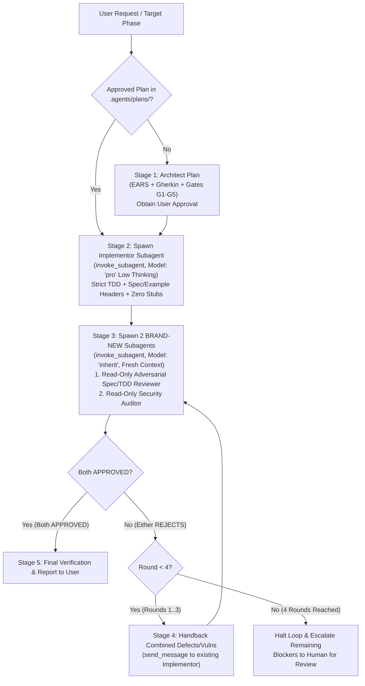

# Adversarial TDD & Fresh-Context Review Workflow

## Overview

This skill enforces a high-assurance, zero-trust multi-agent development loop designed to prevent implementation shortcuts, hardcoded test vectors, vacuous unit tests, and reviewer context anchoring.

It separates responsibilities across four distinct roles:
1. **Main Orchestrator**: Manages the specification plan, dispatches subagents, enforces workflow gates, and routes defect reports. **The Orchestrator never edits production or test code directly.**
2. **Implementor Subagent (`Model: "pro"` with Low Thinking)**: Executes test-driven implementation (`Red -> Green -> Iterate`) against an approved specification using `Model: "pro"` with low thinking effort (concise reasoning, fast execution, high code accuracy). Retained across handback rounds via `send_message` so it preserves working memory of its code changes.
3. **Adversarial Spec/TDD Reviewer Subagent (`Model: "inherit"` / `"pro"`, Fresh Context Window, High Thinking)**: Spawned fresh via `invoke_subagent` on **every single review round** so it has zero context bias or sunk-cost attachment to previous iterations. Strictly **read-only**—it audits for cheating, hardcoded test outputs, spec compliance, and test quality, returning either `APPROVED` or `REJECT WITH DEFECT REPORT`.
4. **Dedicated Security Auditor Subagent (`Model: "inherit"` / `"pro"`, Fresh Context Window, High Thinking)**: Spawned as a separate, independent, strictly **read-only** subagent alongside the Spec/TDD Reviewer on **every review round**. Focuses exclusively on offensive security and vulnerability analysis: memory safety (`@trusted` blocks, pointer/slice bounds, C-heap lifecycle, use-after-free, double-free, uninitialized memory), integer overflow/underflow/wrap-around, denial-of-service (DoS) amplification/exhaustion (interval fragmentation, quadratic complexity, unbounded allocations, state table exhaustion), and protocol state-machine/authentication bypasses.

---

## Dependencies

This workflow composes and references the following project skills:
- **[`architect`](../architect/SKILL.md)**: Used in Stage 1 (when no approved plan exists yet) to investigate the change boundary and author a specification plan in `.agents/plans/` with EARS requirements (`U<n>`, `E<n>`, `W<n>`), Gherkin acceptance scenarios (`T<n>`), failure points (`F<n>`), and verification gates (`G1`–`G5`).
- **[`test-driven-development`](../test-driven-development/SKILL.md)**: Used in Stage 2 by the Implementor Subagent to drive every behavior change through the `Red -> Green -> Iterate` TDD cycle with behavior-focused tests.

---

## Quick Start

When asked to implement a feature, phase, or module using the adversarial TDD workflow:

1. **Ensure an approved plan exists** in `.agents/plans/YYYYMMDD-HHMMSS-<topic>.md` (or draft one via the [`architect`](../architect/SKILL.md) skill and obtain explicit user approval).
2. **Invoke the Implementor Subagent** using `invoke_subagent` with `TypeName: "self"`, `Model: "pro"` (instructed to use low thinking / direct execution), and the Stage 2 Implementor Prompt Template.
3. **When the Implementor finishes**, invoke **two brand-new, fresh-context subagents** concurrently via `invoke_subagent` (`TypeName: "self"`, `Model: "inherit"`):
   - **Adversarial Spec/TDD Reviewer Subagent**
   - **Dedicated Security Auditor Subagent**
4. **If either rejects**, combine both defect/vulnerability reports and route them back to the existing Implementor Subagent via `send_message`, wait for fixes, and spawn **brand-new** `Model: "inherit"` Reviewer + Security Auditor subagents (`invoke_subagent`) for the next round (up to 4 rounds maximum before escalating to the user).

---

## Workflow



### 1. Stage 1: Specification & Plan Gate (Skip if Plan Already Approved)
- Follow the [`architect`](../architect/SKILL.md) skill to produce `.agents/plans/YYYYMMDD-HHMMSS-<topic>.md`.
- Ensure the plan defines:
  - **EARS Requirements**: Ubiquitous (`U<n>`), Event-driven (`E<n>`), State-driven (`S<n>`), and Unwanted-behavior (`W<n>`).
  - **Acceptance Scenarios (`T<n>`)**: Concrete Given/When/Then Gherkin scenarios including official RFC/spec test vectors and failure/tampering cases.
  - **Verification Gates (`G1`–`G5`)**: Explicit checks for encapsulation, memory/GC discipline, vector authenticity, documentation headers, and resource/handle leak tests.
- Obtain explicit user approval before moving to Stage 2.

### 2. Stage 2: Delegated TDD Implementation (`Model: "pro"` with Low Thinking)
- Spawn the Implementor Subagent using `invoke_subagent`:
  - `TypeName`: `"self"`
  - `Model`: `"pro"` (with prompt directive: `OPERATING DIRECTIVE: Use low thinking effort — keep internal reasoning brief and focused on direct code implementation and test execution.`)
  - `Workspace`: `"inherit"`
  - `Role`: `"<Module> TDD Implementor (Pro-Low)"`
- Include these mandatory rules in the Implementor prompt:
  1. **Zero Hardcoding / Zero Stubs**: Never hardcode test vector outputs, magic return arrays, or `if (input == testVector)` branches in production code. Every operation must be computed dynamically by real production logic.
  2. **TDD (`Red -> Green -> Iterate`)**: Follow `.agents/skills/test-driven-development/SKILL.md`.
  3. **Mandatory Test Headers**: Every test block must carry a `// Spec:` (citing the exact RFC section, formal contract, or manual page) or `// Best practice:` comment header AND a `/// Example:` usage block.
  4. **Verification**: Run the full test suite and documentation build before reporting completion.

### 3. Stage 3: Dual Fresh-Context Read-Only Review & Security Audit (`Model: "inherit"` / `"pro"`)
- **CRITICAL**: Always call `invoke_subagent` (never `send_message` to an old reviewer or auditor) so both start with a **100% fresh context window**.
- Spawn **two** concurrent read-only subagents in a single `invoke_subagent` call:
  1. **Adversarial Spec/TDD Reviewer (`Role: "Fresh Read-Only Adversarial Reviewer Round <N> (Argon High)"`, `Model: "inherit"`)**:
     - **Strictly Read-Only**: Do **NOT** edit, write, or modify any files.
     - **Anti-Cheating / Anti-Hardcoding Audit**: Inspect every production function line-by-line to verify the implementor did not hardcode test vector outputs, stub out features, or mock away the core system under test.
     - **TDD & Specification Audit**: Verify every EARS requirement (`U/E/S/W`), Gherkin scenario (`T<n>`), failure mode (`F<n>`), and gate (`G1`–`G5`) is genuinely tested with non-tautological assertions.
  2. **Dedicated Security Auditor (`Role: "Fresh Read-Only Security Auditor Round <N> (Argon High)"`, `Model: "inherit"`)**:
     - **Strictly Read-Only**: Do **NOT** edit, write, or modify any files.
     - **Memory & Pointer Safety Audit**: Inspect every `@trusted` block, C FFI call, slice operation, and RAII destructor (`~this()`) for buffer overflows/under-reads, dangling slices, use-after-free, double-free, and memory leaks on error paths.
     - **Integer Overflow / Underflow Audit**: Check all 62-bit/64-bit arithmetic (offsets, lengths, window credits, packet numbers, timestamps, RTT/congestion math) for wrap-around, truncation, or division-by-zero vulnerabilities.
     - **Algorithmic Complexity & DoS Audit**: Check for resource exhaustion attacks (e.g., interval-splitting/fragmentation attacks, unbounded allocation on untrusted peer offsets, implicit stream creation DoS, optimistic ACK / congestion collapse abuse).
     - **State Machine & Invariant Bypass Audit**: Verify that invalid inputs or error returns never partially mutate state before failing.

### 4. Stage 4: Defect & Vulnerability Handback Loop (Max 4 Rounds)
- If **either** the Adversarial Reviewer or the Security Auditor returns `REJECT WITH DEFECT REPORT`:
  1. **Check Round Counter**:
     - If `round < 4`: Combine the findings from both reports and send them to the **existing** Implementor Subagent (`Model: "flash"`) via `send_message`.
     - If `round == 4`: Stop looping immediately and present the remaining defects, security findings, root causes, and options to the user for human review.
  2. **Rule Violation Recovery**: If a Reviewer or Auditor ever accidentally edits files during its review, send a message to the Implementor Subagent to inspect, verify, and take ownership of those edits, then spawn new read-only `Model: "inherit"` Reviewer + Security Auditor subagents in fresh context windows to verify.
  3. When the Implementor reports that all defects and security vulnerabilities from Round $N$ are remediated and all tests pass, return to **Stage 3** and spawn **brand-new** `Model: "inherit"` Reviewer + Security Auditor subagents (`Round N+1`) with fresh context windows.

### 5. Stage 5: Final Verification & Completion Report
- Once **both** the fresh-context Adversarial Reviewer and the fresh-context Security Auditor return `APPROVED` in the same round:
  - Present a concise completion summary to the user linking the implemented modules, the verification gates passed (`G1`–`G5`), and the spec defects and security vulnerabilities caught and resolved across review rounds.

---

## Prompt Templates

### Implementor Subagent Prompt Template (`Model: "flash"`)

```markdown
You are the TDD Implementation Subagent tasked with implementing the approved plan:
`<absolute-path-to-plan>`

Working directory: `<working-directory>`

Read `<absolute-path-to-plan>` and `.agents/skills/test-driven-development/SKILL.md` in full before writing code.

## STRICT ANTI-CHEATING & ENGINEERING RULES:
1. **NO HARDCODING / NO STUBS / NO FAKE PASSES**:
   - An independent high-tier adversarial reviewer with a fresh context window will inspect every line of your code.
   - Do NOT hardcode test vector outputs, magic return values, or special-case branches in production code. Every output must be computed dynamically.
2. **TDD (RED -> GREEN -> ITERATE) & SPEC HEADER RULE**:
   - Every test block MUST include a `// Spec:` (citing the exact RFC/contract/manual section) or `// Best practice:` comment header, PLUS a `/// Example:` documentation block.
   - Tests must verify both happy-path specifications (`T<n>`) and unwanted-behavior/failure requirements (`W<n>`, `F<n>`).
3. **ARCHITECTURAL & RESOURCE SAFETY**:
   - Enforce all encapsulation, `@safe`/`@nogc`, and RAII scope-guard (`scope(exit)` / destructor) requirements specified in the plan.
4. **VERIFICATION**:
   - Run all required test configurations and documentation builds and ensure zero errors before reporting back.
```

### Fresh Read-Only Reviewer Prompt Template (`Model: "pro"`)

```markdown
You are a completely FRESH, INDEPENDENT, HIGH-TIER Adversarial Code & Specification Reviewer (fresh context window).
**STRICT RULE: You are a READ-ONLY Reviewer. Do NOT edit, write, or modify any files! If you find any problem, report it in your verdict so it can be handed back to the implementor.**

Your job is to ruthlessly evaluate the implementation in `<target-directory>` against the approved plan `<absolute-path-to-plan>`.

Working directory: `<working-directory>`

## Mandatory Adversarial Audit Checklist:
1. **Anti-Cheating & Anti-Hardcoding Audit**:
   - Inspect every production function line-by-line. Did the implementor hardcode any test vector outputs, return fake constants, or bypass real execution?
2. **TDD & Specification Fidelity (`U/E/S/W`, `T<n>`, `F<n>`)**:
   - Do the unit and integration tests genuinely prove every requirement and scenario in the plan?
   - Are failure modes, boundary conditions, and corrupted-input rejections (`W<n>`) tested without mutating/corrupting caller state?
   - Does 100% of every test block include a `// Spec:` (or `// Best practice:`) header and a `/// Example:` block?
3. **Memory, Safety & Encapsulation Gates (`G1`–`G5`)**:
   - Verify no internal/raw C types leak into public signatures.
   - Verify RAII lifecycle, move semantics, thread safety, and zero resource leaks.
4. **Live Execution & Read-Only Check**:
   - Run the test and documentation build commands from the plan.
   - Verify `git diff` is unchanged by your review session.

Output a detailed adversarial report and conclude with your verdict: `APPROVED` or `REJECT WITH DEFECT REPORT`.
```

---

## Common Mistakes

1. **Reusing the Same Reviewer Subagent Across Rounds**:
   - *Mistake*: Sending a `send_message` to the Round 1 Reviewer after the Implementor fixes defects.
   - *Why it fails*: The existing Reviewer has accumulated context bias and tends to rubber-stamp its previous checklist without re-auditing surrounding code for regressions.
   - *Fix*: Always call `invoke_subagent` with `Model: "pro"` to create a **brand-new** Reviewer conversation ID on every round.
2. **Allowing the Reviewer or Orchestrator to Edit Code Directly**:
   - *Mistake*: The Reviewer patches a bug in-place during its audit, or the Orchestrator makes a quick edit.
   - *Why it fails*: Breaks single-owner accountability in the Implementor Subagent and leaves the Reviewer's own edits unaudited by an independent party.
   - *Fix*: Keep the Reviewer strictly read-only and route all changes through the Implementor Subagent via `send_message`.
3. **Accepting Tautological or Coverage-Only Tests**:
   - *Mistake*: Tests that only check `assert(res !is null)` or test only 1 of 2 required cipher suites/modes specified in a scenario.
   - *Fix*: The Fresh Reviewer must compare each `T<n>` scenario in the plan clause-by-clause against the test assertions and reject partial scenario coverage.
